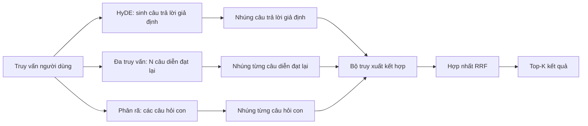

# Viết lại truy vấn: HyDE, Đa truy vấn và Phân rã truy vấn (Query Rewriting: HyDE, Multi-Query, and Decomposition)

> Truy vấn mà người dùng nhập vào không phải là truy vấn mà bộ truy xuất của bạn mong muốn. Việc viết lại truy vấn (query rewriting) giúp thu hẹp khoảng cách này trước khi tiến hành truy xuất, nhờ đó bộ chỉ mục sẽ tiếp nhận thông tin gần gũi hơn với hình thái của câu trả lời.

**Type:** Xây dựng (Build)
**Languages:** Python
**Prerequisites:** Phase 11 bài học 04 (embeddings), 06 (RAG); các bài học nền tảng Phase 19 Track B (bài học 20-29); Phase 19 bài học 64 và 65
**Time:** ~90 phút

## Mục tiêu học tập
- Hiện thực kỹ thuật Nhúng tài liệu giả định (Hypothetical Document Embeddings - HyDE): sinh ra một câu trả lời giả lập, nhúng câu trả lời đó và truy xuất dựa trên vector giả định đó thay vì vector của câu truy vấn.
- Hiện thực kỹ thuật mở rộng đa truy vấn (multi-query expansion): viết lại một truy vấn thành N câu diễn đạt tương đương (paraphrases), truy xuất với từng câu và hợp nhất kết quả bằng phương pháp Dung hợp hạng nghịch đảo (Reciprocal Rank Fusion - RRF).
- Hiện thực kỹ thuật phân rã truy vấn (query decomposition): chia tách một câu hỏi phức tạp thành các câu hỏi con (sub-questions), truy xuất cho từng câu hỏi con rồi hợp nhất lại.
- So sánh trực tiếp ba bộ viết lại truy vấn trên cùng một tập dữ liệu kiểm thử (fixture) và giải thích trường hợp chiến thắng của từng chiến lược.
- Thiết lập một mô hình ngôn ngữ giả lập (mock LLM) tạo ra các đầu ra tất định trên tập kiểm thử để vòng lặp viết lại có thể chạy hoàn toàn ngoại tuyến (offline).

## Vấn đề

Người dùng nhập: "nhóm chúng ta phải làm gì khi việc tải lên thất bại và ngân sách đã cạn?". Kho ngữ liệu chứa một tài liệu ghi: "AbortMultipartOnFail hủy một tiến trình tải lên nhiều phần S3 (S3 multipart upload) đang chạy và giảm trừ ngân sách thử lại trên mỗi bucket khi quá trình tải lên thất bại". Truy vấn và tài liệu không hề chia sẻ chung một cụm danh từ nào. Thuật toán BM25 bỏ sót tài liệu này. Bộ truy xuất bi-encoder xếp tài liệu ở vị trí thứ ba hoặc thứ tư vì vector truy vấn rơi vào một vùng không gian nhúng ưu tiên tài liệu về các tác vụ bị hủy (cancelled jobs), chứ không phải tài liệu về các lượt tải lên bị hủy bỏ (aborted uploads). Bước xếp hạng lại hai giai đoạn từ bài học 66 có thể cứu vãn câu trả lời nếu nó nằm trong top-N, nhưng nếu nó thậm chí không lọt vào top-N thì bộ xếp hạng lại sẽ không bao giờ nhìn thấy nó.

Giải pháp khắc phục là viết lại truy vấn trước khi đưa vào bộ truy xuất. Bài báo năm 2023 "Precise Zero-Shot Dense Retrieval without Relevance Labels" (Gao et al.) đã giới thiệu kỹ thuật HyDE: yêu cầu một LLM viết ra tài liệu giả định có khả năng trả lời truy vấn, nhúng tài liệu giả định đó và sử dụng vector nhúng của nó làm vector truy xuất. Tài liệu giả định nằm đúng vùng trong không gian nhúng vì nó được viết bằng văn phong của kho ngữ liệu. Vector truy vấn ban đầu thì không làm được điều đó.

Hai kỹ thuật tương đồng thường đi kèm với HyDE. Mở rộng đa truy vấn (thuật ngữ được GraphRAG của Microsoft sử dụng) sinh ra N cách diễn đạt lại của truy vấn và truy xuất với từng cách, sau đó hợp nhất lại. Phân rã truy vấn (được phổ biến dưới tên "subquery decomposition" trong nghiên cứu DSPy năm 2024 của Stanford) tách câu hỏi "nhóm chúng ta phải làm gì khi việc tải lên thất bại và ngân sách đã cạn" thành hai câu hỏi: "điều gì xảy ra khi việc tải lên thất bại" và "điều gì xảy ra khi ngân sách thử lại đã cạn". Hai lượt truy xuất, một kết quả hợp nhất, cả hai phần thông tin của câu trả lời đều được tiếp cận.

Bài học này hiện thực cả ba kỹ thuật và chạy thử nghiệm chúng trên cùng một kho ngữ liệu kiểm thử.

## Khái niệm



### Chi tiết về HyDE

HyDE thay thế vector truy vấn của người dùng bằng vector tài liệu giả định do LLM tạo ra. Lời nhắc (prompt) rất ngắn gọn:

```text
You are a domain expert. Write a one-paragraph passage that answers the question
below. Use the same vocabulary and phrasing the documentation in this domain would
use. Do not refuse. Do not say you do not know.

Question: {user_query}

Passage:
```

Câu trả lời của LLM có thể sai về mặt dữ kiện thực tế vì LLM không biết kho ngữ liệu nội bộ của bạn. Điều đó hoàn toàn bình thường. Bộ truy xuất không quan tâm đến tính đúng đắn của dữ kiện mà chỉ quan tâm đến phân phối token (token distribution). Đoạn văn giả định chứa các từ khóa như "abort", "multipart", "bucket", "budget", vì đó là những từ ngữ mà một tài liệu hướng dẫn về chủ đề này sẽ sử dụng. Hãy nhúng đoạn văn đó. Vector thu được sẽ rơi vào gần đoạn văn thực tế trong kho dữ liệu.

Trong môi trường sản xuất, bạn nên giới hạn tài liệu giả định từ hai đến ba câu. Các đoạn giả định dài hơn sẽ thu nạp thêm nhiều nhiễu. Các đoạn quá ngắn lại làm mất đi tín hiệu từ vựng mà HyDE cần.

### Chi tiết về mở rộng đa truy vấn (Multi-query expansion)

Sinh ra N cách diễn đạt khác nhau của truy vấn người dùng. Lời nhắc đơn giản nhất:

```text
Rewrite the following question in {N} different ways. Each rewrite must preserve
the original intent. Number them 1 to {N}. Do not add explanations.
```

Truy xuất top-k cho từng cách diễn đạt lại. Hợp nhất N danh sách đã xếp hạng bằng RRF (cùng thuật toán từ bài học 65). Phương pháp này tiết kiệm, có thể chạy song song và hoàn toàn tất định.

Đa truy vấn phát huy tối đa hiệu quả khi cách diễn đạt ban đầu của người dùng chỉ là một trong nhiều cách hợp lệ để đặt câu hỏi, và bất kỳ cách viết lại nào cũng có thể truy xuất tốt hơn. Phương pháp này kém hiệu quả khi mọi cách viết lại đều tồi như nhau do câu hỏi gốc có khiếm khuyết cơ bản.

### Chi tiết về phân rã truy vấn (Decomposition)

Một lượt truy xuất đơn lẻ không thể thỏa mãn một câu hỏi đa khía cạnh (multi-faceted question). Kỹ thuật phân rã yêu cầu LLM chia câu hỏi thành các câu hỏi con và hệ thống sẽ truy xuất riêng cho từng câu hỏi con. Lời nhắc:

```text
The following question may require information from multiple distinct topics.
Decompose it into a list of sub-questions. Each sub-question must be answerable
independently. If the question is already atomic, return it unchanged.

Question: {user_query}
```

Truy xuất theo từng câu hỏi con rồi hợp nhất lại. Phân rã là công cụ thích hợp cho các câu hỏi chứa liên từ, phép so sánh nhiều mệnh đề, hoặc hai chủ đề không liên quan. Đây là công cụ sai lầm cho các câu hỏi nguyên tử (atomic questions); nhiệm vụ của bộ phân rã ở trường hợp đó là giữ nguyên câu hỏi đơn lẻ và không tự tạo ra các câu hỏi con giả tạo.

### Tại sao cả ba kỹ thuật đều cần tồn tại

Cả ba kỹ thuật bổ trợ lẫn nhau. HyDE bắc cầu thu hẹp khoảng cách token giữa truy vấn và kho ngữ liệu. Đa truy vấn xử lý sự biến thiên trong cách diễn đạt. Phân rã giải quyết các truy vấn đa chủ đề. Một hệ thống sản xuất sẽ chạy cả ba hoặc lựa chọn chiến lược phù hợp theo từng truy vấn (hệ thống đầu-cuối trong bài học 69 sẽ minh họa bộ chọn này).

## Mô hình ngôn ngữ giả lập (Mock LLM)

Bài học này chạy hoàn toàn ngoại tuyến. LLM giả lập là một bảng tra cứu nhỏ có khóa là truy vấn của người dùng, kèm theo phương án dự phòng cho các truy vấn chưa từng gặp. Bảng tra cứu bao gồm:

- Với mỗi truy vấn kiểm thử: một đoạn văn giả định đã viết sẵn, ba câu diễn đạt lại và một phép phân rã.
- Với một truy vấn chưa biết: một phép biến đổi tất định: lấy các từ nội dung của truy vấn, mở rộng qua bảng ánh xạ từ đồng nghĩa và trả về kết quả.

Hình dạng cấu trúc của mô hình giả lập là điều quan trọng, không phải dữ liệu mẫu. Trong sản xuất, bạn chỉ cần thay thế hàm giả lập bằng một lệnh gọi mô hình thực tế. Bộ truy xuất phía sau hoàn toàn không thay đổi.

```figure
cd-hyde-vector
```

## Xây dựng thực tế (Build It)

Tệp `code/main.py` hiện thực các thành phần:

- `MockLLM` - thành phần thay thế tất định như đã mô tả ở trên.
- `HyDERewriter` - gọi LLM để viết tài liệu giả định, trả về đầu ra dưới dạng `RewriteResult` chứa văn bản giả định và truy vấn mà bộ truy xuất nên dùng.
- `MultiQueryRewriter` - gọi LLM để lấy N câu diễn đạt lại, trả về danh sách các truy vấn.
- `DecomposeRewriter` - gọi LLM để phân rã, trả về danh sách các câu hỏi con.
- `retrieve_with_rewriter` - nhận một bộ viết lại và một bộ truy xuất, thực hiện các truy vấn viết lại và dung hợp kết quả.
- Bản thử nghiệm chạy cả ba bộ viết lại trên tập kiểm thử và in ra chiến lược nào trả về tài liệu chứa câu trả lời chuẩn (gold answer) đầu tiên.

Cấu trúc bộ truy xuất được tái sử dụng từ bài học 65 (truy xuất kết hợp BM25 + dense). Cơ chế dung hợp là thuật toán RRF quen thuộc. Cấu trúc mới duy nhất là giao diện bộ viết lại (rewriter interface), vốn rất gọn gàng.

Chạy mã nguồn:

```bash
python3 code/main.py
```

Đầu ra là bảng xếp hạng theo từng chiến lược và phần tóm tắt cuối cùng. HyDE chiến thắng ở truy vấn có sự lệch pha về cách dùng từ. Đa truy vấn chiến thắng ở truy vấn có độ biến thiên diễn đạt lớn. Phân rã chiến thắng ở truy vấn đa chủ đề. Phương án dự phòng (không viết lại truy vấn) thất bại ở ít nhất một trong ba trường hợp.

## Các trường hợp lỗi tiềm ẩn mà bản thử nghiệm che giấu

**HyDE bị ảo giác (hallucination) sai định danh đặc thù của kho dữ liệu.** Mô hình tự bịa ra một tên hàm. Điểm BM25 của tài liệu giả định đối với tài liệu chính xác bị sụt giảm vì tên bịa đặt trở thành token có trọng số cao nhưng lại không hề xuất hiện trong bộ chỉ mục. Hãy giới hạn độ dài của văn bản giả định và giảm trọng số của BM25 trong bước dung hợp.

**Các câu viết lại của đa truy vấn bị hội tụ (converge).** Một mô hình yếu sẽ tạo ra ba câu diễn đạt lại gần như y hệt nhau. N lượt truy xuất sẽ trả về cùng một danh sách top-k. Phép hợp nhất RRF lúc này không đem lại giá trị nào hơn một lượt truy xuất đơn lẻ. Hãy thêm chỉ dẫn rõ ràng về tính đa dạng vào lời nhắc và phát hiện các câu trùng lặp bằng độ tương đồng Jaccard.

**Phân rã bị chia tách quá mức (over-split).** Bộ phân rã biến một câu hỏi nguyên tử thành một danh sách câu hỏi con. Các lượt truy xuất đều trả về cùng một tài liệu nhưng với thứ hạng bị giảm. Kết quả hợp nhất trở nên tệ hơn câu hỏi gốc. Hãy phát hiện điều này bằng một bước kiểm tra "các câu hỏi con này có thực sự khác biệt hay không" trước khi phân nhánh truy xuất.

**Độ trễ nhân lên.** HyDE tốn thêm một lượt gọi LLM. Đa truy vấn tốn một lượt gọi LLM để sinh N câu viết lại, sau đó là N lượt truy xuất. Phân rã tốn một lượt gọi LLM để chia nhỏ câu hỏi, sau đó là M lượt truy xuất. Các lượt truy xuất có thể chạy song song; lượt gọi LLM chính là mức sàn giới hạn độ trễ (latency floor).

## Sử dụng trong thực tế (Use It)

Các khuôn mẫu trong môi trường sản xuất:

- Lựa chọn chiến lược theo từng truy vấn dựa trên độ dài và đặc điểm: truy vấn ngắn nguyên tử dùng đa truy vấn, truy vấn phức tạp nhiều mệnh đề dùng phân rã, truy vấn nặng về thuật ngữ chuyên ngành dùng HyDE.
- Lưu bộ nhớ đệm kết quả viết lại theo mã băm của truy vấn. Nhiều câu truy vấn của người dùng có xu hướng lặp lại.
- Chạy cả ba chiến lược song song và dung hợp cả ba tập kết quả thành một danh sách duy nhất bằng RRF. Chi phí là ba lượt gọi LLM và một bước dung hợp; chất lượng thu được là hợp của phạm vi bao phủ từ cả ba chiến lược.

## Triển khai thành phẩm (Ship It)

Bài học 69 sẽ kết nối giai đoạn viết lại này phía trước bộ truy xuất từ bài học 65 và bộ xếp hạng lại từ bài học 66. Bài học 68 đánh giá mức cải thiện mà bộ viết lại mang lại cho độ bao phủ truy xuất (retrieval recall).

## Bài tập

1. Hiện thực RAG-Fusion (một biến thể năm 2024 của đa truy vấn) trong đó các câu diễn đạt lại được tạo ra có tính đa dạng có chủ đích, sau đó bước xếp hạng lại (bài học 66) sẽ chọn ra danh sách cuối cùng.
2. Thêm một chiến lược thứ tư: lời nhắc lùi một bước (step-back prompting - yêu cầu LLM đưa ra câu hỏi khái quát hơn, truy xuất trên câu hỏi đó rồi mới thu hẹp lại). So sánh trên tập kiểm thử.
3. Huấn luyện bộ phân rã nhận biết các câu hỏi nguyên tử bằng cách thêm đầu phân loại "câu hỏi có mang tính nguyên tử hay không". Đo tỷ lệ chia tách thừa trước và sau khi áp dụng.
4. Thay thế LLM giả lập bằng một lời gọi mô hình thực tế. Đo lường độ trễ trên từng chiến lược trong hạ tầng của bạn.
5. Thêm điểm số độ tin cậy (confidence score) cho mỗi câu viết lại. Loại bỏ các câu viết lại dưới ngưỡng quy định. Đo lường tác động đến độ bao phủ.

## Thuật ngữ cốt lõi

| Thuật ngữ | Cách gọi thông thường | Ý nghĩa thực tế |
|---|---|---|
| HyDE | "Truy xuất bằng tài liệu giả lập" | LLM viết câu trả lời; nhúng và truy xuất trên tài liệu đó thay vì câu truy vấn |
| Đa truy vấn (Multi-query) | "Mở rộng diễn đạt tương đương" | N câu viết lại của truy vấn; truy xuất N lần, hợp nhất bằng RRF |
| Phân rã truy vấn (Decomposition) | "Tách truy vấn con" | Truy vấn đa chủ đề được tách thành các câu hỏi con, truy xuất độc lập |
| Truy vấn nguyên tử (Atomic query) | "Đơn chủ đề" | Truy vấn không thể phân rã thêm mà không tạo ra các câu hỏi con giả tạo |
| Lùi một bước (Step-back) | "Trừu tượng hóa truy vấn" | Đặt câu hỏi khái quát hơn, truy xuất thông tin nền tảng, sau đó thu hẹp phạm vi |

## Đọc thêm

- Gao, Ma, Lin, Callan, "Precise Zero-Shot Dense Retrieval without Relevance Labels" (HyDE), 2023
- Microsoft Research, "Multi-Query Expansion for Retrieval"
- Stanford DSPy, "Subquery Decomposition for Multi-Hop QA"
- [Tài liệu hướng dẫn biến đổi truy vấn của LlamaIndex](https://docs.llamaindex.ai/en/stable/optimizing/advanced_retrieval/query_transformations/)
- Phase 11 bài học 07 - các mô hình kiến trúc RAG nâng cao
- Phase 19 bài học 65 - bộ truy xuất tiếp nhận đầu vào từ bộ viết lại này
- Phase 19 bài học 68 - quy trình đánh giá đo lường mức cải thiện của bộ viết lại
