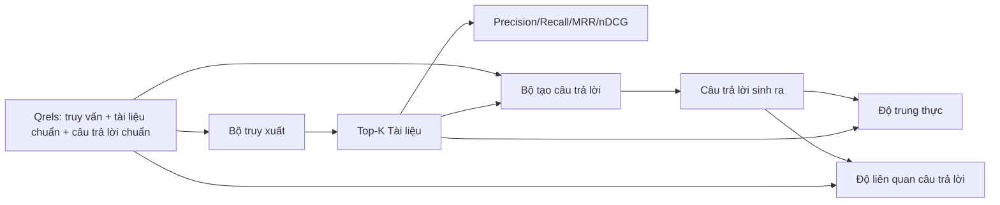

# Đánh giá RAG: Precision, Recall, MRR, nDCG, Độ trung thực và Độ liên quan của câu trả lời (RAG Evaluation: Precision, Recall, MRR, nDCG, Faithfulness, Answer Relevance)

> Nếu bạn không thể đánh giá đồng thời cả bước truy xuất và câu trả lời được tạo ra, bạn chưa thể đưa hệ thống vào triển khai thực tế. Hai yếu tố này đo lường bằng các chỉ số hoàn toàn khác nhau và cùng một lời nhắc có thể thất bại trên các khía cạnh độc lập.

**Type:** Xây dựng (Build)
**Languages:** Python
**Prerequisites:** Phase 11 bài học 06 (RAG), 10 (đánh giá); các bài học nền tảng Phase 19 Track B (bài học 20-29); Phase 19 bài học 64, 65, 66, 67
**Time:** ~90 phút

## Mục tiêu học tập
- Tính toán bốn chỉ số truy xuất từ tập nhãn chuẩn qrels (query relevance): precision@k, recall@k, MRR (mean reciprocal rank - thứ hạng nghịch đảo trung bình) và nDCG@k (normalized discounted cumulative gain).
- Tính toán hai chỉ số đánh giá câu trả lời: độ trung thực (faithfulness - mọi luận điểm đều có căn cứ từ ngữ cảnh được truy xuất) và độ liên quan của câu trả lời (answer relevance - câu trả lời giải quyết đúng trọng tâm câu hỏi).
- Xây dựng tệp nhãn chuẩn qrels kiểm thử (chứa truy vấn, id tài liệu chuẩn, văn bản câu trả lời chuẩn) để quy trình đánh giá đọc từ đầu đến cuối.
- Phân tích các giá trị chỉ số để chẩn đoán điểm nghẽn mà đường ống đang gặp lỗi: khâu truy xuất, xếp hạng, sinh văn bản hay đối chiếu căn cứ (grounding).

## Vấn đề

Một hệ thống RAG có ít nhất bốn bộ phận vận hành: bộ chia đoạn (chunker), bộ truy xuất (retriever), bộ xếp hạng lại (reranker) và bộ tạo câu trả lời (generator). Bất kỳ bộ phận nào trong số đó cũng có thể là nguyên nhân dẫn đến câu trả lời sai. Nếu không có các chỉ số theo từng giai đoạn, bạn hoàn toàn mất phương hướng.

Người dùng báo cáo một câu trả lời sai. Liệu đó là do bộ chia đoạn đã cắt đứt phần văn bản chứa đáp án? Hay do bộ truy xuất không đưa đoạn tài liệu đó vào top-k? Hay do bộ xếp hạng lại đã đẩy đoạn văn đúng ra khỏi vị trí số một? Hay do bộ tạo câu trả lời đã phớt lờ đoạn văn được cung cấp và tự thêu dệt thông tin? Bạn không thể kết luận nếu chỉ nhìn vào câu trả lời cuối cùng. Bạn cần:

- Các chỉ số truy xuất (retrieval metrics) để chấm điểm đầu ra của bộ truy xuất.
- Các chỉ số xếp hạng (ranking metrics) để chấm điểm vị trí của đoạn văn chuẩn trong danh sách thứ tự.
- Độ trung thực (faithfulness) để chấm điểm việc bộ tạo văn bản có tuân thủ chặt chẽ ngữ cảnh được truy xuất hay không.
- Độ liên quan của câu trả lời (answer relevance) để chấm điểm việc câu trả lời có giải quyết đúng câu hỏi hay không.

Bài học này xây dựng toàn bộ sáu chỉ số nói trên dựa trên một tệp qrels kiểm thử. Quy trình đánh giá chạy ngoại tuyến và mang tính tất định; trong môi trường sản xuất, bạn sẽ thay thế trọng tài LLM giả lập (mock LLM-as-judge) bằng một mô hình thực tế.

## Khái niệm



### Precision@k

Trong số top-k tài liệu mà bộ truy xuất trả về, tỷ lệ tài liệu thuộc tập nhãn chuẩn là bao nhiêu? Nếu tập chuẩn có 3 tài liệu và top-3 trả về 2 tài liệu đúng cùng 1 tài liệu sai, precision@3 là 2 / 3. Hãy sử dụng precision khi chi phí của việc lấy nhầm đoạn tài liệu không liên quan là rất cao (bộ tạo câu trả lời bị lãng phí token, hoặc đoạn văn sai làm sai lệch câu trả lời).

### Recall@k

Trong số các tài liệu chuẩn, tỷ lệ tài liệu xuất hiện trong top-k là bao nhiêu? Nếu tập chuẩn có 3 tài liệu và top-5 chứa toàn bộ cả 3 tài liệu đó, recall@5 là 1.0. Hãy sử dụng recall khi chi phí của việc bỏ sót câu trả lời là rất cao (bạn thà nhận thêm một đoạn văn sai còn hơn là bỏ lỡ hoàn toàn đoạn văn chứa câu trả lời).

Trong các hệ thống RAG thực tế, chỉ số mà mọi người hay trích dẫn nhất là recall@k. Khâu sinh câu trả lời có thể dễ dàng bỏ qua các đoạn văn không liên quan; nhưng nó không thể tự bịa ra câu trả lời từ một đoạn tài liệu mà nó chưa từng nhìn thấy.

### MRR (Mean Reciprocal Rank - Thứ hạng nghịch đảo trung bình)

Với mỗi truy vấn, tìm vị trí xuất hiện của tài liệu liên quan đầu tiên trong danh sách xếp hạng. Thứ hạng nghịch đảo (reciprocal rank) là 1 / vị trí. Lấy giá trị trung bình trên toàn bộ tập truy vấn. MRR là một chỉ số tóm tắt bằng một con số duy nhất về mức độ hiệu quả của bộ truy xuất trong việc đưa câu trả lời tốt nhất lên vị trí đầu tiên.

MRR ưu tiên cực kỳ mạnh mẽ cho vị trí số 1. Một truy vấn có tài liệu chuẩn nằm ở hạng 1 sẽ đóng góp 1.0 điểm. Hạng 2 đóng góp 0.5 điểm. Hạng 10 chỉ còn đóng góp 0.1 điểm. Chỉ số này bị chi phối hoàn toàn bởi phần đầu của danh sách.

### nDCG@k

Mức tăng tích lũy chiết khấu chuẩn hóa (Normalized Discounted Cumulative Gain). Công thức đầy đủ gán một mức tăng (gain) cho từng tài liệu được truy xuất (thường là 1 cho tài liệu liên quan, 0 cho không liên quan), chiết khấu theo logarit của vị trí, cộng tổng lại và chia cho DCG lý tưởng (IDCG - mức DCG đạt được nếu xếp hạng hoàn hảo). Giá trị nằm trong khoảng từ 0 đến 1.

nDCG hỗ trợ độ liên quan phân cấp (graded relevance): tập nhãn chuẩn có thể quy định "tài liệu A là 3 điểm, tài liệu B là 2 điểm, tài liệu C là 1 điểm". MRR và recall@k làm phẳng mọi thứ về dạng nhị phân. Hãy dùng nDCG khi kho ngữ liệu có nhiều tài liệu liên quan một phần đối với mỗi truy vấn.

### Độ trung thực (Faithfulness)

Đối với mỗi luận điểm (claim) trong câu trả lời được tạo ra, kiểm tra xem luận điểm đó có được củng cố bởi ngữ cảnh đã truy xuất hay không. Cách triển khai tiêu chuẩn sử dụng một lời nhắc LLM làm trọng tài (LLM-as-judge) nhận vào cặp (luận điểm, ngữ cảnh) và trả về có hoặc không. Chỉ số này là tỷ lệ các luận điểm vượt qua bài kiểm tra.

Độ trung thực giúp phát hiện lỗi phổ biến của bộ tạo câu trả lời: mô hình tự thêu dệt nội dung. Ngay cả khi bộ truy xuất trả về các đoạn văn chính xác, một bộ sinh bị ảo giác vẫn là một hệ thống hỏng. Độ trung thực còn được gọi là tính có căn cứ (groundedness), sự chứng thực (support) hay quy kết nguồn gốc (attribution).

Bài học này hiện thực độ trung thực bằng một trọng tài giả lập tất định, kiểm tra xem các token của từng luận điểm có trùng khớp với ngữ cảnh truy xuất vượt qua một ngưỡng nhất định hay không. Trong sản xuất, bạn sẽ thay thế bằng một lệnh gọi mô hình thực tế. Cấu trúc của chỉ số hoàn toàn giữ nguyên.

### Độ liên quan của câu trả lời (Answer relevance)

Liệu câu trả lời có thực sự giải quyết câu hỏi đặt ra hay không? Độ trung thực đặt câu hỏi "câu trả lời có dựa trên ngữ cảnh hay không?". Độ liên quan của câu trả lời đặt câu hỏi "câu trả lời có bám sát câu hỏi hay không?". Một câu trả lời trung thực nhưng lạc đề sẽ có điểm trung thực cao nhưng điểm liên quan thấp. Một câu trả lời ngắn gọn, đúng trọng tâm nhưng phớt lờ ngữ cảnh sẽ có điểm liên quan cao nhưng điểm trung thực thấp.

Cách triển khai chuẩn cũng sử dụng LLM làm trọng tài: nhận vào (câu hỏi, câu trả lời) và đánh giá xem câu trả lời có giải quyết câu hỏi hay không. Bài học này sử dụng một thành phần thay thế kết hợp giữa độ trùng khớp token và trọng tài giả lập.

## Dữ liệu kiểm thử qrels

```python
{
  "qid": "q1",
  "query": "what is the abort threshold for multipart uploads",
  "gold_doc_ids": ["d1", "d3"],
  "gold_answer_substring": "three failed parts",
  "graded_relevance": {"d1": 3, "d3": 2},
}
```

Mỗi truy vấn mang theo:
- chuỗi truy vấn (query string),
- tập hợp id tài liệu chuẩn (cho precision / recall / MRR),
- từ điển độ liên quan phân cấp (cho nDCG),
- chuỗi con của câu trả lời chuẩn (được giữ lại như siêu dữ liệu tham chiếu trên mỗi mục qrel; độ trung thực trong bài học này được tính bằng cách đánh giá các luận điểm trích xuất so với ngữ cảnh truy xuất, chứ không phải so với chuỗi con này).

Trong môi trường thực tế, bạn phải tự dán nhãn các dữ liệu này. Bài học này cung cấp sẵn một tập kiểm thử được xây dựng thủ công để quy trình đánh giá có thể chạy ngay lập tức.

```figure
ci-rag-metric-ladder
```

## Xây dựng thực tế (Build It)

Tệp `code/main.py` hiện thực các thành phần:

- `precision_at_k(retrieved, gold, k)` - định nghĩa toán học nguyên bản.
- `recall_at_k(retrieved, gold, k)` - định nghĩa toán học nguyên bản.
- `mean_reciprocal_rank(retrieved_list_of_lists, gold_list)` - giá trị trung bình trên toàn bộ các truy vấn.
- `ndcg_at_k(retrieved, graded_relevance, k)` - DCG / IDCG với mức tăng nhị phân hoặc phân cấp.
- `extract_claims(answer)` - tách câu trả lời thành các luận điểm dưới dạng câu hoàn chỉnh.
- `faithfulness(claims, context_texts, judge)` - tỷ lệ luận điểm được xác nhận là có căn cứ.
- `answer_relevance(question, answer, judge)` - trọng tài đánh giá câu trả lời có bám sát câu hỏi hay không.
- `MockJudge` - trọng tài so khớp trùng lặp token tất định để quy trình đánh giá chạy ngoại tuyến.
- `evaluate_pipeline(pipeline_fn, qrels, ks)` - bộ điều phối chạy toàn bộ các chỉ số đo lường.
- Bản thử nghiệm chạy ba biến thể đường ống (đường cơ sở chia đoạn, truy xuất kết hợp, truy xuất kết hợp + xếp hạng lại) đối chiếu với tập qrels và in ra bảng tổng hợp các chỉ số.

Chạy mã nguồn:

```bash
python3 code/main.py
```

Đầu ra hiển thị precision@k, recall@k, MRR, nDCG@k, độ trung thực và độ liên quan của câu trả lời cho từng biến thể trong một bảng chỉ số duy nhất. Dòng truy xuất kết hợp vượt trội hơn đường cơ sở chia đoạn về recall; dòng có xếp hạng lại vượt trội hơn truy xuất kết hợp về MRR.

## Đọc hiểu chỉ số để chẩn đoán sự cố

| Hiện tượng | Nguyên nhân có khả năng nhất | Cách khắc phục |
|---|---|---|
| Recall@k thấp, precision@k thấp | Bộ chia đoạn cắt rời câu trả lời hoặc bộ truy xuất không tìm thấy | Điều chỉnh ranh giới chia đoạn (bài học 64) hoặc phương thức truy xuất (bài học 65) |
| Recall@k khá tốt, MRR thấp | Đoạn tài liệu đúng nằm trong top-k nhưng không nằm ở vị trí số 1 | Cải thiện bộ xếp hạng lại (bài học 66) |
| MRR cao, độ trung thực thấp | Bộ tạo câu trả lời tự thêu dệt nội dung dù ngữ cảnh đã chuẩn xác | Tinh chỉnh lời nhắc sinh nội dung; bắt buộc trích dẫn nguồn hoặc từ chối trả lời |
| Độ trung thực cao, độ liên quan thấp | Câu trả lời bám sát ngữ cảnh nhưng lạc đề | Dùng bộ viết lại truy vấn (bài học 67) hoặc tinh chỉnh lời nhắc sinh câu trả lời |
| Cả bốn chỉ số đều cao, người dùng vẫn phàn nàn | Tập dữ liệu đánh giá không mang tính đại diện | Mở rộng tập qrels bằng các câu truy vấn thực tế của người dùng |

## Các trường hợp lỗi tiềm ẩn mà bản thử nghiệm che giấu

**Độ lệch của trọng tài LLM (LLM-as-judge bias).** Một mô hình thường có xu hướng đánh giá các câu trả lời do chính nó tạo ra là trung thực hơn thực tế. Hãy sử dụng một họ mô hình khác cho vai trò trọng tài so với bộ tạo câu trả lời, hoặc chấm điểm thủ công một tập mẫu.

**Sự mục nát của tập qrels (Qrels rot).** Các câu trả lời chuẩn sẽ bị trôi dạt theo thời gian khi kho ngữ liệu thay đổi. Một tài liệu từng là chuẩn cho truy vấn q1 vào tháng 1 năm 2024 có thể không còn là câu trả lời đúng vào tháng 10 năm 2024 vì nhóm phát triển đã đổi tên hàm. Hãy lên lịch đánh giá lại tập qrels định kỳ mỗi quý.

**Kiểm tra vi mô độ trung thực bỏ sót các luận điểm tổng thể.** Việc kiểm tra độ trung thực theo từng câu đơn lẻ có thể vượt qua, nhưng cấu trúc tổng thể của toàn bộ câu trả lời lại gây hiểu lầm. Hãy bổ sung đánh giá định tính trên cấp độ mẫu bên cạnh các chỉ số tự động.

**Recall@k che giấu lỗi trên từng nhóm truy vấn.** Một mức recall trung bình 90% có thể che giấu việc một nhóm truy vấn cụ thể luôn luôn thất bại. Hãy phân tách tập qrels theo nhóm truy vấn (nghĩa đen, diễn đạt lại, đa chủ đề) và báo cáo chỉ số cho từng lát cắt riêng biệt.

## Sử dụng trong thực tế (Use It)

Các khuôn mẫu trong môi trường sản xuất:

- Chạy quy trình đánh giá trên mỗi lần thay đổi bộ truy xuất hoặc bộ tạo câu trả lời. Hãy coi sự sụt giảm recall@k nghiêm trọng như một ca kiểm thử thất bại (test failure).
- Lưu vết chỉ số (metric trace) cho từng truy vấn. Khi người dùng khiếu nại, hãy tra cứu mục qrels tương ứng để kiểm tra xem lỗi đó lẽ ra đã được phát hiện hay chưa.
- Phân tầng tập qrels: một tập kiểm tra khói (smoke set) gồm 20 truy vấn chạy trong CI; một tập kiểm thử hồi quy (regression set) gồm 200 truy vấn chạy hàng đêm; một tập đánh giá chuyên sâu gồm 2000 truy vấn chạy hàng tuần.

## Triển khai thành phẩm (Ship It)

Bài học 69 sẽ kết nối toàn bộ đường ống (bộ chia đoạn, bộ truy xuất, bộ xếp hạng lại, bộ tạo câu trả lời) và chạy quy trình đánh giá này đối với toàn bộ hệ thống đầu-cuối.

## Bài tập

1. Thêm chỉ số truy xuất thứ năm: tỷ lệ trúng mục tiêu (hit-rate@k). So sánh với recall@k. Giải thích trường hợp chúng có sự khác biệt.
2. Hiện thực độ trung thực phân cấp: 0 (không có căn cứ), 1 (có căn cứ một phần), 2 (hoàn toàn có căn cứ). Cập nhật công thức tính chỉ số tương ứng.
3. Thay thế trọng tài giả lập bằng một lời gọi mô hình thực tế. Đo lường mức độ bất đồng ý kiến giữa trọng tài giả lập và trọng tài thực trên tập kiểm thử.
4. Thêm phân lát truy vấn ("nghĩa đen", "diễn đạt lại", "đa chủ đề"). Báo cáo chỉ số chi tiết cho từng lát cắt.
5. Thêm chỉ số "độ dài câu trả lời" và tính tương quan của nó với độ trung thực. Vẽ đường cong biểu diễn mối liên hệ.

## Thuật ngữ cốt lõi

| Thuật ngữ | Cách gọi thông thường | Ý nghĩa thực tế |
|---|---|---|
| Precision@k | "Tỷ lệ trúng trên số tài liệu lấy về" | Tỷ lệ tài liệu trong top-k thuộc tập nhãn chuẩn |
| Recall@k | "Tỷ lệ trúng trên số tài liệu chuẩn" | Tỷ lệ tài liệu chuẩn xuất hiện trong top-k |
| MRR | "Vị trí trúng đầu tiên" | Giá trị trung bình của 1 / thứ hạng của tài liệu liên quan đầu tiên |
| nDCG@k | "Chất lượng xếp hạng phân cấp" | DCG trên top-k chia cho DCG lý tưởng (IDCG) |
| Độ trung thực (Faithfulness) | "Tính có căn cứ" | Tỷ lệ luận điểm trong câu trả lời được chứng thực bởi ngữ cảnh truy xuất |
| Độ liên quan câu trả lời (Answer relevance) | "Có trả lời đúng trọng tâm không?" | Câu trả lời có phù hợp với ý định của câu hỏi hay không |
| Qrels | "Nhãn chuẩn" | Tập hợp truy vấn đã dán nhãn cùng tài liệu chuẩn và câu trả lời chuẩn |

## Đọc thêm

- Buckley, Voorhees, "Evaluating Evaluation Measure Stability", SIGIR 2000 - bài báo kinh điển về các chỉ số xếp hạng
- Jarvelin, Kekalainen, "Cumulated Gain-based Evaluation of IR Techniques" - bài báo về nDCG
- [Ragas: Automated Evaluation of RAG Pipelines](https://docs.ragas.io)
- [Anthropic, Introducing Contextual Retrieval](https://www.anthropic.com/engineering/contextual-retrieval) - chấm điểm truy xuất bằng 1 trừ đi recall@20
- Phase 11 bài học 10 - nền tảng của khung đánh giá hệ thống AI
- Phase 19 các bài học 64-67 - các thành phần được đánh giá trong bài học này
- Phase 19 bài học 69 - đường ống đầu-cuối mà quy trình đánh giá này chấm điểm
