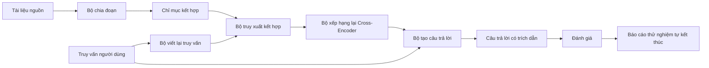

# Hệ thống RAG đầu-cuối (End-to-End RAG System)

> Sáu bài học về các thành phần riêng lẻ. Một đường ống duy nhất. Một vòng lặp đánh giá duy nhất. Một bản thử nghiệm tự kết thúc (self-terminating demo). Đây chính là hệ thống mà bạn sẽ đưa vào triển khai thực tế.

**Type:** Xây dựng (Build)
**Languages:** Python
**Prerequisites:** Phase 11 bài học 06 (RAG), 10 (đánh giá); các bài học nền tảng Phase 19 Track B (bài học 20-29); Phase 19 bài học 64, 65, 66, 67, 68
**Time:** ~90 phút

## Mục tiêu học tập
- Kết hợp bộ chia đoạn (chunker), bộ truy xuất kết hợp (hybrid retriever), bộ viết lại truy vấn (query rewriter), bộ xếp hạng lại cross-encoder (cross-encoder reranker) và bộ tạo câu trả lời (answer generator) thành một đường ống đầu-cuối hoàn chỉnh.
- Hiện thực một bộ tạo câu trả lời có khả năng trích dẫn các luận điểm bằng neo tham chiếu đoạn (chunk anchor), đi kèm cơ chế dự phòng từ chối trả lời khi độ tin cậy thấp (refuse-on-low-confidence).
- Chạy quy trình đánh giá từ bài học 68 đối với đường ống đã lắp ráp và chứng minh rằng hệ thống phân tầng hoàn chỉnh vượt trội trên mọi chỉ số so với các thành phần hoạt động riêng lẻ.
- Xây dựng một bản thử nghiệm CLI tự kết thúc: nạp kho ngữ liệu kiểm thử, chạy một tập truy vấn cố định và thoát với mã trạng thái zero kèm báo cáo tóm tắt.

## Vấn đề

Sáu thành phần hoạt động độc lập không chứng minh được điều gì. Bộ chia đoạn có thể đạt recall@5 rất cao trên kho ngữ liệu nhưng lại thất bại ở chỉ số recall@5 của toàn hệ thống vì bộ truy xuất không thể xếp hạng đúng những gì bộ chia đoạn tạo ra. Bộ xếp hạng lại có thể cải thiện MRR trên một tập ứng viên tổng hợp nhưng lại thất bại trên các ứng viên thực tế của bi-encoder vì độ bao phủ của bi-encoder trong ngân sách ứng viên là quá thấp. Bộ viết lại truy vấn có thể đưa tài liệu chuẩn lên đầu ở một truy vấn cụ thể nhưng lại sụp đổ ở truy vấn tiếp theo vì mô hình LLM giả lập sinh ra một tài liệu giả định thoái hóa.

Bài kiểm tra tích hợp thực sự là toàn bộ đường ống phải được chạy đầu-cuối trên cùng một tập nhãn chuẩn qrels kiểm thử, với cùng các chỉ số đo lường, thông qua một tệp điều phối duy nhất kết nối mọi bộ phận lại với nhau. Đó là những gì bài học này sẽ xây dựng. Nếu các chỉ số trên đường ống tích hợp đánh bại các chỉ số trong bản thử nghiệm riêng lẻ của từng giai đoạn, bạn đã chứng minh được tính hiệu quả của toàn hệ thống.

## Khái niệm



### Các lựa chọn kết nối đường ống

Đường ống là một đồ thị nhỏ. Mỗi giai đoạn là một hàm với chữ ký kiểu (type signature) rõ ràng.

| Giai đoạn | Đầu vào | Đầu ra |
|---|---|---|
| Chunker (Bộ chia đoạn) | Văn bản tài liệu | Danh sách các bản ghi Chunk |
| Retriever (Bộ truy xuất) | Chuỗi truy vấn | Danh sách top-N bản ghi Chunk |
| Rewriter (Bộ viết lại - tùy chọn) | Chuỗi truy vấn | Danh sách các câu viết lại + văn bản giả định |
| Reranker (Bộ xếp hạng lại) | Truy vấn, tập ứng viên | Danh sách top-K bản ghi Chunk kèm điểm số cross-encoder |
| Generator (Bộ tạo câu trả lời) | Truy vấn, top-K bản ghi Chunk | Chuỗi câu trả lời kèm trích dẫn nguồn |

Việc liên kết các giai đoạn rất mạch lạc khi mỗi chữ ký kiểu được giữ ổn định. Lớp `Pipeline` trong bài học quản lý năm giai đoạn này và cung cấp phương thức `query` để thực thi chúng theo đúng thứ tự. Mọi giai đoạn đều có thể hoán đổi: bạn có thể truyền vào một bộ chia đoạn, bộ truy xuất, bộ viết lại, bộ xếp hạng lại hoặc bộ tạo câu trả lời khác mà đường ống vẫn vận hành trơn tru.

### Bộ tạo câu trả lời có trích dẫn nguồn

Bộ tạo câu trả lời là giai đoạn cuối cùng và cũng là nơi dễ phát sinh lỗi nhất. Bài học cung cấp một bộ tạo câu trả lời giả lập tất định với quy trình:

1. Tiếp nhận top-K đoạn văn bản sau khi xếp hạng lại.
2. Chọn tối đa hai đoạn văn có tỷ lệ trùng lặp token nội dung cao nhất với truy vấn.
3. Xuất ra câu trả lời bằng cách ghép nối một câu từ mỗi đoạn đã chọn, phía sau mỗi câu gắn kèm neo tham chiếu `[doc_id:chunk_index]`.
4. Nếu không có đoạn văn nào vượt qua ngưỡng trùng lặp tối thiểu, xuất ra "Tôi không biết" và không kèm theo trích dẫn.

Trong sản xuất, bạn sẽ thay thế bộ giả lập bằng một lệnh gọi LLM thực tế với mẫu lời nhắc sau:

```text
You are answering a question using only the snippets below.
Cite every claim with the anchor in parentheses.
If the snippets do not answer the question, say "I do not know".

Question: {query}

Snippets:
{enumerated chunks with anchors}

Answer:
```

Nhánh từ chối khi độ tin cậy thấp chính là lý do tại sao chúng ta phải ghi nhận điểm số cross-encoder của vị trí top-1. Nếu điểm số này nằm dưới ngưỡng quy định của kho ngữ liệu, bộ sinh sẽ từ chối trả lời. Đây là van an toàn cốt lõi ngăn chặn các câu trả lời bị ảo giác.

### Bản thử nghiệm tự kết thúc (Self-terminating demo)

Bản thử nghiệm chạy toàn bộ quy trình đầu-cuối. Nó in vết phân tích từng giai đoạn của một truy vấn mẫu, chạy quy trình đánh giá trên bốn mục qrels kiểm thử, in bảng chỉ số và thoát với mã trạng thái zero nếu tất cả các chỉ số của bài học 68 đạt ngưỡng quy định. Nếu có bất kỳ chỉ số nào thấp hơn ngưỡng, bản thử nghiệm sẽ thoát với mã lỗi khác zero kèm thông báo nêu rõ chỉ số bị vi phạm.

Đây chính là hình mẫu của một bài kiểm tra khói (CI smoke test). Đường ống chạy ngoại tuyến, tốc độ nhanh, hoàn toàn tất định. Các ngưỡng kiểm thử được thiết lập chặt chẽ trên tập dữ liệu mẫu để mọi sự suy thoái ở bất kỳ bài học nào trong số sáu bài học đều sẽ khiến bản thử nghiệm báo lỗi ngay lập tức.

```figure
rag-pipeline-flow
```

## Xây dựng thực tế (Build It)

Tệp `code/main.py` hiện thực các thành phần:

- `Chunk` - bản ghi dữ liệu được truyền qua mọi giai đoạn (mở rộng cấu trúc từ bài học 64 với `chunk_index` và `doc_id` nguồn).
- `Chunker` - lựa chọn chiến lược từ bài học 64 (mặc định là chia tách đệ quy - recursive split).
- `HybridIndex` - đóng gói BM25 + dense + RRF từ bài học 65.
- `Rewriter` (tùy chọn) - lựa chọn một trong các chiến lược HyDE, đa truy vấn, phân rã từ bài học 67 dựa trên độ dài truy vấn và sự hiện diện của liên từ.
- `Reranker` - mô hình cross-encoder đã huấn luyện từ bài học 66, với tập huấn luyện kiểm thử nhỏ hơn để hội tụ trong vài giây.
- `Generator` - bộ tạo câu trả lời giả lập tất định có trích dẫn nguồn và cơ chế từ chối khi độ tin cậy thấp.
- `Pipeline` - kết hợp năm giai đoạn với phương thức `query(question)` trả về `Result(answer, top_k, latency_ms_per_stage)`.
- `run_demo()` - nạp kho ngữ liệu, chạy ba truy vấn kiểm thử, chạy đánh giá, in kết quả và thiết lập mã thoát theo ngưỡng chỉ số.

Chạy mã nguồn:

```bash
python3 code/main.py
```

Đầu ra bao gồm vết truy vết của một truy vấn, bảng đánh giá đầy đủ các chỉ số và trạng thái đạt/không đạt (pass/fail) cuối cùng. Trả về mã thoát 0 trên tập kiểm thử.

## Các trường hợp lỗi tiềm ẩn mà bản thử nghiệm che giấu

**Sự trôi dạt ranh giới chia đoạn (Chunker boundary drift).** Nếu bạn thay đổi chiến lược chia đoạn giữa thời điểm dán nhãn qrels đánh giá và thời điểm chạy thử nghiệm, các id tài liệu chuẩn sẽ không còn khớp. Hãy khóa chặt chiến lược chia đoạn trong tệp qrels. Bản thử nghiệm chứa một phần tiêu đề ghi rõ tên chiến lược chia đoạn đang dùng.

**Tập huấn luyện của bộ xếp hạng lại bị rò rỉ vào tập đánh giá.** 14 bộ ba huấn luyện trong bài học 66 có thể chứa các câu hỏi tương tự như các truy vấn đánh giá. Trong sản xuất, hãy tách biệt tuyệt đối các truy vấn đánh giá. Các truy vấn đánh giá trong bản thử nghiệm này được thiết kế cố ý không giao thoa với tập huấn luyện của bộ xếp hạng lại.

**Bộ tạo câu trả lời giả lập che giấu nguy cơ ảo giác.** Mô hình giả lập không thể bị ảo giác vì nó chỉ trích xuất trực tiếp văn bản từ các đoạn đã truy xuất. Bài học đã lưu ý điều này và hướng dẫn đường dẫn thay thế sang mô hình thực tế trong môi trường sản xuất.

**Chưa hỗ trợ truyền phát trực tuyến (streaming).** Đường ống trả về toàn bộ câu trả lời ở cuối mỗi giai đoạn. Một hệ thống sản xuất thực tế sẽ truyền phát trực tuyến đầu ra của bộ tạo văn bản. Kỹ thuật streaming nằm ngoài phạm vi bài học; các chỉ số đánh giá chất lượng câu trả lời đều vận hành trên chuỗi văn bản hoàn chỉnh cuối cùng trong cả hai trường hợp.

**Đo lường độ trễ chỉ mang tính ngoại tuyến.** Các lệnh gọi LLM giả lập tốn thời gian không đáng kể. Trong thực tế, các lệnh gọi LLM thực tế sẽ chiếm phần lớn thời gian xử lý. Hãy hoạch định ngân sách độ trễ trong phạm vi yêu cầu; việc đo thời gian từng giai đoạn trong bài học này chỉ đo lường khối lượng công việc của CPU.

## Sử dụng trong thực tế (Use It)

Các khuôn mẫu trong môi trường sản xuất:

- Triển khai tệp đường ống dưới một bộ điều phối tập trung duy nhất với các giao diện giai đoạn tường minh. Tránh phân tán mã kết nối rải rác trong toàn bộ kho mã nguồn.
- Chạy quy trình đánh giá trước mỗi lần gộp mã (merge) có tác động tới bất kỳ giai đoạn nào. Nếu các chỉ số đánh giá sụt giảm, yêu cầu gộp mã sẽ không được thông qua.
- Lưu trữ vết chỉ số theo từng lần chạy CI để bạn có thể truy cứu nguyên nhân suy thoái do việc thay đổi giai đoạn nào gây ra.
- Thiết lập một tập kiểm tra khói gồm 20 truy vấn (tập con của tập hồi quy) có thể chạy dưới 30 giây; toàn bộ tập kiểm thử hồi quy sẽ chạy định kỳ hàng đêm.

## Triển khai thành phẩm (Ship It)

Tệp đường ống trong bài học này là cấu trúc nền tảng mà các bài học thuộc Track F trong Phase 19 kế thừa. Các bài học tiếp theo sẽ bổ sung tự động hóa nạp dữ liệu, tái lập chỉ mục gia tăng (incremental re-index), giám sát từ xa (telemetry) và một lớp phục vụ yêu cầu (serving layer) ở phía trên. Toàn bộ các mảng truy xuất, xếp hạng lại, viết lại và đánh giá đã được hoàn thiện tại đây.

## Bài tập

1. Thêm một bộ chọn chiến lược theo từng truy vấn bên trong bộ viết lại: sử dụng các thuật toán phỏng đoán (heuristics) từ bài học 67 (độ dài, liên từ, tỷ lệ thuật ngữ chuyên ngành) để chọn HyDE, đa truy vấn hoặc phân rã.
2. Thêm một lệnh gọi LLM thực tế cho bộ tạo câu trả lời ẩn sau một cờ biến môi trường. Mặc định sử dụng bộ giả lập. Đo lường sự chênh lệch độ trễ.
3. Mở rộng bản thử nghiệm để nhận tham số dòng lệnh `--corpus path` nhằm nạp một kho ngữ liệu thực tế. Chạy lại quy trình đánh giá và kiểm tra ngưỡng chỉ số.
4. Thêm cờ `--strategy` cho bộ chia đoạn. Đo lường mức độ đóng góp của từng chiến lược đối với chỉ số recall đầu-cuối.
5. Thêm giao diện tạo câu trả lời dạng truyền phát (streaming) và đưa vào quy trình đánh giá. Xác nhận rằng độ trung thực được tính toán trên toàn bộ chuỗi văn bản hoàn chỉnh chứ không phải trên từng phần tiền tố được truyền phát.

## Thuật ngữ cốt lõi

| Thuật ngữ | Cách gọi thông thường | Ý nghĩa thực tế |
|---|---|---|
| Đường ống (Pipeline) | "Đường ống RAG" | Các giai đoạn được liên kết từ khâu nạp dữ liệu đến câu trả lời có trích dẫn |
| Neo trích dẫn (Citation anchor) | "Liên kết nguồn" | Tham chiếu (doc_id, chunk_index) được gắn vào từng luận điểm |
| Từ chối khi độ tin cậy thấp | "Tôi không biết" | Bộ sinh không đưa ra câu trả lời khi điểm top-1 của cross-encoder dưới ngưỡng |
| Tập kiểm tra khói (Smoke set) | "Đánh giá CI" | Tập con tối thiểu của qrels chạy trong mỗi lần kiểm tra pull request |
| Giao diện giai đoạn (Stage interface) | "Chữ ký hàm" | Kiểu dữ liệu đầu vào và đầu ra ổn định của từng giai đoạn trong đường ống |

## Đọc thêm

- [Anthropic, Building search and retrieval](https://www.anthropic.com/news/contextual-retrieval)
- [Pinterest, MCP internal search](https://medium.com/pinterest-engineering) - kiến trúc tham khảo trong môi trường sản xuất
- [Ragas: Automated Evaluation of RAG Pipelines](https://docs.ragas.io)
- Phase 11 bài học 06 - nền tảng RAG
- Phase 19 các bài học 64-68 - các thành phần được tích hợp trong bài học này
