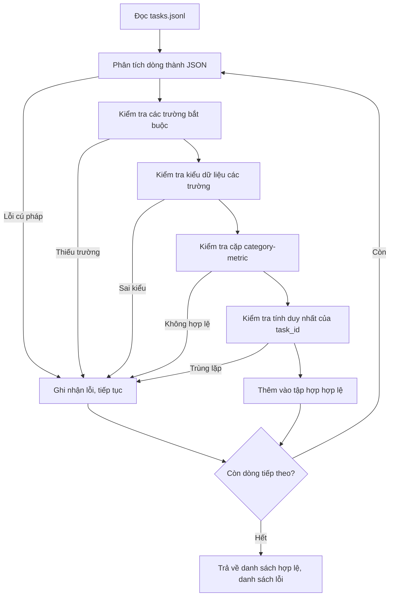

# Định dạng quy cách tác vụ (Task Spec Format)

> Một khung đánh giá (eval harness) chỉ có giá trị bằng đúng bản giao ước (contract) mà các tác vụ của nó tuân thủ. Hãy đóng băng cấu trúc JSONL và vốn từ vựng chỉ số đo lường trước khi bạn viết bất kỳ một hàm chấm điểm nào.

**Type:** Xây dựng (Build)
**Languages:** Python
**Prerequisites:** Các bài học nền tảng Phase 19 Track B
**Time:** ~90 phút

## Mục tiêu học tập

- Định nghĩa một lược đồ bản ghi tác vụ định dạng JSONL đáp ứng số học, câu hỏi trắc nghiệm, thực thi mã nguồn, phân loại và tóm tắt văn bản tự do trong cùng một cấu trúc thống nhất.
- Ghim cố định một tập từ vựng khép kín cho tên các chỉ số đo lường để các bài học tiếp theo (71-73) có thể điều phối xử lý chỉ dựa trên một trường dữ liệu duy nhất.
- Quy định các ví dụ ít mẫu (few-shot examples) và các quy tắc hậu xử lý (post-processing rules) như một phần nội tại của tác vụ thay vì của trình thực thi (runner), đảm bảo cùng một lời nhắc sẽ tạo ra cùng một mục tiêu trên các mô hình khác nhau.
- Hiện thực một bộ xác thực nghiêm ngặt (strict validator) nhằm từ chối các bản ghi sai định dạng trước khi chúng tiếp cận tới trình thực thi.
- Cung cấp một tập kiểm thử gồm 10 tác vụ mẫu kích hoạt mọi nhánh điều kiện của quy cách để bộ xác thực có dữ liệu thực tế kiểm tra.

```figure
ci-task-spec-gate
```

## Tại sao cần một quy cách đóng băng

Một kho mã nguồn nghiên cứu thường tích lũy các đoạn mã đánh giá nhanh hơn nhiều so với tốc độ tích lũy các bài kiểm thử tự động. Sau sáu tháng, mỗi sổ tay lập trình (notebook) sẽ có một cấu trúc JSON riêng, mỗi chỉ số đo lường bị lập trình lại hai lần và không có kết quả nào có thể so sánh chéo giữa các lượt chạy. Cách giải quyết rất giản dị: hãy chọn một lược đồ (schema), viết một bộ xác thực và kiên quyết từ chối mọi thứ sai lệch. Đó chính là những gì bài học này thực hiện.

Cấu trúc bản ghi học hỏi ý tưởng từ các khung đánh giá như BIG-bench, HELM và lm-eval, nhưng tên các trường dữ liệu do chúng ta tự làm chủ. Mỗi trường đều có một mục đích duy nhất: trình thực thi đọc tác vụ; chỉ số đo lường đọc mục tiêu; bước hậu xử lý chuẩn hóa chuỗi sinh ra. Không có trường nào bị biến đổi tùy tiện ở giữa đường ống.

## Cấu trúc bản ghi

Một tác vụ là một đối tượng JSON nằm gọn trên một dòng duy nhất. Khung đánh giá sẽ đọc tệp `tasks.jsonl` và xác thực từng dòng độc lập. Một dòng lỗi chỉ hủy bỏ riêng bản ghi đó chứ không làm dừng toàn bộ lượt chạy.

```json
{
  "task_id": "arith_001",
  "category": "arithmetic",
  "prompt": "Compute the result. Question: 17 + 24\nAnswer:",
  "targets": ["41"],
  "metric_name": "exact_match",
  "few_shot_examples": [
    {"prompt": "Question: 2 + 2\nAnswer:", "completion": "4"}
  ],
  "post_process": "strip_whitespace",
  "metadata": {"difficulty": "easy"}
}
```

Các trường bắt buộc gồm `task_id`, `category`, `prompt`, `targets`, `metric_name`, `post_process`. Trường `few_shot_examples` và `metadata` là tùy chọn. Bất kỳ trường cấp cao nhất (top-level) nào không nằm trong quy cách đều sẽ khiến quá trình xác thực báo lỗi.

## Quy tắc các trường dữ liệu

`task_id` là một chuỗi ký tự không chứa khoảng trắng. Bộ xác thực sẽ bắt buộc tính duy nhất trên toàn bộ tệp.

`category` phải là một trong các giá trị: `arithmetic` (số học), `mcq` (câu hỏi trắc nghiệm), `code_exec` (thực thi mã), `classification` (phân loại), `summary` (tóm tắt). Phân loại này ràng buộc cặp chỉ số đo lường và quy tắc hậu xử lý hợp lệ. Một tác vụ `code_exec` bắt buộc phải dùng `metric_name = code_exec` và một tác vụ `mcq` bắt buộc phải dùng `metric_name = exact_match` đối chiếu với mục tiêu là một chữ cái đơn lẻ.

`prompt` là một chuỗi ký tự không rỗng. Bộ xác thực nghiêm cấm khoảng trắng thừa ở cuối chuỗi và từ chối các bản ghi đã chứa sẵn khối ví dụ few-shot bên trong phần thân lời nhắc. Việc kết xuất few-shot thuộc trách nhiệm của trình thực thi, không phải của người tạo tác vụ.

`targets` là một danh sách chuỗi ký tự không rỗng. Với `exact_match`, chỉ cần khớp với bất kỳ phần tử nào cũng được tính là đúng. Với `f1` và `rouge_l`, mục tiêu đạt điểm cao nhất sẽ được chọn. Với `mcq`, danh sách chỉ được chứa đúng một phần tử.

`metric_name` phải là một trong các giá trị: `exact_match`, `f1`, `bleu_4`, `rouge_l`, `accuracy`, `code_exec`. Đây là một tập từ vựng khép kín. Một chỉ số đo lường mới đòi hỏi phải có một bài học mới và một mục bổ sung chính thức tại đây.

`few_shot_examples` là một danh sách các cặp `{prompt, completion}`. Bộ xác thực giới hạn danh sách tối đa tám ví dụ để giữ cho độ dài lời nhắc không bị vượt ngưỡng kiểm soát.

`post_process` phải là một trong các giá trị: `none`, `strip_whitespace`, `lower`, `extract_letter`, `extract_code_block`, `extract_first_line`. Mỗi quy tắc có một hành vi tất định duy nhất. Bộ xác thực nghiêm cấm việc kết hợp nhiều quy tắc hậu xử lý lại với nhau.

## Hành vi của bộ xác thực



Bộ xác thực trả về hai danh sách: các bản ghi hợp lệ và các bản ghi lỗi kèm theo dòng vi phạm, quy tắc bị phá vỡ và trường dữ liệu gây ra lỗi. Trình thực thi sẽ từ chối khởi chạy nếu danh sách lỗi không rỗng, trừ khi người dùng chỉ định rõ ràng cờ `--allow-bad-tasks`.

## Kết xuất ví dụ ít mẫu (Few-shot rendering)

Trình thực thi sẽ ghép nối các ví dụ few-shot lên phía trước lời nhắc chính, phân cách bằng một dòng trống. Cùng một đoạn mã nguồn kết xuất sẽ chạy cho mọi mô hình, do đó nguồn gốc gây biến thiên kết quả duy nhất chính là bản thân mô hình. Tác giả chỉ cần viết ví dụ một lần duy nhất, không phải viết lại riêng cho từng nhà cung cấp mô hình.

```python
def render(task):
    parts = []
    for ex in task.get("few_shot_examples", []):
        parts.append(ex["prompt"] + " " + ex["completion"])
    parts.append(task["prompt"])
    return "\n\n".join(parts)
```

## Các quy tắc hậu xử lý

Bước hậu xử lý chạy ngay sau khi mô hình sinh chuỗi và trước khi chỉ số đo lường chấm điểm. Bước này hoàn toàn tất định và không lưu trạng thái (stateless).

- `none`: giữ nguyên chuỗi văn bản không thay đổi.
- `strip_whitespace`: loại bỏ khoảng trắng ở đầu và cuối chuỗi.
- `lower`: chuyển chuỗi về dạng chữ thường.
- `extract_letter`: trích xuất ký tự đầu tiên khớp với mẫu biểu thức chính quy `[A-E]`, dùng cho câu hỏi trắc nghiệm MCQ.
- `extract_code_block`: trích xuất phần thân bên trong khối mã nguồn ba dấu phẩy ngược (triple-backtick) đầu tiên, dùng cho tác vụ thực thi mã code-exec.
- `extract_first_line`: trích xuất dòng đầu tiên không rỗng, dùng cho phân loại tóm tắt.

Một tác vụ đòi hỏi một quy tắc nằm ngoài danh sách này cần được đưa vào một bài học mới.

## Những gì bài học này không thực hiện

Bài học này không chấm điểm. Không gọi mô hình ngôn ngữ. Không thực thi mã nguồn bên ngoài. Những việc đó sẽ được thực hiện ở các bài học 71, 72 và 75. Bài học này đóng băng bản giao ước nền tảng mà tất cả các bài học sau phải tuân theo.

Tập kiểm thử gồm 10 tác vụ mẫu bao gồm hai câu hỏi số học, hai câu trắc nghiệm MCQ, hai câu thực thi mã, hai câu phân loại và hai câu tóm tắt văn bản. Bộ xác thực đều phê duyệt thành công cả 10 tác vụ này. Một tập dữ liệu kiểm thử riêng biệt (`tasks_bad.jsonl`) vi phạm toàn bộ các quy tắc và bộ xác thực phát hiện chính xác số lượng lỗi tương ứng.

## Cách đọc hiểu mã nguồn

Tệp `main.py` định nghĩa `TaskSpec`, `validate_task`, `validate_file` và một điểm vào giao diện dòng lệnh (CLI entry point). Hàm tải dữ liệu kiểm thử là `load_fixtures`. Các hàm hỗ trợ kết xuất và hậu xử lý nằm ngay cạnh bộ xác thực để trình thực thi trong bài học 75 chỉ cần nhập một mô-đun duy nhất.

Hãy đọc `main.py` từ trên xuống dưới. Sau đó đọc `code/tests/test_spec.py`. Các bài kiểm thử ghim chặt từng quy tắc xác thực và từng hành vi hậu xử lý. Phần chạy thử ở cuối `main.py` sẽ xác thực tập dữ liệu mẫu đi kèm và in ra bảng tóm tắt.

## Phát triển xa hơn

Các bộ kiểm thử đánh giá thực tế thường mở rộng các thể loại bài tập tương tự như cách cơ sở dữ liệu mở rộng các cột. Quyết định sáng suốt là kiên quyết từ chối bổ sung một thể loại tác vụ mới nếu không đồng thời bổ sung thêm một chỉ số đo lường, một quy tắc hậu xử lý và ít nhất một tác vụ mẫu chuẩn. Hãy quản lý quy cách tác vụ tương tự như quy trình di chuyển lược đồ cơ sở dữ liệu (database migration): mọi thay đổi đều phải được xem xét, đánh số phiên bản và kèm theo bài kiểm tra nghiêm ngặt. Bộ xác thực trong bài học này chính là cánh cổng kiểm soát đó.
