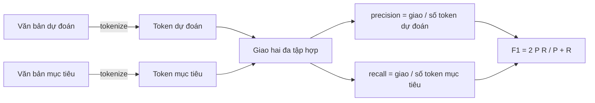
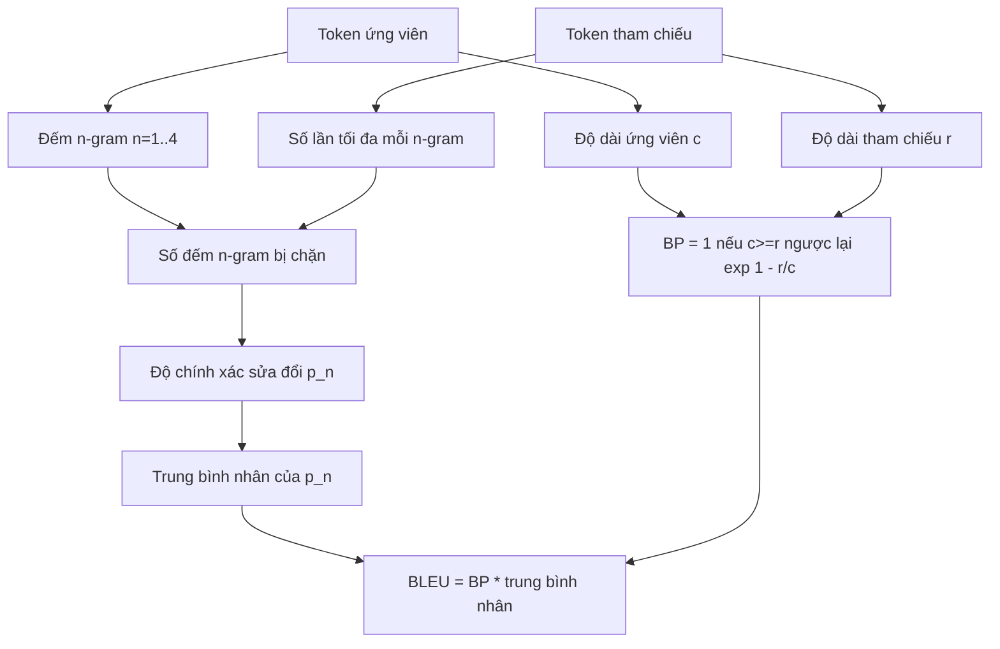

# Các chỉ số cổ điển (Classical Metrics)

> BLEU, ROUGE-L, F1, khớp chính xác (exact-match), độ chính xác (accuracy). Năm chỉ số đo lường kinh điển này vẫn chiếm phần lớn các số liệu đánh giá mô hình ngôn ngữ lớn (LLM) được công bố trong các nghiên cứu. Hãy tự hiện thực từng chỉ số từ các nguyên lý cơ bản nhất để hiểu rõ bản chất thực sự của các con số đó.

**Type:** Xây dựng (Build)
**Languages:** Python
**Prerequisites:** Các bài học nền tảng Phase 19 Track B, bài học 70
**Time:** ~90 phút

## Mục tiêu học tập

- Hiện thực các chỉ số khớp chính xác (exact-match), F1 và độ chính xác (accuracy) ở cấp độ token với các quy tắc token hóa (tokenisation rules) tường minh.
- Hiện thực chỉ số BLEU-4 từ nền tảng gốc rễ: độ chính xác n-gram sửa đổi (modified n-gram precision), trung bình nhân trên các bậc n từ 1 đến 4 và hệ số phạt câu ngắn (brevity penalty).
- Hiện thực chỉ số ROUGE-L dựa trên chuỗi con chung dài nhất (longest common subsequence - LCS), kết hợp độ chính xác và độ bao phủ qua điểm F-beta.
- Điều phối tính điểm dựa trên trường `metric_name` từ bài học 70 để trình thực thi (runner) hoàn toàn độc lập với chi tiết của từng chỉ số.
- Ghim cố định hành vi bằng các vector tham chiếu lấy từ các ví dụ tính toán thủ công từng bước, không phụ thuộc vào bất kỳ thư viện bên thứ ba nào.

```figure
cd-bleu-overlap
```

## Tại sao cần tự hiện thực lại

Bạn sẽ bắt gặp những bài báo công bố điểm BLEU là 28.3, trong khi một bài báo khác lại ghi BLEU là 0.283. Bạn sẽ thấy điểm số ROUGE-L chênh lệch nhau tới 10 điểm giữa hai thư viện khác nhau chỉ vì một bên chuyển văn bản về chữ thường còn bên kia thì không. Cách nhanh nhất để thoát khỏi sự hoang mang này là tự tay viết các hàm đo lường, chỉ rõ dòng mã nào quyết định việc token hóa và dòng mã nào áp dụng kỹ thuật làm mịn (smoothing). Sau khi đã nắm vững, việc so sánh các con số giữa các công trình nghiên cứu sẽ trở thành việc đọc hiểu cách thiết lập tham số đo lường, thay vì tranh cãi về sự khác biệt giữa các thư viện.

Thư viện chuẩn (stdlib) kết hợp cùng `numpy` là hoàn toàn đủ. BLEU chỉ là phép đếm và chặn trên (clamping). ROUGE-L là bài toán quy hoạch động (dynamic programming). F1 là phép giao tập hợp trên các token. Phần thử thách nhất là chọn một bộ token hóa và cam kết tuân thủ nó một cách nhất quán.

## Token hóa (Tokenisation)

Bộ token hóa sử dụng biểu thức chính quy `re.findall(r"\w+", text.lower())`. Chuyển về chữ thường, trích xuất các chuỗi ký tự từ (chữ cái, chữ số và dấu gạch dưới), bỏ qua tất cả những ký tự còn lại. Mọi chỉ số trong bài học này đều dùng chính xác bộ token hóa này. Trình thực thi không có quyền thay đổi. Nếu bạn thay đổi bộ token hóa, bạn đang chạy trên một chuẩn đối sánh (benchmark) hoàn toàn khác.

```python
TOKEN_RE = re.compile(r"\w+", re.UNICODE)
def tokenize(text):
    return TOKEN_RE.findall(text.lower())
```

Đây là một sự tinh giản có chủ đích. Các hệ thống trong môi trường sản xuất sẽ cần quan tâm thêm tới các ngôn ngữ CJK (Trung - Nhật - Hàn), các dạng từ viết tắt và các định danh mã nguồn. Điểm cốt lõi của bài học là bộ token hóa đóng vai trò như một bản giao ước bất biến, không phải một nút vặn để tinh chỉnh tùy tiện.

## Khớp chính xác (Exact match)

```python
def exact_match(pred, targets):
    return float(any(pred.strip() == t.strip() for t in targets))
```

Hàm trả về 1.0 hoặc 0.0 cho mỗi tác vụ. Điểm tổng hợp trên toàn bộ tập dữ liệu là giá trị trung bình cộng. Đây là chỉ số nòng cốt cho các bài toán số học, câu hỏi trắc nghiệm MCQ và các bài toán phân loại câu ngắn.

## F1 ở cấp độ token (Token-level F1)

Xây dựng đa tập hợp (multiset) các token cho chuỗi dự đoán và chuỗi mục tiêu. Độ chính xác (precision) là kích thước giao của hai đa tập hợp chia cho số lượng token trong đa tập hợp dự đoán. Độ bao phủ (recall) là kích thước giao đó chia cho số lượng token trong đa tập hợp mục tiêu. Điểm F1 là trung bình điều hòa (harmonic mean) của precision và recall. Phần hiện thực xử lý đầy đủ các trường hợp biên khi chuỗi dự đoán hoặc chuỗi mục tiêu bị rỗng.



Đối với các tác vụ có nhiều đáp án mục tiêu (multi-target), chúng ta lấy điểm F1 cao nhất trong danh sách các mục tiêu. Điều này hoàn toàn khớp với cách đánh giá dạng SQuAD được báo cáo rộng rãi trong y văn học thuật.

## BLEU-4

BLEU là chỉ số kinh điển trong dịch máy (machine translation) và vẫn thường xuyên xuất hiện trong các bài toán tóm tắt văn bản. Công thức chúng ta sử dụng là BLEU-4 ở cấp độ câu (sentence-level BLEU-4), chấm điểm trên từng cặp dự đoán và văn bản tham chiếu, đi kèm hệ số phạt câu ngắn (brevity penalty) tiêu chuẩn và kỹ thuật làm mịn cộng một (additive-one smoothing) trên số lượng n-gram sửa đổi, giúp một cụm 4-gram bị thiếu không làm tụt toàn bộ điểm số về bằng không.

Với mỗi cặp ứng viên - tham chiếu, chúng ta đếm độ chính xác n-gram sửa đổi cho n bằng 1, 2, 3, 4. Độ chính xác sửa đổi sẽ chặn số lượng n-gram của ứng viên không vượt quá số lần xuất hiện tối đa của n-gram đó trong bất kỳ bản tham chiếu nào, nhờ vậy ứng viên không thể gian lận điểm số bằng cách lặp lại một cụm từ duy nhất. Trung bình nhân trên bốn độ chính xác n-gram sau đó được nhân với hệ số phạt độ dài ngắn.



Quy tắc làm mịn được áp dụng là phương pháp mà Lin và Och gọi là "Phương pháp 1" (method 1): cộng thêm một vào cả tử số và mẫu số của mỗi độ chính xác n-gram trước khi lấy logarit. Điều này tránh được lỗi `log 0` khi bản tham chiếu không có cụm 4-gram nào trùng khớp, đồng thời vẫn giữ điểm số xấp xỉ giá trị chưa làm mịn đối với các câu ứng viên dài.

## ROUGE-L

ROUGE-L so sánh chuỗi con chung dài nhất (LCS) giữa chuỗi token của câu ứng viên và câu tham chiếu. LCS nắm bắt được thứ tự từ mà không bắt buộc các từ phải nằm liền kề nhau, đó là lý do tại sao nó trở thành chỉ số mặc định cho tác vụ tóm tắt văn bản. Chúng ta tính toán độ dài LCS bằng bảng quy hoạch động chuẩn, sau đó tính độ bao phủ recall là `lcs / độ dài tham chiếu`, độ chính xác precision là `lcs / độ dài ứng viên`, rồi kết hợp qua công thức F-beta với beta bằng một để có dạng F1 đối xứng.

```python
def lcs_length(a, b):
    n, m = len(a), len(b)
    dp = numpy.zeros((n + 1, m + 1), dtype=int)
    for i in range(n):
        for j in range(m):
            if a[i] == b[j]:
                dp[i+1, j+1] = dp[i, j] + 1
            else:
                dp[i+1, j+1] = max(dp[i+1, j], dp[i, j+1])
    return int(dp[n, m])
```

Bảng ma trận `numpy` giúp việc triển khai trở nên dễ hiểu; việc dùng danh sách Python thuần cũng hoạt động tốt. Các tác vụ sử dụng ROUGE-L sẽ chịu chi phí tính toán $O(n m)$ cho mỗi tác vụ. Với độ dài tóm tắt thông thường, thời gian chạy luôn dưới một phần nghìn giây.

## Độ chính xác phân loại (Accuracy)

Đối với các tác vụ phân loại, độ chính xác quy về chỉ số khớp chính xác: chuỗi dự đoán đạt 1 điểm nếu khớp với bất kỳ mục tiêu nào đã được chuẩn hóa trong danh sách. Chúng ta tách thành một hàm riêng biệt để bộ điều phối có thể kích hoạt dựa trên `metric_name` mà không cần phải thực hiện các phép so sánh chuỗi phức tạp bên trong trình thực thi.

## Giao ước điều phối (Dispatch contract)

Điểm truy cập duy nhất là hàm `score(metric_name, prediction, targets)`. Hàm trả về một số thực trong khoảng `[0, 1]`. Trình thực thi không cần rẽ nhánh theo tên chỉ số, nó chỉ cần chuyển tiếp lệnh gọi và ghi nhận kết quả. Đây chính là giao diện mà bài học 75 sẽ liên kết với quy cách tác vụ từ bài học 70.

```python
def score(metric_name, pred, targets):
    if metric_name == "exact_match":
        return exact_match(pred, targets)
    if metric_name == "f1":
        return max(f1_score(pred, t) for t in targets)
    if metric_name == "bleu_4":
        return max(bleu4(pred, t) for t in targets)
    if metric_name == "rouge_l":
        return max(rouge_l(pred, t) for t in targets)
    if metric_name == "accuracy":
        return accuracy(pred, targets)
    raise ValueError(f"unknown metric_name: {metric_name}")
```

Chỉ số `code_exec` sẽ được xử lý trong bài học 72 và được ghép vào bảng điều phối tại bài học đó.

## Những gì bài học này không thực hiện

Bài học này không gọi mô hình. Không chuẩn hóa chuỗi sinh ra vượt quá những gì các quy tắc hậu xử lý từ bài học 70 đã làm. Không tính toán khoảng tin cậy (confidence intervals). Không triển khai BLEURT hay BERTScore (các phương pháp này đòi hỏi một mô hình học sâu và nằm ở bài học khác). Trọng tâm ở đây là mức nền tảng tối thiểu vững chắc: năm chỉ số, một bộ token hóa, một bảng điều phối duy nhất.

## Cách đọc hiểu mã nguồn

Tệp `main.py` định nghĩa từng chỉ số dưới dạng các hàm độc lập kèm theo bộ điều phối. Các vector tham chiếu mẫu nằm trong khối `_reference_examples` ở cuối tệp. Đoạn mã chạy thử thực thi bộ điều phối trên tám ví dụ mẫu và in ra điểm số của từng chỉ số. Các bài kiểm thử trong `code/tests/test_metrics.py` ghim chặt các vector tham chiếu và kiểm tra kỹ lưỡng mọi trường hợp biên (chuỗi dự đoán rỗng, bản tham chiếu rỗng, không có token chung, khớp chính xác, hiện tượng lặp lại cụm từ bị chặn).

Hãy đọc `main.py` từ trên xuống dưới. Các hàm được sắp xếp theo độ phức tạp tăng dần: `exact_match` và `accuracy` chỉ chiếm một dòng mỗi hàm; `F1` chiếm sáu dòng; `BLEU` và `ROUGE-L` là các phần nặng ký nhất kèm theo các chú thích chi tiết về quy tắc làm mịn và hệ thức truy hồi của LCS.

## Phát triển xa hơn

Các chỉ số cổ điển là điều kiện cần nhưng chưa đủ. Chúng thưởng điểm dựa trên sự trùng lặp bề mặt câu chữ và bỏ sót ngữ nghĩa thực sự. Giải pháp là xếp chồng các chỉ số dựa trên mô hình (model-based metrics như BLEURT, BERTScore, G-Eval) lên trên một khi bạn đã hoàn toàn tin tưởng vào nền móng của các chỉ số cổ điển. Đó sẽ là nội dung của các bài học tiếp theo. Còn hiện tại: hãy đảm bảo năm chỉ số này hoạt động chuẩn xác, được ghim chặt bằng kiểm thử tự động, và bạn sẽ có một bộ công cụ đánh giá có thể kiểm toán được, tốc độ nhanh và có khả năng tái lập hoàn hảo.
