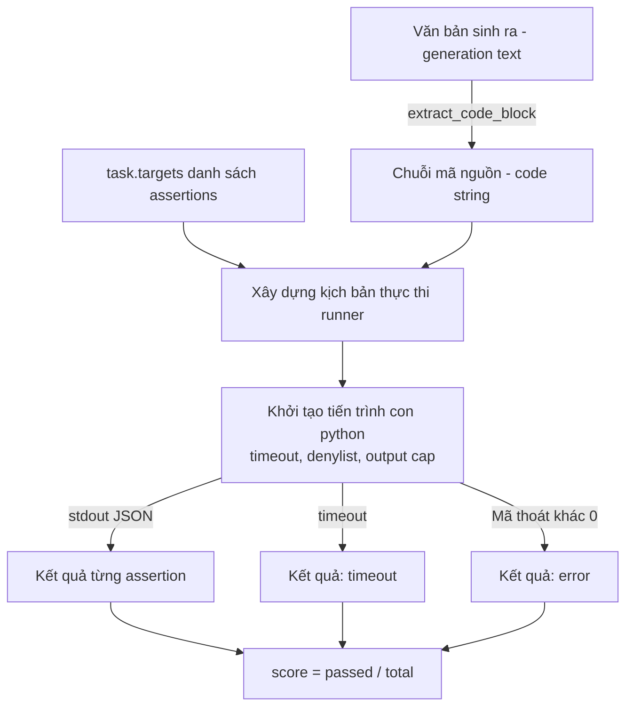
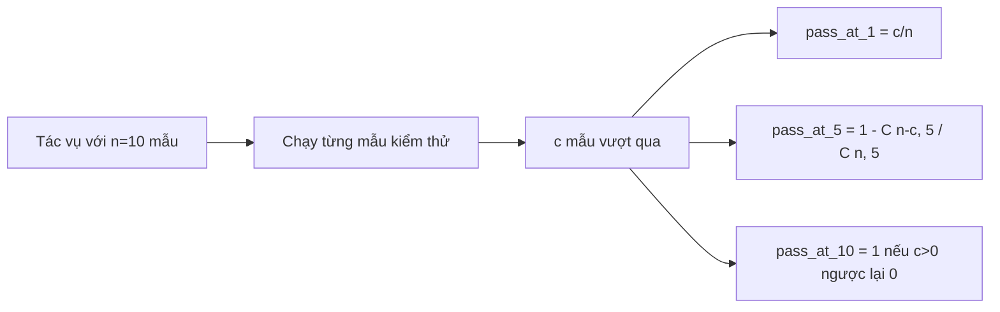

# Chỉ số Đánh giá Thực thi Mã nguồn (Code Exec Metric)

> Mã nguồn do mô hình sinh ra chỉ thực sự đúng đắn khi vượt qua được các bài kiểm thử. Hệ thống đánh giá (eval harness) cần trích xuất mã, thực thi an toàn mà không làm sập tiến trình chủ (host), và thống kê tỷ lệ vượt qua (pass-rate) một cách trung thực. Bài học này sẽ xây dựng bề mặt đó.

**Type:** Build
**Languages:** Python
**Prerequisites:** Phase 19 Track B foundations, lessons 70 and 71
**Time:** ~90 min

## Mục tiêu học tập (Learning objectives)

- Trích xuất một khối mã nguồn từ văn bản sinh tự do theo quy tắc hậu xử lý (post-process rule) từ bài học 70.
- Thực thi đoạn mã ứng viên (candidate code) trong một tiến trình con cô lập (isolated subprocess) với giới hạn thời gian thực (wall-clock timeout), trần dung lượng đầu ra (output cap), và danh sách chặn nhập khẩu thư viện (import denylist).
- Chấm điểm tác vụ dựa trên tỷ lệ các chuỗi khẳng định (assertion strings) được cung cấp vượt qua thành công trên mã ứng viên.
- Tính toán chỉ số pass-at-k cho các tác vụ lấy nhiều mẫu sinh từ cùng một mô hình.
- Xử lý các sự cố sập hộp cát (sandbox crashes), lỗi cú pháp (syntax errors) và vượt quá thời gian chờ (timeouts) như các dạng thức lỗi loại một (first-class fail modes) với các mã thoát phân biệt để bộ chạy đánh giá (runner) có thể ghi nhật ký.

```figure
sandbox-runner
```

## Tại sao cần một tiến trình con cô lập (Why an isolated subprocess)

Việc dùng trực tiếp hàm `exec` nội tuyến (inline `exec`) tiềm ẩn rủi ro lớn về tính bảo mật và độ ổn định của hệ thống. Một đoạn mã được sinh ra chứa `while True: pass` sẽ làm treo toàn bộ tiến trình đánh giá vô thời hạn. Một đoạn mã chứa `import shutil; shutil.rmtree('/')` sẽ gây ra thảm họa đúng như những gì lệnh đó biểu thị. Giải pháp triệt để là khởi tạo một tiến trình thông dịch Python (Python interpreter) mới cho mỗi đoạn mã ứng viên, truyền mã nguồn qua luồng đầu vào tiêu chuẩn stdin, ghi kết quả khẳng định (assertion results) ra luồng đầu ra tiêu chuẩn stdout, và buộc chấm dứt (kill) tiến trình nếu nó chạy quá thời hạn quy định. Tiến trình đánh giá của máy chủ vẫn tiếp tục vận hành mà không bị gián đoạn.

Các bộ công cụ đánh giá thực tế như HumanEval, MBPP, BigCodeBench và LiveCodeBench đều sử dụng môi trường hộp cát tiến trình con (subprocess sandbox). Một số hệ thống còn xếp thêm một lớp Docker bên trên. Ở đây, chúng ta dừng lại ở cấp độ tiến trình con vì một lý do xác đáng: nó mang tính khả chuyển (portable), chỉ sử dụng thư viện chuẩn (stdlib), và phát hiện được trọn vẹn các dạng thức thất bại quan trọng cho mục đích đánh giá mang tính sư phạm. Các triển khai môi trường sản xuất thực tế sẽ bổ sung thêm bộ lọc cuộc gọi hệ thống seccomp, cách ly mạng (network isolation) và hệ thống tệp chỉ đọc (read-only filesystem). Bài học tiếp theo về gia cố an ninh (hardening) sẽ nằm ngoài lộ trình này.

## Cấu trúc của một tác vụ thực thi mã (The shape of a code-exec task)

Một tác vụ `code_exec` chứa các chuỗi khẳng định kiểm thử trong trường `targets`. Bộ chạy đánh giá sẽ trích xuất khối mã nằm trong thẻ phân đoạn (fenced code block) từ văn bản sinh ra, dựng một khung kiểm thử (test harness) bao quanh nó và thực thi kết quả.



Điểm số là một phân số trong khoảng `[0, 1]`. Một tác vụ có ba chuỗi khẳng định mà vượt qua được hai chuỗi sẽ đạt điểm 0.667. Bộ chạy đánh giá luôn trả về cùng một cấu trúc dữ liệu bất kể lỗi gì xảy ra: các sự cố sập của tiến trình con được ánh xạ thành một mã lỗi chuẩn hóa (normalized error code), chứ không phải là một vết ngăn xếp lỗi Python (Python traceback) tràn ngược lên khung kiểm thử.

## Danh sách từ chối (The denylist)

Danh sách từ chối hoạt động dựa trên cơ chế nhập khẩu thư viện (import-based). Trước khi thực thi mã ứng viên, kịch bản chạy sẽ viết lại các câu lệnh nhập khẩu của những mô-đun nguy hiểm thành một đoạn mã giả (stub) làm phát sinh ngoại lệ `ImportError("denied")`. Danh sách này được thiết kế thận trọng và có chủ đích: `os.system`, `subprocess`, `socket`, `requests`, `urllib`, `urllib.request`, `urllib.error`, `urllib.parse`, `ctypes`, `shutil`, `http.client`, `asyncio.subprocess`.

Chúng ta không cho rằng cơ chế này là bất khả xâm phạm. Một đoạn mã có tính đối kháng và chủ đích phá hoại cao có thể vượt qua bất kỳ hộp cát nào chạy cùng tiến trình trong Python. Danh sách từ chối đóng vai trò như một chốt chặn dự phòng (backstop). Giới hạn thời gian thực tế và trần dung lượng đầu ra mới là những cơ chế kiểm soát chịu tải trọng yếu (load-bearing controls).

```python
DENIED = {
    "os.system": True,
    "subprocess": True,
    "socket": True,
    "shutil": True,
    "requests": True,
    "urllib": True,
    "ctypes": True,
}
```

Chúng ta bao bọc mã ứng viên bằng cách chèn thêm câu lệnh `import sys` ở đầu cùng một chốt chặn can thiệp động (monkey-patch) khiến `os.system` phát sinh lỗi ngoại lệ. Khuôn mẫu hoàn chỉnh được định nghĩa trong `main.py`.

## Giới hạn thời gian thực tế (Wall-clock timeout)

Mỗi tiến trình con được cấp một quỹ thời gian mặc định là ba giây thời gian thực (wall-clock seconds). Bộ chạy sử dụng lệnh `subprocess.run(..., timeout=t)`. Nếu thời gian thực thi vượt quá ngưỡng, bộ chạy sẽ bắt ngoại lệ `TimeoutExpired`, chấm dứt tiến trình con và ghi nhận lý do thoát là `timeout` cho tác vụ đó. Điểm số của tác vụ sẽ bằng không. Bộ chạy tiếp tục chuyển sang tác vụ kế tiếp.

Thời gian chờ là đối số `timeout_s` truyền vào hàm `run_candidate`; bộ chạy ở bài học 75 thiết lập tham số này một lần cho mỗi lượt chạy thông qua biến `code_exec_timeout_s`. Các bài kiểm thử đơn vị chạy lâu có thể yêu cầu thời gian dài hơn, nhưng hàm `run_candidate` sẽ kẹp chặt (clamp) giá trị trong khoảng từ 0.1 đến 30 giây để đảm bảo toàn bộ bộ kiểm thử luôn nằm trong giới hạn kiểm soát.

## Trần dung lượng đầu ra (Output cap)

Tiến trình con có thể làm tràn ngập luồng stdout, gây cạn kiệt bộ nhớ của máy chủ. Bộ chạy sẽ truyền phát luồng stdout vào một bộ đệm và lập tức chấm dứt tiến trình con ngay khi tổng dung lượng tích lũy vượt quá 256 KB. Kết quả được ghi nhận với `exit_code = error` kèm chuỗi thông tin chi tiết `"output overflow"`. Hiện tượng này thường xuất hiện trên thực tế khi một đoạn mã do mô hình sinh ra vô tình chứa một vòng lặp vô tận có lệnh in ra màn hình.

## Chỉ số Pass-at-k

Pass-at-k là ước lượng không chệch (unbiased estimator) được sử dụng bởi HumanEval cùng các bộ đánh giá tương đương. Giả sử ta lấy `n` mẫu độc lập cho mỗi tác vụ và có `c` mẫu trong số đó vượt qua kiểm thử, thì xác suất để một mẫu ngẫu nhiên gồm `k` giải pháp trích từ `n` mẫu đó chứa ít nhất một giải pháp đúng được tính bằng công thức:

```text
pass_at_k(n, c, k) = 1 - C(n - c, k) / C(n, k)
```

Khi `n - c < k`, tử số `C(n - c, k)` bằng không theo quy ước tổ hợp thông thường (không thể chọn ra `k` giải pháp lỗi từ tập có ít hơn `k` giải pháp lỗi), do đó giá trị của biểu thức sẽ bằng `1`. Việc hiện thực hóa thuật toán xử lý trực tiếp trường hợp biên này. Chúng ta cung cấp hàm `pass_at_k(n, c, k)` để tầng bảng xếp hạng (leaderboard layer) trong bài học 74 có thể tái sử dụng.



## Các mã trạng thái thoát (Exit codes)

Bộ chạy trả về một trong năm kết quả cho mỗi tác vụ:

- `pass`: khi mọi khẳng định kiểm thử đều vượt qua.
- `assertion_fail`: khi mã nguồn thực thi thành công nhưng có ít nhất một khẳng định kiểm thử thất bại.
- `syntax_error`: khi mã nguồn không thể nhập khẩu hoặc gặp lỗi cú pháp `SyntaxError`.
- `timeout`: khi thời gian thực tế vượt quá ngưỡng cho phép.
- `error`: đối với bất kỳ sự cố sập nào khác, bao gồm cả việc kích hoạt danh sách từ chối và tràn dung lượng đầu ra (lỗi tràn đầu ra được ghi chú với chi tiết `"output overflow"`).

Điểm số vẫn là một giá trị phân số. Mã thoát đóng vai trò là siêu dữ liệu (metadata). Các bài học tiếp theo trong quy trình có thể quyết định việc xem một trường hợp timeout là điểm không hay là dữ liệu bị thiếu.

## Những điều bài học này không giải quyết (What this lesson does not do)

Bài học này không cung cấp cho bạn một môi trường hộp cát hoàn chỉnh cấp độ hệ điều hành. Nó không chạy mã nguồn tùy ý không đáng tin cậy lấy trực tiếp từ Internet công cộng. Nó cũng không xử lý các tác vụ có lưu trạng thái (stateful tasks) như thao tác vào/ra tệp (file I/O) hay các cuộc gọi mạng. Những tác vụ như vậy đòi hỏi một container hoặc một máy ảo siêu nhỏ (microVM). Trọng tâm của bài học này là thiết lập một bản giao ước chuẩn mực (contract): một tiến trình con cô lập, một danh sách từ chối, một giới hạn thời gian thực, một trần dung lượng đầu ra, một tập từ vựng mã thoát rõ ràng, và nền tảng toán học của chỉ số pass-at-k.

## Hướng dẫn đọc mã nguồn (How to read the code)

Tệp `main.py` định nghĩa các hàm `extract_code`, `run_candidate`, `score_code_exec`, và `pass_at_k`. Kịch bản thực thi cho tiến trình con được xây dựng dưới dạng một chuỗi ký tự và truyền qua cờ `-c` tới một trình thông dịch Python hoàn toàn mới. Các bài kiểm thử trong `code/tests/test_exec.py` kiểm tra toàn bộ bốn mã thoát cùng chỉ số pass-at-k trên các ví dụ mẫu được xây dựng theo phong cách HumanEval.

Hãy đọc `main.py` từ đầu đến cuối. Khuôn mẫu bộ chạy (runner template) là thành phần then chốt chịu tải. Hãy quan sát kỹ vòng lặp kiểm tra assertion cho đến khi bạn có thể dự đoán chính xác cấu trúc phong bì JSON (JSON envelope) mà nó ghi ngược về tiến trình cha.

## Đào sâu mở rộng (Going further)

Khi cấu trúc tiến trình con đã vận hành ổn định, mối bận tâm tiếp theo sẽ là tính khả chuyển trên các nền tảng khác nhau. Các phiên bản Python khác nhau xử lý tín hiệu `SIGKILL` theo cách khác nhau trên Windows. Giải pháp tối ưu và sạch sẽ nhất là đóng gói bộ chạy vào một ảnh Docker (Docker image). Bước tiếp theo sau đó là thay thế các chuỗi khẳng định bằng các tệp kiểm thử đơn vị (unit test) thực sự, giúp hệ thống đánh giá tương thích với môi trường CI trong thực tế sản xuất. Khi đã đạt đến bước đó, hãy ngừng gọi các chuỗi khẳng định là bài kiểm thử; chúng chỉ là các bài kiểm tra mang tính minh họa đồ chơi và mang đầy đủ các dạng thức thất bại của những mô hình đồ chơi.
