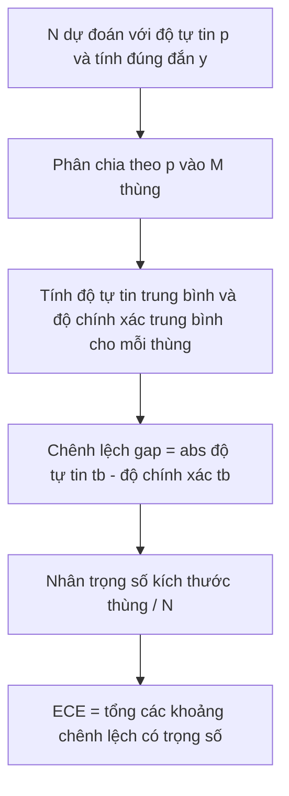
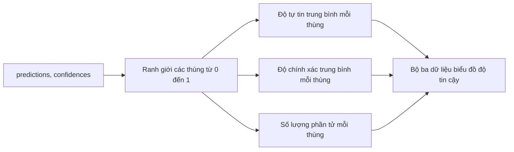

# Độ hỗn loạn và Độ hiệu chuẩn (Perplexity and Calibration)

> Nếu mô hình của bạn tuyên bố độ tự tin 90% trên một nghìn câu trả lời nhưng chỉ trả lời đúng sáu trăm câu, mô hình đó chưa được hiệu chuẩn tốt. Độ hiệu chuẩn (calibration) chiếm một nửa độ tin cậy của quy trình đánh giá. Nửa còn lại là độ hỗn loạn (perplexity), thước đo cho biết mô hình có đánh giá văn bản kiểm định độc lập là hợp lý hay không.

**Type:** Build
**Languages:** Python
**Prerequisites:** Phase 19 Track B foundations, lessons 70 and 71
**Time:** ~90 min

## Mục tiêu học tập (Learning objectives)

- Tính toán độ hỗn loạn cấp token (token-level perplexity) trên một tập ngữ liệu kiểm định độc lập (held-out corpus) từ các giá trị log-xác suất âm của token (token negative log-probabilities) do bộ điều hợp mô hình (model adapter) cung cấp.
- Tính toán sai số hiệu chuẩn kỳ vọng (expected calibration error - ECE) của một bộ phân loại hoặc tác vụ trắc nghiệm nhiều lựa chọn từ các xác suất dự đoán đã được phân thùng (binned predicted probabilities).
- Tính toán điểm số Brier (Brier score - sai số bình phương trung bình so với biến chỉ thị tính đúng đắn) và giải thích những khía cạnh mà Brier nắm bắt được nhưng ECE bỏ sót.
- Xây dựng dữ liệu biểu đồ độ tin cậy (reliability diagram data) cần thiết để vẽ đường cong giữa độ tự tin và độ chính xác (confidence-versus-accuracy curve).
- Tích hợp cả ba chỉ số vào khung điều khiển đánh giá (eval harness) để bộ chạy có thể gắn các số liệu `perplexity`, `ece` và `brier` vào báo cáo tổng hợp mô hình.

```figure
cd-reliability-diagram
```

## Ý nghĩa thực sự của độ hỗn loạn (What perplexity tells you)

Độ hỗn loạn là hàm mũ của giá trị đối số log-hợp lý âm trung bình trên mỗi token (exponentiated average negative log-likelihood per token). Giá trị càng thấp biểu thị mô hình càng tốt. Độ hỗn loạn bằng 1 đồng nghĩa với việc mô hình gán xác suất tuyệt đối bằng 1 cho mọi token thực tế xuất hiện. Độ hỗn loạn bằng đúng kích thước từ vựng (vocabulary size) biểu thị mô hình chỉ dự đoán theo phân phối đều (uniform) và không học được bất kỳ quy luật nào. Các giá trị thực tế nằm ở khoảng giữa: một mô hình nền tảng (base model) mạnh mẽ của năm 2026 trên tập WikiText-103 dao động trong khoảng từ 8 đến 12. Một mô hình kém chất lượng trên cùng tập văn bản sẽ có chỉ số trên 50.

Khung điều khiển đánh giá không tự tính toán log-xác suất. Dữ liệu này được cung cấp bởi bộ điều hợp mô hình (model adapter). Khung điều khiển đóng vai trò tổng hợp: tiếp nhận danh sách log-xác suất trên từng token, danh sách số lượng token theo từng chuỗi, và trả về độ hỗn loạn của toàn bộ ngữ liệu.

```python
def perplexity(neg_log_probs, token_counts):
    total_nll = sum(neg_log_probs)
    total_tokens = sum(token_counts)
    return math.exp(total_nll / total_tokens)
```

Việc hiện thực hóa thuật toán xử lý trường hợp biên chuỗi không chứa token nào và kiểm tra ràng buộc để đảm bảo các giá trị log-xác suất âm đều không âm. Một lỗi phổ biến là quên dấu đổi dấu âm: một bộ điều hợp trả về `log p` thay vì `-log p` sẽ tạo ra giá trị perplexity nhỏ hơn 1, điều vốn bất khả thi về mặt toán học. Hàm sẽ chặn đứng lỗi này như một vi phạm giao ước (contract violation).

## ECE đo lường điều gì (What ECE measures)

Sai số hiệu chuẩn kỳ vọng nhóm các dự đoán theo mức độ tự tin (confidence) của chúng vào một số lượng thùng cố định, sau đó đo lường khoảng cách trung bình giữa độ tự tin và độ chính xác thực nghiệm trên các thùng, được tính trọng số theo kích thước của từng thùng.



Công thức chuẩn mực sử dụng 10 thùng có độ rộng bằng nhau trên đoạn `[0, 1]`. Bản hiện thực hóa hỗ trợ số lượng thùng là bất kỳ số nguyên dương nào. Chúng ta cung cấp tham số `bins` để bộ chạy có thể linh hoạt lựa chọn giữa quy ước công bố nghiên cứu (10 thùng) và quy ước so sánh chi tiết (15 thùng).

Chỉ số ECE chịu ảnh hưởng bởi số lượng thùng và kích thước mẫu dữ liệu. Với 10 thùng và chỉ 100 mẫu dự đoán, bạn không thể phân biệt được giá trị ECE 0.02 là do mô hình hay chỉ là nhiễu ngẫu nhiên. Triển khai thuật toán sẽ trả về số lượng thùng thực sự có dữ liệu (populated bins) cùng với giá trị ECE, giúp bộ chạy có thể từ chối báo cáo một con số đơn lẻ khi kích thước mẫu quá ít.

## Điểm Brier làm được gì mà ECE không làm được (What Brier score does that ECE does not)

ECE chỉ quan tâm đến khoảng chênh lệch trung bình. Một mô hình tự tin thái quá ở một nửa số thùng và tự tin dưới mức ở nửa số thùng còn lại vẫn có thể đạt chỉ số ECE thấp dù mức độ hiệu chuẩn cục bộ rất kém. Điểm số Brier (Brier score) đo lường sai số bình phương so với kết quả nhị phân thực tế trên từng lượt dự đoán, do đó nó trực tiếp phạt độ phân tán sai lệch.

Đối với kết quả nhị phân, Brier được tính bằng `mean((p_i - y_i)^2)`. Công thức này phân rã thành ba thành phần: độ tin cậy (reliability), độ phân giải (resolution) và độ bất định (uncertainty). Chúng ta tính toán cả điểm số tổng thể lẫn các thành phần phân rã. Bộ chạy báo cáo giá trị vô hướng (scalar) nhưng ghi nhận các thành phần phân rã vào nhật ký để phục vụ bảng điều khiển trực quan (dashboard).

```python
def brier(p, y):
    return float(np.mean((p - y) ** 2))
```

## Dữ liệu biểu đồ độ tin cậy (Reliability diagram data)

Biểu đồ độ tin cậy biểu diễn trực quan độ tự tin dự đoán so với độ chính xác thực nghiệm trong từng thùng. Đường chéo đại diện cho trạng thái hiệu chuẩn hoàn hảo. Hàm tính toán trả về bộ ba mảng: độ tự tin trung bình trên từng thùng, độ chính xác trung bình trên từng thùng, và số lượng mẫu trong từng thùng. Mã nguồn vẽ biểu đồ nằm ở tầng hạ nguồn; bài học này dừng lại ở việc định hình cấu trúc dữ liệu chuẩn xác.



Bộ ba giá trị trả về cung cấp chính xác những gì tầng gọi cần để vẽ đồ thị hoặc tính toán các biến thể ECE tùy chỉnh (ECE thích ứng, sweep ECE, v.v.). Chúng ta trả về mảng numpy để mã nguồn tầng dưới không phải chuyển đổi định dạng.

## Nguồn gốc của độ tự tin (Confidence sources)

Khung điều khiển không áp đặt giả định rằng độ tự tin bắt buộc phải xuất phát từ hàm softmax. Nó chấp nhận bất kỳ giá trị nào nằm trong khoảng `[0, 1]` cho mỗi lượt dự đoán. Đối với các tác vụ trắc nghiệm nhiều lựa chọn, độ tự tin tự nhiên nhất là `softmax trên log-likelihood của các phương án`. Đối với văn bản tự do, độ tự tin tự nhiên là xác suất do chính mô hình tự báo cáo hoặc hàm mũ của log-likelihood trung bình. Hệ thống đánh giá chỉ đơn thuần tiêu thụ con số này. Nguồn gốc của giá trị đó thuộc phạm vi trách nhiệm của bộ điều hợp.

## Các trường hợp biên (Edge cases)

- Mọi dự đoán đều sai: ECE bằng chính độ tự tin trung bình, điểm Brier ở mức cao, perplexity phụ thuộc vào đánh giá của mô hình đối với văn bản.
- Mọi dự đoán đều đúng với độ tự tin cao: ECE tiệm cận 0, điểm Brier tiệm cận 0.
- Bộ dự đoán bất định tuyệt đối tại p=0.5: mọi dự đoán đều rơi vào một thùng duy nhất, do đó ECE bằng `|0.5 - accuracy|`. Điểm Brier chính xác bằng 0.25, bởi vì `(0.5 - y)^2 = 0.25` bất kể `y` bằng 0 hay 1.
- Dữ liệu đầu vào rỗng: ECE, Brier và hàm reliability trả về `0.0` (hoặc các mảng điền số không). Perplexity trả về `NaN` cho trường hợp không có token nào. Không có nhánh nào phát sinh cảnh báo gây nhiễu; bộ chạy sẽ tự kiểm tra giá trị và quyết định báo cáo hay bỏ qua.

Những trường hợp này được bao phủ chặt chẽ trong bộ kiểm thử. Một mô hình thực tế trên một bộ chuẩn thực tế sẽ không chạm đến các ngưỡng này, nhưng một bộ điều hợp bị lỗi hoặc một tập mẫu quá nhỏ sẽ gặp phải, và bộ chạy không được phép gặp sự cố sập.

## Điều phối đánh giá (Dispatch)

Độ hiệu chuẩn không phải là một chỉ số tính trên từng tác vụ như F1. Nó là một báo cáo tổng hợp trên toàn mô hình. Bộ chạy tích lũy các cặp `(confidence, correct)` xuyên suốt toàn bộ quá trình đánh giá và tính toán ECE, Brier cùng dữ liệu độ tin cậy một lần duy nhất. Độ hỗn loạn được tính toán trên một tập ngữ liệu văn bản kiểm định độc lập, tách biệt hoàn toàn khỏi việc chấm điểm từng tác vụ.

Giao diện sử dụng:

```python
report = CalibrationReport.from_predictions(confidences, correct)
report.ece          # float
report.brier        # float
report.reliability  # tuple gồm ba mảng numpy
report.populated_bins  # int
```

`PerplexityResult.from_token_nll(neg_log_probs, token_counts)` trả về độ hỗn loạn và log-hợp lý âm trung bình trên mỗi token.

## Những điều bài học này không giải quyết (What this lesson does not do)

Bài học này không trực tiếp gọi mô hình. Nó không tự cài đặt hàm softmax. Nó không ước lượng độ tự tin từ các token đầu ra; đó là nhiệm vụ của bộ điều hợp. Nó không thực hiện co giãn nhiệt độ (temperature scaling) hay co giãn Platt (Platt scaling); đó là các kỹ thuật hiệu chỉnh hậu nghiệm (post-hoc fixes) nằm trong một bài học khác. Mục tiêu của bài học này là biến ba con số (perplexity, ECE, Brier) trở nên đáng tin cậy và có khả năng tái lập hoàn toàn.

## Hướng dẫn đọc mã nguồn (How to read the code)

Tệp `main.py` định nghĩa các hàm `perplexity`, `expected_calibration_error`, `brier_score`, `reliability_diagram`, cùng các lớp dữ liệu `CalibrationReport` và `PerplexityResult`. Bản chạy mẫu minh họa trên các dự đoán tổng hợp có nhãn thực tế đã biết: một mô hình được hiệu chuẩn chuẩn xác, một mô hình tự tin thái quá, và một mô hình tự tin dưới mức. Các bài kiểm thử trong `code/tests/test_calibration.py` ghim chặt từng trường hợp biên cùng các giá trị tham chiếu cho các bộ dự đoán tổng hợp.

Hãy đọc `main.py` từ trên xuống dưới. Trình tự các hàm đi từ đại lượng vô hướng đến véc-tơ rồi đến đối tượng báo cáo. Mỗi hàm đều có chuỗi tài liệu (docstring) ngắn gọn trình bày cơ sở toán học và bản giao ước giao diện.

## Đào sâu mở rộng (Going further)

Độ hiệu chuẩn là trục bị xem nhẹ nhiều nhất trong các công bố đánh giá mô hình. Phần lớn các bảng xếp hạng chỉ công bố một con số độ chính xác duy nhất rồi kết luận. Một mô hình chiến thắng về độ chính xác nhưng thua cuộc về điểm Brier sẽ là một giải pháp tồi tệ hơn khi triển khai vào môi trường sản xuất so với một mô hình có độ chính xác thấp hơn vài điểm phần trăm nhưng báo cáo trung thực mức độ bất định của nó. Khi bạn đã thiết lập xong hệ thống đo lường hiệu chuẩn, hãy thử nghiệm co giãn nhiệt độ trên một phần dữ liệu xác thực độc lập, tính toán lại ECE và quan sát khoảng chênh lệch thu hẹp dần. Đó là nội dung của một bài học chuyên sâu khác, nhưng nền móng bắt đầu từ chính nơi này.
