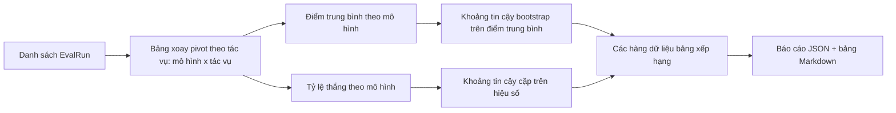
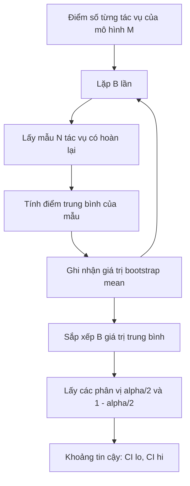

# Tổng hợp Bảng xếp hạng (Leaderboard Aggregation)

> Tính toán điểm số trên từng tác vụ riêng lẻ là điều đơn giản. Xếp hạng từng mô hình trên các tập tác vụ không đồng nhất (heterogeneous tasks) phức tạp hơn nhiều. Đánh giá ý nghĩa thống kê (statistical significance) trên một bảng xếp hạng gồm hàng nghìn dự đoán là phần mà hầu hết mọi người đều bỏ qua. Bài học này sẽ không bỏ qua bước đó.

**Type:** Build
**Languages:** Python
**Prerequisites:** Phase 19 Track B foundations, lessons 70, 71, 73
**Time:** ~90 min

## Mục tiêu học tập (Learning objectives)

- Tổng hợp điểm số từng tác vụ trên nhiều mô hình và nhiều dạng bài kiểm thử thành một hàng dữ liệu tinh gọn cho từng mô hình.
- Chuẩn hóa các thang điểm không đồng nhất để tỷ lệ vượt qua (pass rates) và giá trị BLEU không làm lệch hướng chỉ số tổng hợp chung.
- Xếp hạng các mô hình theo điểm trung bình (mean) và theo tỷ lệ thắng (win-rate), đồng thời giải thích rõ khi nào mỗi phương pháp phản ánh đúng bản chất.
- Tính toán khoảng tin cậy bootstrap (bootstrap confidence intervals) trên điểm trung bình của từng mô hình và trên khoảng chênh lệch giữa từng cặp mô hình (pairwise differences).
- Xuất bảng xếp hạng dưới dạng báo cáo JSON và bảng Markdown để bộ chạy ở bài học 75 có thể dán trực tiếp vào bình luận quy trình CI.

```figure
ci-leaderboard-ci
```

## Cấu trúc dữ liệu đầu vào (The shape of input)

Bộ tổng hợp tiếp nhận một danh sách các bản ghi `EvalRun`:

```python
@dataclass
class EvalRun:
    model_id: str
    task_id: str
    metric_name: str
    score: float          # trong khoảng [0, 1]
    category: str
```

Bộ chạy ở bài học 75 phát ra một bản ghi cho mỗi cặp `(model, task)`. Bộ tổng hợp không bận tâm đến việc điểm số được sinh ra như thế nào. Nó kỳ vọng quá trình chuẩn hóa đã được hoàn tất trước đó: mọi điểm số đều nằm trong đoạn `[0, 1]`.

## Kết quả đầu ra (The output)

Ba bảng dữ liệu được tạo ra:



Một hàng trong bảng xếp hạng bao gồm: `model_id`, `mean_score`, `mean_ci_lo`, `mean_ci_hi`, `win_rate`, `tasks_completed`, cùng một bản đồ tùy chọn `categories` biểu thị điểm trung bình theo từng danh mục.

## Chuẩn hóa dữ liệu (Normalisation)

Nếu một tác vụ chấm điểm trong khoảng `[0, 1]` còn một tác vụ khác chấm trong khoảng `[0, 100]`, tác vụ thứ hai sẽ âm thầm lấn át hoàn toàn điểm trung bình chung. Bộ tổng hợp sẽ xác thực xem mọi điểm số đầu vào có nằm trong đoạn `[0, 1]` hay không và từ chối xử lý lượt chạy nếu điều kiện này bị vi phạm. Việc khắc phục phải diễn ra ở tầng thượng nguồn: bản thân hàm tính toán chỉ số đã phải trả về một phân số. Các bài học từ 71 đến 73 thực thi nghiêm ngặt giao ước này.

## Điểm trung bình và Tỷ lệ thắng (Mean and win-rate)

Hai cơ chế xếp hạng này phục vụ các mục tiêu khác nhau:

Điểm trung bình (mean score) là trung bình cộng điểm số các tác vụ của một mô hình. Đây là con số tiêu đề thường được các bảng xếp hạng công bố. Tuy nhiên, nó rất nhạy cảm với các giá trị ngoại lai (outliers) và sự mất cân bằng giữa các tác vụ.

Tỷ lệ thắng (win-rate) đếm tần suất một mô hình đánh bại mọi mô hình khác trên cùng một tác vụ. Đối với mỗi tác vụ, mô hình có điểm cao nhất sẽ chiến thắng (trường hợp hòa điểm sẽ trao một trận thắng trọn vẹn cho mọi mô hình tham gia hòa). Tỷ lệ thắng bằng số trận thắng chia cho tổng số tác vụ mà mô hình có điểm số. Phương pháp này ít nhạy cảm hơn với giá trị ngoại lai và sự khác biệt về quy mô thang đo, nhưng lại làm mất đi một phần thông tin biên độ.

```python
def win_rate(model_id, runs_by_task, all_models):
    wins, total = 0, 0
    for task_id, runs in runs_by_task.items():
        scores = {r.model_id: r.score for r in runs if r.model_id in all_models}
        if model_id not in scores:
            continue
        total += 1
        best = max(scores.values())
        if scores[model_id] >= best:
            wins += 1
    return wins / total if total else 0.0
```

Khung điều khiển báo cáo đồng thời cả hai số liệu. Bộ chạy ở bài học 75 mặc định xếp hạng theo điểm trung bình; cột tỷ lệ thắng bằng Markdown luôn sẵn có để người dùng lựa chọn theo nhu cầu.

## Khoảng tin cậy Bootstrap (Bootstrap confidence intervals)

Điểm trung bình của từng mô hình luôn đi kèm với một khoảng tin cậy được ước lượng bằng phương pháp tái lấy mẫu bootstrap (bootstrap resampling) trên các tác vụ. Chúng ta tái lấy mẫu mã định danh tác vụ có hoàn lại (resample with replacement), tính điểm trung bình trên tập mẫu được chọn, lặp lại quá trình này `B` lần, và lấy khoảng phân vị (percentile interval) ở mức ý nghĩa `alpha`.



Đối với các so sánh theo cặp (pairwise comparisons), chúng ta áp dụng bootstrap trên khoảng chênh lệch điểm từng tác vụ `score_A - score_B`, lấy khoảng phân vị và báo cáo kết quả. Người dùng có thể quan sát xem khoảng tin cậy có chứa giá trị 0 hay không. Nếu khoảng tin cậy không chứa số 0, sự khác biệt có ý nghĩa thống kê ở mức alpha. Nếu có chứa số 0, bảng xếp hạng sẽ coi hai mô hình này ở trạng thái hòa nhau.

Các hàm trợ giúp cấp thấp (`bootstrap_mean_ci`, `bootstrap_pairwise_diff`) mặc định sử dụng `B=1000`; các bộ tổng hợp công khai (`aggregate`, `pairwise_diffs`) mặc định dùng `b=500` để các bản chạy minh họa và kiểm thử diễn ra nhanh chóng. Giá trị alpha mặc định là 0.05. Bài học này duy trì việc tính toán bootstrap thuần túy bằng NumPy, không phụ thuộc vào SciPy.

## Phân loại danh mục (Categories)

Nếu trường `EvalRun.category` được thiết lập, bộ tổng hợp cũng sẽ báo cáo điểm trung bình theo từng danh mục. Đây là các cột hiển thị trên mọi bảng xếp hạng như `math`, `reasoning`, `code`, `safety`. Nó giúp bộ chạy phát hiện liệu một mô hình có đạt kết quả tổng thể tốt nhưng lại yếu kém trong mảng lập trình hay không — một thông tin mà điểm trung bình chung thường che khuất.

## Kết xuất Markdown (Markdown rendering)

Bảng xếp hạng được kết xuất dưới dạng bảng Markdown:

```text
| Rank | Model | Mean | 95% CI | Win rate | Tasks |
|------|-------|------|--------|----------|-------|
| 1    | gpt   | 0.78 | 0.74-0.82 | 0.62 | 50 |
| 2    | claude| 0.75 | 0.71-0.79 | 0.34 | 50 |
| 3    | random| 0.10 | 0.07-0.13 | 0.04 | 50 |
```

Bảng được sắp xếp theo điểm số trung bình. Khoảng tin cậy được làm tròn đến hai chữ số thập phân. Các mã định danh mô hình dài quá 20 ký tự sẽ được cắt tỉa gọn gàng.

## Những điều bài học này không giải quyết (What this lesson does not do)

Bài học này không trực tiếp chạy các mô hình. Nó không gọi tầng đo lường chỉ số. Nó không cài đặt ECE thích ứng hay các biến thể hiệu chuẩn khác; những nội dung đó thuộc bài học 73. Nó không gán trọng số cho từng tác vụ. Mọi tác vụ ở đây đều có giá trị ngang nhau. Các bảng xếp hạng thực tế trong sản xuất thường gán trọng số cho tác vụ; chúng tôi để ngỏ điểm móc nối này thông qua trường `weight` nhưng tạm thời bỏ qua trong bộ tổng hợp. Bạn có thể bổ sung cơ chế gán trọng số trong các bài học nâng cao tiếp theo nếu cần.

## Hướng dẫn đọc mã nguồn (How to read the code)

Tệp `main.py` định nghĩa các lớp `EvalRun`, `LeaderboardRow` cùng các hàm `aggregate`, `bootstrap_mean_ci`, `bootstrap_pairwise_diff` và `render_markdown`. Bản chạy mẫu dựng một bộ thử nghiệm tổng hợp gồm ba mô hình và mười hai tác vụ, thực hiện tổng hợp và in bảng xếp hạng cùng bảng chênh lệch từng cặp. Các bài kiểm thử trong `code/tests/test_leaderboard.py` kiểm định chặt chẽ phương pháp bootstrap, khả năng kết xuất Markdown, các trường hợp biên của tỷ lệ thắng và hành vi khi dữ liệu đầu vào rỗng.

Hãy đọc `main.py` từ trên xuống dưới. Cấu trúc dữ liệu (`EvalRun`, `LeaderboardRow`) xuất hiện đầu tiên, tiếp theo là bộ tổng hợp, thứ ba là thuật toán bootstrap, và cuối cùng là tầng kết xuất hiển thị. Mỗi hàm đều có một giao ước thực thi rõ ràng.

## Đào sâu mở rộng (Going further)

Các khoảng tin cậy tính riêng cho từng mô hình là các phép thử độc lập không ghép cặp (unpaired), nhưng các phép so sánh mô hình đúng chuẩn phải được ghép cặp (paired). Nếu mô hình A và mô hình B cùng chạy trên một trăm tác vụ giống nhau, phép kiểm định phù hợp nhất là bootstrap ghép cặp trên các chênh lệch điểm số từng tác vụ, điều mà hàm `bootstrap_pairwise_diff` đã hiện thực hóa. Đi xa hơn nữa, bạn sẽ cần một cơ chế bootstrap phân tầng (hierarchical bootstrap) tôn trọng các họ tác vụ (các bài toán toán học không độc lập hoàn toàn với nhau; một lỗi số học có thể làm hỏng mười bài toán cùng lúc). Đó là nội dung mở rộng sau này. Mục tiêu của bài học này là tạo dựng một nền tảng vững chắc để hệ thống đánh giá có thể đưa ra những con số mà bạn hoàn toàn có cơ sở khoa học để bảo vệ.
