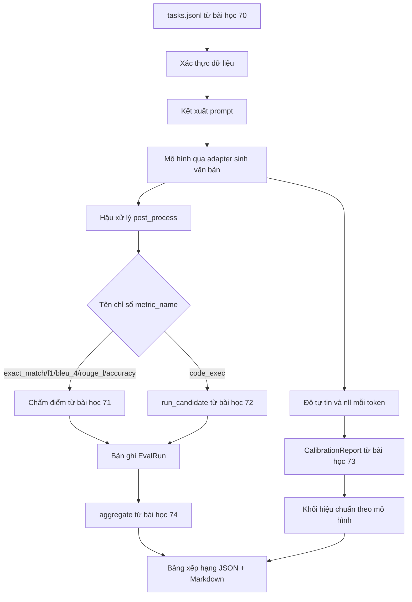

# Bộ Chạy Đánh Giá Đầu-Cuối (End-to-End Eval Runner)

> Năm bài học xây dựng từng đường ống chức năng, một bài học để gắn kết tất cả lại với nhau. Bộ chạy đánh giá sẽ đọc đặc tả tác vụ từ bài học 70, gọi mô hình thông qua bộ điều hợp (adapter), chấm điểm với các chỉ số từ bài học 71 và 72, đính kèm báo cáo hiệu chuẩn từ bài học 73, và xuất bảng xếp hạng từ bài học 74. Bản chạy minh họa tự kết thúc sạch sẽ.

**Type:** Build
**Languages:** Python
**Prerequisites:** Phase 19 Track B foundations, lessons 70 through 74
**Time:** ~90 min

## Mục tiêu học tập (Learning objectives)

- Định nghĩa giao diện `ModelAdapter` để bất kỳ mô hình nào (mô hình giả lập, mô hình cục bộ, hoặc API từ xa) đều có thể đáp ứng với bề mặt phương thức tối giản.
- Vận hành quy trình đánh giá trên tệp dữ liệu mẫu cố định (fixture JSONL) với cơ chế thực thi tác vụ song song trên nhóm luồng worker (worker pool).
- Kết hợp tầng chỉ số đo lường (exact_match, F1, BLEU-4, ROUGE-L, code_exec) với tầng hiệu chuẩn chỉ trong một lượt duyệt duy nhất (single pass).
- Phát ra các bản ghi `EvalRun` cho từng mô hình và truyền trực tiếp vào bộ tổng hợp bảng xếp hạng.
- Xuất đồng thời báo cáo JSON và bảng Markdown; tự kết thúc với mã thoát 0 khi lượt chạy hoàn hảo, hoặc mã thoát khác 0 khi phát sinh lỗi xác thực hay lỗi runtime.

```figure
eval-grid
```

## Đường ống đánh giá (The pipeline)



Bộ chạy đánh giá là điểm tích hợp trung tâm. Mỗi bài học từ 70 đến 74 sở hữu một mô-đun riêng biệt mà bộ chạy sẽ kết hợp lại. Bộ chạy không nhân bản bất kỳ logic nào từ các mô-đun đó: nó trực tiếp nhập khẩu (import) chúng.

## Giao diện bộ điều hợp (The adapter interface)

Bộ điều hợp đóng vai trò là ranh giới tiếp giáp (seam) giữa bộ chạy đánh giá và bất kỳ mô hình nào. Giao diện này được tinh gọn tối đa:

```python
class ModelAdapter:
    model_id: str

    def generate(self, prompt: str, task: TaskSpec) -> Generation: ...
```

`Generation` là một lớp dữ liệu (dataclass) bao gồm:

- `text`: văn bản đầu ra dạng tự do của mô hình.
- `confidence`: số thực trong khoảng `[0, 1]` đại diện cho xác suất tự báo cáo của mô hình đối với câu trả lời.
- `token_nll`: tổng log-likelihood âm tùy chọn trên các token được sinh ra.
- `token_count`: số lượng token được sinh ra tùy chọn.

Các bộ điều hợp giả lập (mock adapters) trong bộ chạy cung cấp ba sắc thái hành vi: `RuleBasedAdapter` (tất định, gần như hoàn hảo), `NoisyAdapter` (tự tin thái quá, thường xuyên trả lời sai), và `BiasedAdapter` (rất giỏi ở một danh mục nhưng tệ ở danh mục khác). Bản chạy minh họa sẽ chạy cả ba bộ điều hợp này trên tập dữ liệu mẫu cố định từ bài học 70.

## Thực thi song song (Parallel execution)

Bộ chạy sử dụng `concurrent.futures.ThreadPoolExecutor` để thực thi song song các tác vụ cho từng mô hình. Số lượng luồng worker mặc định bằng giá trị nhỏ hơn giữa 8 và số lượng tác vụ. Việc dùng luồng (threads) là hoàn toàn thỏa đáng vì điểm nghẽn của các lệnh gọi mô hình thực tế nằm ở thao tác vào/ra mạng (network I/O). Nhánh thực thi mã nguồn (code-exec) sẽ tự khởi tạo tiến trình con bên trong tác vụ, và bộ điều phối luồng chỉ đảm nhận việc chờ đợi tiến trình con đó hoàn thành.

Để phục vụ các bài kiểm thử tất định (deterministic tests), bộ chạy cung cấp hàm `run_eval(adapters, tasks, parallel=False)` giúp bộ kiểm thử có thể ghim chặt thứ tự thực thi tuần tự.

## Vòng lặp chấm điểm một lượt (The single-pass scoring loop)

Đối với mỗi tác vụ:

1. Kết xuất câu nhắc (prompt) hoàn chỉnh (tiền tố few-shot cộng với phần thân câu nhắc).
2. Gọi bộ điều hợp mô hình và bấm giờ lượt gọi.
3. Hậu xử lý văn bản sinh ra theo đúng quy tắc định sẵn của tác vụ.
4. Điều phối đến tầng chỉ số tương ứng.
5. Xây dựng bản ghi `EvalRun` chứa điểm số và siêu dữ liệu chỉ số.
6. Thêm cặp `(confidence, correct)` vào bộ đệm hiệu chuẩn (calibration buffer).

Tín hiệu `correct` được xác định là `score >= 1.0` đối với các chỉ số kiểu so khớp chính xác (`exact_match`, `accuracy`, `code_exec`) và `score >= 0.5` đối với các chỉ số phân cấp theo mức độ. Ngưỡng này được định nghĩa cố định trong `_correct_from_score` và bộ chạy không mở quyền ghi đè tùy tiện từ bên ngoài.

## Tổng hợp kết quả (Aggregation)

Sau khi mọi tác vụ đều đã có kết quả, bộ chạy sẽ gọi các hàm `aggregate` và `pairwise_diffs` từ bài học 74 cùng với `CalibrationReport.from_predictions` từ bài học 73. Kết quả đầu ra được đóng gói trong một phong bì JSON duy nhất:

```json
{
  "leaderboard": [...],
  "pairwise": [...],
  "calibration": {
    "model_id_a": {"ece": 0.04, "brier": 0.10, "populated_bins": 8, ...},
    ...
  },
  "summary": {
    "tasks": 10,
    "models": 3,
    "wall_seconds": 1.2
  }
}
```

Bộ chạy cũng xuất một bảng định dạng Markdown ra luồng stdout để người dùng có thể dán trực tiếp kết quả vào phần đánh giá Pull Request.

## Bản chạy mẫu tự kết thúc (Self-terminating demo)

Bản demo thực thi ba bộ điều hợp giả lập trên mười tác vụ mẫu từ bài học 70. Thời gian chạy thực tế (wall time) duy trì dưới mười giây. Mã thoát là 0 đối với một lượt chạy hoàn toàn sạch sẽ.

Các tiêu chí cho một lượt chạy sạch:

- Mọi tác vụ đều vượt qua bước xác thực theo bài học 70.
- Mọi tác vụ đều được chấm điểm thành công theo bài học 71 và 72.
- Báo cáo hiệu chuẩn được tổng hợp theo bài học 73 mà không phát sinh lỗi.
- Bảng xếp hạng phân định thứ bậc bộ điều hợp dựa trên luật nằm trên bộ điều hợp ngẫu nhiên một cách tuyệt đối.

Nếu bất kỳ điều kiện nào trong số này bị vi phạm, bộ chạy sẽ thoát với mã lỗi khác 0 kèm theo thông điệp lỗi có cấu trúc bên trong phong bì JSON.

## Những điều bài học này không giải quyết (What this lesson does not do)

Bài học này không trực tiếp gọi đến các mô hình thực tế bên ngoài. Nó không triển khai luồng xác thực khóa API (API key) hay cơ chế xử lý giới hạn tần suất (rate-limit handling). Nó không hỗ trợ truyền phát trực tuyến (streaming) hay sinh một phần kết quả; bộ điều hợp trả về toàn bộ văn bản trong một lượt gọi duy nhất. Nó không cài đặt cơ chế thử lại (retry) hay lưu bộ nhớ đệm (caching). Những mối quan tâm đó thuộc trách nhiệm của tầng bộ điều hợp; bản thân bộ chạy đánh giá hoàn toàn độc lập với chỉ số đo lường (metric-agnostic) và độc lập với nhà cung cấp mô hình (provider-agnostic).

## Hướng dẫn đọc mã nguồn (How to read the code)

Tệp `main.py` là trung tâm tích hợp. Nó nhập khẩu mã nguồn từ năm bài học trước thông qua một hàm trợ giúp nhỏ `_load_sibling` có khả năng phân giải đường dẫn tương đối. Các lớp dữ liệu `Generation`, `EvalReport`, và `ModelAdapter` được định nghĩa cục bộ. Các bộ điều hợp giả lập nằm ở cuối tệp.

Hãy đọc `main.py` từ trên xuống dưới. Lướt nhanh qua các lệnh import, sau đó phân tích hàm `run_eval`, tiếp tục đến hàm `_score_one`, và cuối cùng xem xét các bộ điều hợp. Khối mã demo ở cuối tệp là điểm bắt đầu thực thi.

Các bài kiểm thử trong `code/tests/test_runner.py` kiểm định giao diện bộ điều hợp, vòng lặp xử lý một lượt, tính tương đương giữa chạy song song và chạy tuần tự, bộ đệm hiệu chuẩn, và cấu trúc của phong bì JSON.

## Đào sâu mở rộng (Going further)

Bộ chạy này là cấu trúc nền móng. Một hệ thống đánh giá cấp độ sản xuất thực tế sẽ bổ sung thêm: một bộ nhớ đệm kết quả có khóa là bộ ba `(task_id, model_id, model_version)`, một sổ cái chi phí theo dõi lượng tiền mặt và token trên từng phiên chạy, một tầng thử lại có cơ chế lùi thời gian (backoff) khi gặp giới hạn tần suất, một chính sách lấy mẫu phục vụ các tác vụ pass-at-k, và định dạng kết xuất truyền phát trực tuyến cho các bộ bài kiểm tra chạy dài. Mỗi tính năng trên đều là một mối quan tâm riêng biệt có thể bao bọc lấy bộ chạy mà không làm thay đổi các tầng chỉ số hay tầng tổng hợp. Sự phân tách độc lập đó chính là giá trị cốt lõi của bản giao ước thiết kế.

Hãy thêm một bộ điều hợp kết nối đến một nhà cung cấp mô hình thực tế sau khi bạn đã cho các bộ giả lập chạy trơn tru. Hãy chọn một dịch vụ có gói miễn phí, viết khoảng ba mươi dòng mã kết nối, và chứng kiến bảng xếp hạng sáng lên với dữ liệu thực. Sau đó, bổ sung nhà cung cấp thứ hai và để khung điều khiển tự động hoàn tất phần việc còn lại.
