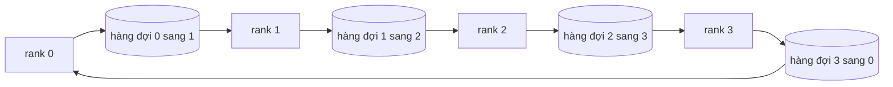

# Các Thao Tác Tập Hợp Từ Đầu (Collective Ops From Scratch)

> Bốn thao tác tập hợp (collective operations) giữ vai trò xương sống kết nối toàn bộ hệ thống huấn luyện phân tán là allreduce, broadcast, allgather và reduce_scatter. Mọi hàm nguyên thủy khác mà một framework huấn luyện cung cấp đều là các lớp bao bọc quanh bốn thao tác này. Hãy tự tay xây dựng chúng trên lưới hàng đợi `multiprocessing.Queue`, đối chiếu xác thực với bản cài đặt tham chiếu, và phần còn lại của lộ trình học sẽ trở nên hoàn toàn sáng tỏ.

**Type:** Build
**Languages:** Python
**Prerequisites:** Phase 19 Track C lessons 42-49
**Time:** ~90 min

## Mục tiêu học tập (Learning Objectives)

- Cài đặt thuật toán ring allreduce qua hai lượt duyệt (reduce-scatter sau đó allgather) và chứng minh toán học rằng khối lượng truyền thông trên mỗi rank là $2(N-1)/N$ byte cho mỗi phần tử.
- Xây dựng các thao tác broadcast, allgather và reduce_scatter dựa trên các lệnh gửi điểm-điểm (point-to-point) thông qua `multiprocessing.Queue`.
- Kiểm chứng tính đúng đắn của từng hàm nguyên thủy so với bản tham chiếu `torch.distributed` sử dụng backend gloo trên cùng dữ liệu đầu vào.
- Biện luận sự lựa chọn giữa cấu trúc vòng (ring) và cấu trúc cây (tree) dựa trên hình thái cụm máy chủ (cluster shape), ngưỡng sàn độ trễ (latency floor), và trần băng thông (bandwidth ceiling).

## Bài toán (The Problem)

Một giải pháp allreduce ngây thơ trên $N$ rank sẽ gửi $N$ lần tensor về một rank gốc (root) và sau đó phát thanh (broadcast) ngược lại $N$ lần. Khi đó, băng thông yêu cầu tăng tuyến tính theo cấp số $O(N)$ trên mỗi rank, rank gốc trở thành điểm nghẽn cổ chai (bottleneck), và thời gian thực tế chạm đáy bằng tích của liên kết mạng chậm nhất nhân với $N$. Thuật toán ring allreduce dàn phẳng quy trình đó thành $2(N-1)$ mảnh nhỏ có kích thước $T/N$, nhờ vậy số lượng byte truyền trên mỗi rank giảm xuống chỉ còn $2T(N-1)/N$. Giá trị này tiệm cận $2T$ khi $N$ tăng lên và không bao giờ vượt quá ngưỡng đó, bất kể quy mô cụm máy tính lớn đến mức nào. Ngược lại, tree allreduce chiếm ưu thế khi số lượng $N$ nhỏ và các đường truyền có độ trễ cao bởi vì độ sâu truyền thông chỉ là $\log_2(N)$ chặng (hops) thay vì $2(N-1)$. Nếu chọn sai tô-pô mạng (topology) cho cấu hình cụm, GPU chậm nhất sẽ áp đặt toàn bộ thời gian của mỗi bước tính toán (step time).

Mọi framework huấn luyện phân tán mà bạn sẽ nghiên cứu trong lộ trình này đều phụ thuộc vào bốn hàm nguyên thủy nói trên. PyTorch DDP đồng bộ hóa gradient thông qua một lệnh allreduce cho từng nhóm tham số (parameter bucket). Kỹ thuật ZeRO phân mảnh trạng thái bộ tối ưu (shards optimizer state) bằng reduce_scatter và truyền phát các tham số đã cập nhật bằng allgather. FSDP biến toàn bộ lượt lan truyền xuôi (forward pass) thành chuỗi thao tác allgather kết hợp reduce_scatter. Kỹ thuật song song đường ống (pipeline parallel) cần broadcast để truyền các giá trị kích hoạt (activations) xuyên qua các nhóm tầng. Nếu bạn không thể tự tay xây dựng bốn thao tác tập hợp này, bạn sẽ không thể suy luận được nguyên nhân vì sao quá trình huấn luyện bị đình trệ (stalls), tại sao hiện tượng lệch gradient lại xuất hiện ở rank 3, hay vì sao bong bóng đường ống (pipeline bubble) lại tăng gấp đôi khi bạn thay đổi tô-pô mạng.

## Khái niệm cốt lõi (The Concept)



### Ring allreduce qua hai lượt duyệt (Ring allreduce in two passes)

Chia tensor thành $N$ mảnh bằng nhau được đánh chỉ số từ $0$ đến $N-1$. Mỗi rank sở hữu mảnh có chỉ số bằng chính thứ hạng (rank) của nó.

Lượt 1, **reduce-scatter**, chạy trong $N-1$ bước. Tại bước $s$, rank $r$ gửi mảnh $(r - s) \pmod N$ tới rank $(r + 1) \pmod N$ và nhận mảnh $(r - s - 1) \pmod N$ từ rank $(r - 1) \pmod N$, tích lũy mảnh nhận được vào bản sao cục bộ của mình. Sau $N-1$ bước, rank $r$ nắm giữ giá trị tổng thu giảm hoàn chỉnh cho mảnh $r$.

Lượt 2, **allgather**, chạy tiếp trong $N-1$ bước khác và xoay vòng các mảnh đã hoàn thiện quanh vòng tròn cho đến khi mọi rank đều nắm giữ giá trị tổng hoàn chỉnh cho tất cả các mảnh.

| Hàm nguyên thủy | Số byte trên mỗi rank | Số bước | Khi nào nên dùng |
|---|---|---|---|
| Ring allreduce | $2T(N-1)/N$ | $2(N-1)$ | $T$ lớn, cụm đồng nhất có băng thông dồi dào |
| Tree allreduce | $T \log_2(N)$ | $2 \log_2(N)$ | $T$ nhỏ hoặc đường truyền có độ trễ mạng cao |
| Broadcast | $T$ | $\log_2(N)$ dạng cây | Khởi tạo tham số, cấu hình đại lượng vô hướng |
| Allgather | $T(N-1)/N$ | $N-1$ | Lan truyền xuôi phân mảnh, ZeRO phục hồi tham số gốc |
| Reduce_scatter | $T(N-1)/N$ | $N-1$ | ZeRO phân mảnh gradient |

### Lưới hàng đợi đóng vai trò thay thế cho NCCL (Queue mesh as a stand-in for NCCL)

NCCL vận hành trên nền tảng PCIe và NVLink với khả năng giảm tải phần cứng cho các phép toán thu giảm. Trên CPU, bạn không có được đặc quyền đó. Một đối tượng `multiprocessing.Queue` cho mỗi cạnh của vòng ring sẽ cung cấp cơ chế phân phối dữ liệu điểm-điểm có thứ tự với một tiến trình sản xuất (producer) và một tiến trình tiêu thụ (consumer) duy nhất. Phép thu giảm diễn ra ở không gian người dùng (user space), do đó phải chịu chi phí phụ trợ của Python, nhưng mô hình luân chuyển dữ liệu trên đường truyền hoàn toàn đồng nhất với ring allreduce của NCCL. Khi bạn hiểu thấu đáo tính đúng đắn trên phiên bản hàng đợi này, hành vi của cụm máy chủ thực tế sẽ tuân theo cùng một nguyên lý.

### Xác thực đối chiếu với Gloo (Verify against gloo)

Mỗi hàm nguyên thủy đều đi kèm một bài kiểm thử đơn vị đối chiếu kết quả của nó với `torch.distributed` được khởi tạo với backend `gloo` trên cùng một tensor và cùng quy mô phân tán (`world_size`). Nếu ring allreduce của bạn lệch so với gloo quá sai số dấu phẩy động `float32 epsilon`, bài kiểm thử sẽ thất bại. Việc xác thực đối chiếu với một bản cài đặt tham chiếu là nguyên tắc bất khả thương lượng; nếu không có bước này, hàm nguyên thủy trông có vẻ đúng đắn cho đến khi sập ở bước thứ 10.000 của một phiên huấn luyện thực thụ.

```figure
ci-ring-allreduce
```

## Các bước triển khai (Build It)

Tệp `code/main.py` hiện thực hóa:

- Lớp `Mesh`: kết nối $N$ thể hiện `multiprocessing.Queue` thành một vòng tròn khép kín và cung cấp giao diện `send(dst, tensor)` cùng `recv(src)` cho từng rank.
- Hàm `ring_allreduce(mesh, rank, world_size, tensor)`: thực thi thuật toán hai lượt duyệt.
- Hàm `broadcast(mesh, rank, world_size, tensor, src)`: truyền thông trên cấu trúc cây logarit.
- Hàm `allgather(mesh, rank, world_size, tensor)`: sử dụng $N-1$ bước xoay vòng.
- Hàm `reduce_scatter(mesh, rank, world_size, tensor)`: nửa đầu của quy trình allreduce.
- Hàm `_gloo_reference(op, world_size, tensor)`: chạy cùng dữ liệu đầu vào qua `torch.distributed` với gloo để so sánh từng byte kết quả.

Chạy mã nguồn:

```bash
python3 code/main.py
```

Đầu ra: bảng xác thực cho từng hàm nguyên thủy so sánh kết quả giữa lưới hàng đợi (queue-mesh) và gloo, kèm theo bộ đếm số byte trên từng rank để minh chứng cho công thức tỷ lệ $2T(N-1)/N$.

## Các mô hình sản xuất trong thực tế (Production patterns in the wild)

Có ba mô hình then chốt giúp gia cố các hàm nguyên thủy để sẵn sàng vận hành trong thực tế:

**Gom cụm gradient trước khi allreduce (Bucket gradients before allreduce).** Một mô hình 1 tỷ tham số có hàng chục nghìn tensor gradient. Nếu thực hiện một lệnh allreduce cho từng tensor riêng lẻ, bạn sẽ phải trả giá bằng ngưỡng sàn độ trễ $N$ lần. DDP gom các gradient thành các khối có dung lượng khoảng 25 MB và phát ra một lệnh allreduce cho mỗi khối; các tensor nhỏ sẽ "đi nhờ" trên lưng các tensor lớn. Nếu không có cơ chế gom cụm này, độ trễ phụ trội sẽ áp đảo hoàn toàn bước tính toán.

**Gối sóng truyền thông và tính toán (Overlap communication with computation).** Quá trình lan truyền ngược (backward pass) tính toán gradient theo từng lớp từ cuối lên đầu. Ngay khi gradient của lớp cuối cùng sẵn sàng, hãy kích hoạt ngay thao tác allreduce cho lớp đó trong khi các lớp tiếp theo vẫn đang tiếp tục tính toán. PyTorch DDP thực hiện điều này bằng các hook kích hoạt khi khối gom cụm sẵn sàng (bucket-ready hooks). Kỹ thuật gối sóng giúp cắt giảm một nửa thời gian truyền thông quan sát được khi mạng lưới có độ dôi dư.

**Lựa chọn ring hay tree theo kích thước thông điệp, không theo cảm tính.** NCCL tích hợp một bộ dò tìm tô-pô mạng tự động chọn ring cho các thông điệp trên ~1 MB và tree cho các thông điệp nhỏ hơn. Điểm giao thoa (crossover) này xuất phát từ sự đánh đổi giữa băng thông và độ trễ: trên 1 MB, thành phần băng thông $2T(N-1)/N$ chiếm ưu thế nên ring chiến thắng; dưới 1 MB, số chặng $\log_2(N)$ nhỏ hơn giúp tree chiến thắng. Việc cố định cứng một loại tô-pô duy nhất sẽ làm giảm thông lượng nghiêm trọng khi kích thước thông điệp không phù hợp.

## Ứng dụng thực tế (Use It)

Các mô hình sản xuất ứng dụng các thao tác này:

- **PyTorch DDP:** Gọi `dist.all_reduce` trên các khối gradient đã được gom cụm sau lượt lan truyền ngược. Kích thước khối gom cụm có thể điều chỉnh; giá trị mặc định 25 MB là tối ưu cho mạng Ethernet 100Gbps.
- **DeepSpeed ZeRO:** Phát lệnh `reduce_scatter` để phân mảnh gradient và `allgather` để tái tạo toàn bộ tham số trước lượt lan truyền xuôi. Các hàm nguyên thủy trong bài học này chính xác là những lệnh mà ZeRO gọi trong thực tế.
- **FSDP:** Lượt lan truyền xuôi bắt đầu bằng `allgather` để phục hồi tham số gốc của lớp (unshard), tính toán, sau đó thu giảm bằng `reduce_scatter` và hủy bỏ các bản sao tham số chưa phân mảnh. Cùng một tập hàm nguyên thủy, nhưng khác biệt ở lịch trình điều phối (schedule).

## Triển khai thành phẩm (Ship It)

Sử dụng các hàm nguyên thủy trên lưới hàng đợi này trong các bài học 77–81:
- Bài học 77 tích hợp `allreduce` vào kiến trúc DDP.
- Bài học 78 kết nối `reduce_scatter` vào cơ chế ZeRO.
- Bài học 79 luân chuyển các giá trị kích hoạt trong pipeline bằng các lệnh gửi và nhận điểm-điểm (`send` và `recv`), không dùng thao tác tập hợp.
- Bài học 81 kết hợp toàn bộ bốn thành phần vào một đồ án mẫu hoàn chỉnh từ đầu đến cuối.

## Bài tập mở rộng (Exercises)

1. Bổ sung biến thể tree allreduce và tạo cơ chế chuyển đổi tự động giữa ring và tree dựa trên kích thước thông điệp. Đo lường điểm giao thoa thực tế.
2. Thêm tham số `recv_timeout_ms` để một rank bị treo sẽ làm nổi lên lỗi quá hạn (deadline error) thay vì làm toàn bộ hệ thống bị treo vô hạn định.
3. Thay thế `multiprocessing.Queue` bằng các kết nối TCP socket cho cả bốn hàm nguyên thủy. Giữ nguyên các bài kiểm thử, chỉ thay đổi phương thức truyền tin thực tế.
4. Bổ sung một điểm móc đo lường băng thông (bandwidth instrumentation hook) để bộ đếm byte trên từng rank ghi dữ liệu vào tệp JSONL.
5. So sánh thời gian thực tế giữa ring và tree trên cụm 4 rank cho các tensor có kích thước 1KB, 1MB, và 16MB. Bảo vệ điểm giao thoa bằng dữ liệu thực nghiệm.

## Thuật ngữ cốt lõi (Key Terms)

| Thuật ngữ | Cách gọi thông thường | Ý nghĩa kỹ thuật chính xác |
|---|---|---|
| Allreduce | "Tính tổng trên các rank" | Sau lệnh gọi, mọi rank đều nắm giữ cùng một tensor đã được thu giảm |
| Ring | "Tô-pô nhanh" | $N-1$ mảnh kích thước $T/N$ luân chuyển quanh vòng tròn hai lần |
| Tree | "Tô-pô logarit" | Quá trình thu giảm diễn ra theo cây nhị phân; độ sâu là $\log_2(N)$ chặng |
| Allgather | "Ghép các mảnh lại" | Mọi rank kết thúc với đầy đủ mảnh dữ liệu của tất cả các rank khác |
| Reduce_scatter | "Chia nhỏ tổng" | Mỗi rank chỉ nắm giữ giá trị tổng thu giảm của duy nhất một mảnh |
| Bucket | "Hợp nhất các tensor nhỏ" | Gom $N$ thao tác allreduce nhỏ thành một thao tác lớn duy nhất |

## Tài liệu đọc thêm (Further Reading)

- [Tài liệu PyTorch Distributed: Các hàm tập hợp NCCL](https://pytorch.org/docs/stable/distributed.html#collective-functions)
- [Bài báo nghiên cứu Horovod ring allreduce](https://arxiv.org/abs/1802.05799)
- [Hướng dẫn lựa chọn tô-pô và thuật toán của NVIDIA NCCL](https://docs.nvidia.com/deeplearning/nccl/user-guide/docs/index.html)
- [Patarasuk và Yuan, Bandwidth optimal allreduce algorithms](https://www.cs.fsu.edu/~xyuan/paper/09jpdc.pdf)
- Phase 10 Bài học 05 — Tổng quan về huấn luyện phân tán
- Phase 19 Bài học 77 — DDP được xây dựng dựa trên các hàm nguyên thủy này
