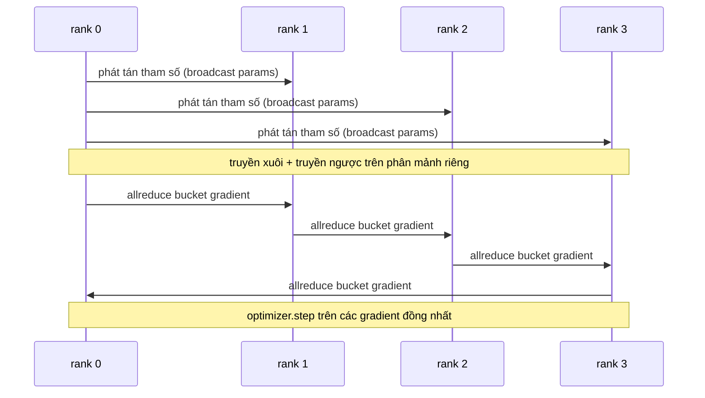

# Xây dựng Song song hóa Dữ liệu (Data Parallel DDP) từ Con số Không

> DistributedDataParallel thực chất là một hook được xây dựng bên trên phép toán gom phân tán (allreduce). Đóng gói mô hình, phát tán (broadcast) các tham số khởi tạo từ rank 0 để mọi tiến trình (rank) bắt đầu ở trạng thái giống hệt nhau, cài đặt một hook lan truyền ngược (backward hook) trên từng tham số để kích hoạt phép allreduce cho gradient, và phần còn lại chỉ là hạ độ dốc (gradient descent). Toàn bộ mô hình thiết kế này gói gọn trong 200 dòng mã.

**Loại:** Xây dựng (Build)
**Ngôn ngữ:** Python
**Yêu cầu tiên quyết:** Phase 19 Chuỗi C các bài học 42-49
**Thời lượng:** ~90 phút

## Mục tiêu Học tập

- Xây dựng một lớp bao bọc (wrapper) theo kiến trúc `DistributedDataParallel` có nhiệm vụ phát tán các tham số khởi tạo và thực hiện allreduce các gradient sau lượt truyền ngược.
- Khởi tạo N tiến trình (rank) CPU bằng `torch.multiprocessing.spawn` qua backend `gloo` với cơ chế thiết lập liên lạc (rendezvous) dựa trên tệp tin.
- Chứng minh tính chuẩn xác của việc đồng bộ hóa gradient bằng cách huấn luyện cùng một mô hình trên cùng một tập dữ liệu theo cách tuần tự và chỉ ra sự tương đương tuyệt đối của tham số ở từng bước (per-step parameter equivalence).
- Luận giải việc sử dụng cơ chế gom nhóm (bucketing / gradient fusion) và chồng lấn (overlap - truyền thông trong khi tính toán lan truyền ngược) như hai thay đổi then chốt biến một hệ thống DDP cơ bản thành DDP cấp độ sản xuất (production).

## Vấn đề

Một mô hình 1 tỷ tham số với 12 GB giá trị kích hoạt (activations) không thể đặt vừa trong một GPU tiêu dùng thông thường. Kể cả khi vừa vặn, quá trình huấn luyện cũng kéo dài nhiều tuần. Song song hóa dữ liệu (data parallel) chia nhỏ batch dữ liệu qua N tiến trình (rank), mỗi rank tính toán lượt truyền xuôi (forward) và truyền ngược (backward) trên phân mảnh (shard) của riêng mình, và ở mỗi bước, gradient của tất cả N rank được cộng tổng lại để cả N bản sao luôn giữ nguyên trạng thái đồng nhất. Gradient tổng này chính là giá trị mà bộ tối ưu hóa (optimizer) dùng để cập nhật bước tiếp theo.

Nếu không đồng bộ hóa gradient, N bản sao sẽ phân kỳ ngay từ bước thứ 2. Mô hình lúc này không còn là "một mô hình duy nhất được huấn luyện trên nhiều dữ liệu hơn", mà trở thành N mô hình riêng biệt ngẫu nhiên có chung trọng số ban đầu. Nếu việc đồng bộ hóa gradient được thực hiện vụng về (gọi một lệnh allreduce riêng cho từng tham số, không chồng lấn, không gom nhóm bucket), mạng truyền thông (network) sẽ trở thành điểm nghẽn cổ chai và các GPU sẽ phải ngừng trệ để chờ đường truyền. Nghệ thuật của DDP nằm ở việc biến chi phí đồng bộ hóa gradient trở nên gần như bằng không so với thời gian tính toán. Thư viện PyTorch DDP chuẩn mực đạt được điều đó bằng cách gom các gradient thành từng bucket, chồng lấn thao tác allreduce với lượt truyền ngược của lớp tiếp theo, và sử dụng NCCL trên đường truyền NVLink. Chúng ta hoàn toàn có thể thực hiện cả ba kỹ thuật này trên CPU với backend `gloo` và thu được những bài học sâu sắc tương đương.

## Khái niệm



### Ba phép toán tập thể (collectives) mà DDP cần

| Giai đoạn | Thao tác tập thể (Collective) | Lý do |
|-----------|-------------------------------|-------|
| Khởi tạo (Init) | Phát tán (broadcast) từ rank 0 | Mọi rank bắt đầu với bộ tham số hoàn toàn giống nhau |
| Sau lan truyền ngược (After backward) | Gom phân tán (allreduce) trên từng gradient | Gradient trung bình là giá trị mà bộ tối ưu hóa cập nhật bước |
| Đôi khi (Sometimes) | Phát tán (broadcast) các bộ đệm (buffers) | Giữ cho các số liệu thống kê luân chuyển (running stats) của Batchnorm luôn đồng bộ |

### Tại sao lại dùng trung bình thay vì tổng

Phép allreduce-SUM chia cho `world_size` sẽ cho ra gradient trung bình (mean gradient). Giá trị trung bình này có tính bất biến đối với `world_size`: tốc độ học (learning rate) được tinh chỉnh ở cấu hình 1 rank vẫn hoạt động hoàn hảo ở cấu hình 4 rank vì độ lớn của gradient trên mỗi bước không bị thay đổi. Nếu chỉ dùng allreduce-SUM mà không chia trung bình, bạn sẽ buộc phải tinh chỉnh lại tốc độ học mỗi khi thay đổi quy mô cụm tính toán. DDP bọc thao tác SUM và thực hiện phép chia; chúng ta cũng làm chính xác như vậy trong bài học này.

### Tại sao cần gom nhóm gradient (bucketing)

Một mô hình transformer sở hữu hàng nghìn tensor tham số. Nếu thực hiện một lệnh allreduce riêng biệt cho từng tensor, bạn sẽ phải chịu độ trễ sàn (latency floor) của backend gloo hàng nghìn lần. DDP gom các gradient thành các nhóm (bucket) có kích thước khoảng ~25 MB và chỉ phát đi một lệnh allreduce cho mỗi bucket. Cùng một lượng byte dữ liệu truyền qua cáp mạng, nhưng độ trễ được khấu hao trên toàn bộ khối lượng bucket. Đối với mô hình kích thước nhỏ trong bài học, chúng ta gom toàn bộ gradient vào một bucket duy nhất; cấu trúc kiến trúc này chính là thứ sẽ được ứng dụng cho quy mô lớn.

### Tại sao cần cố định hạt giống (seed) cẩn trọng

Mỗi rank phải gọi `torch.manual_seed(seed + rank)` cho việc xáo trộn dữ liệu (shuffling) nhưng lại phải gọi `torch.manual_seed(seed)` khi khởi tạo tham số. Việc dùng chung một hạt giống cho xáo trộn dữ liệu sẽ khiến mọi rank xử lý cùng một thứ tự batch (làm mất đi bản chất của song song hóa dữ liệu). Đối với các tham số, lệnh phát tán (broadcast) từ rank 0 khi khởi tạo chính là yếu tố làm cho các bản sao trở nên giống hệt nhau, và nó sẽ ghi đè lên bất kỳ giá trị nào mà mỗi rank tự khởi tạo ban đầu. Hạt giống khởi tạo dùng chung đóng vai trò dự phòng: nếu lệnh phát tán bị bỏ qua hoặc bị lỗi, việc khởi tạo riêng theo từng rank sẽ khiến mỗi bản sao mang trọng số ban đầu khác nhau, và việc đồng bộ hóa gradient đơn thuần sẽ không bao giờ kéo chúng hội tụ lại được. Hãy thiết lập mẫu seed thật chuẩn xác, nếu không bài kiểm thử tính tương đương của tham số sẽ thất bại ngay từ bước đầu tiên.

````figure ci-ddp-grad-sync
````

## Xây dựng Thực tế

Mã nguồn `code/main.py` cài đặt:

- `MiniMLP`: một mạng MLP 3 tầng đủ nhỏ để hội tụ trong vài giây, nhưng đủ phức tạp để làm nổi bật các mối nối kết nối phân tán.
- `DistributedDataParallel(model, world_size)`: phát tán các tham số tại thời điểm khởi tạo, trả về một wrapper có hàm `sync_grads` chia các gradient đã gom tích lũy bằng allreduce-sum cho `world_size`.
- `worker(rank, world_size, ...)`: vòng lặp huấn luyện hoàn chỉnh với việc khởi tạo `torch.distributed` trên backend gloo, thực hiện truyền xuôi, truyền ngược, đồng bộ hóa và bước tối ưu.
- `_reference_single_process_loop(...)`: huấn luyện cùng một mô hình trên cùng tập dữ liệu một cách tuần tự trên 1 rank, được kiểm thử sử dụng để so sánh sự tương đương tuyệt đối tới từng byte của tham số sau mỗi bước.

Chạy thử nghiệm:

```bash
python3 code/main.py
```

Kết quả đầu ra: một bảng huấn luyện theo từng bước so sánh hàm mất mát (loss) và mã kiểm tra tổng (checksum) tham số của tiến trình đơn với quá trình chạy DDP trên 4 rank. Hai luồng thực thi tạo ra các đường cong suy giảm hàm mất mát giống hệt nhau tới mức sai số float epsilon, chứng minh rằng cơ chế đồng bộ hóa gradient hoàn toàn chính xác.

## Các mẫu hình sản xuất trong thực tế

Có ba mẫu hình giúp hoàn thiện DDP đạt chuẩn sẵn sàng cho môi trường sản xuất (production).

**Tìm kiếm tham số không sử dụng (find unused parameters).** Một số nhánh tính toán truyền xuôi có thể bỏ qua tham số theo điều kiện (rẽ nhánh sớm - early exit, bộ định tuyến chuyên gia - mixture-of-experts router). Các tham số bị bỏ qua sẽ không có gradient, nhưng hook sẵn sàng của bucket trong DDP vẫn tiếp tục chờ chúng, dẫn tới tình trạng bế tắc (deadlock) trong allreduce. Tùy chọn `find_unused_parameters=True` hướng dẫn DDP kiểm tra xem những tham số nào thực sự nhận được gradient trước khi tiến hành gom nhóm. Chi phí của việc này là phải duyệt đồ thị tính toán ở mỗi bước, vì vậy hãy tắt nó trừ khi luồng truyền xuôi của bạn có rẽ nhánh động.

**Tối ưu hóa đồ thị tĩnh (static graph optimisation).** Khi đồ thị truyền xuôi ổn định qua các bước, thiết lập `static_graph=True` cho phép DDP tính toán trước lịch trình gom nhóm bucket. Kỹ thuật tối ưu này rất có ý nghĩa ở quy mô lớn: việc tính trước giúp tiết kiệm vài mili-giây trên mỗi bước, một con số tích lũy đáng kể qua 10.000 bước huấn luyện.

**Tích lũy gradient (gradient accumulation) cần sự cẩn trọng.** Việc tích lũy gradient qua K vi-batch (microbatches) mà không đồng bộ hóa ở từng vi-batch mang lại mức tăng thông lượng lên tới 10 lần. DDP cung cấp trình quản lý ngữ cảnh `no_sync()` để tạm dừng thao tác allreduce sau lượt truyền ngược. Nếu quên sử dụng context manager này, bạn sẽ thực hiện allreduce K lần vô ích; thông lượng huấn luyện sẽ tụt giảm nghiêm trọng.

## Sử dụng trong Thực tế

Các mẫu hình trong sản xuất:

- **PyTorch DDP.** Triển khai chuẩn mực trong ngành. Lớp `torch.nn.parallel.DistributedDataParallel(model)` tích hợp sẵn cơ chế gom nhóm (bucketing), chồng lấn (overlap) và ngữ cảnh `no_sync`.
- **HuggingFace Accelerate.** Bổ sung thêm trình khởi chạy (launcher) xử lý các biến môi trường của `torchrun` và việc đóng gói mô hình. Bản chất bên dưới vẫn là DDP.
- **Megatron-LM data parallel.** Kết hợp DDP với song song hóa tensor (tensor parallel) cho các mô hình lớn; phần song song hóa dữ liệu vẫn tuân theo đúng khuôn mẫu allreduce-sau-truyền-ngược này.

## Triển khai Mở rộng

Bài học 78 (ZeRO sharding) thay thế phép allreduce trên từng tham số bằng phép gom-phân-mảnh (reduce_scatter) để mỗi rank chỉ cần lưu trữ phân mảnh trạng thái bộ tối ưu hóa của riêng mình. Bài học 81 sẽ tích hợp DDP cùng với ZeRO vào một bản trình diễn hoàn chỉnh từ đầu đến cuối.

## Bài tập Thực hành

1. Bổ sung các bucket gradient có kích thước cấu hình được và đo đạc mức tăng tốc độ so với phương thức gọi một lệnh allreduce cho từng tham số trên một mô hình sâu hơn.
2. Cài đặt `no_sync()` dưới dạng một context manager và xác minh rằng việc tích lũy gradient khớp hoàn toàn với đường cơ sở (baseline) đơn tiến trình qua K vi-batch.
3. Thêm chế độ `find_unused_parameters` trong đó lượt truyền xuôi thỉnh thoảng bỏ qua một tầng của MLP; nếu không có cờ này, quá trình chạy sẽ phải gặp lỗi deadlock.
4. Thay thế gloo bằng cơ chế đồng bộ hóa thuần túy chỉ dùng `torch.distributed.barrier()` để cảm nhận sự khác biệt căn bản giữa đồng bộ hóa dựa trên allreduce và đồng bộ hóa dựa trên rào chắn (barrier).
5. Đo đạc chi phí phụ trội (overhead) của việc đồng bộ hóa gradient theo tỷ lệ phần trăm thời gian của một bước với kích thước batch là 1, 16, 256 và giải thích quy luật mở rộng (scaling).

## Thuật ngữ Then chốt

| Thuật ngữ | Cách gọi thông thường | Ý nghĩa bản chất |
|-----------|----------------------|------------------|
| DDP | "Song song hóa dữ liệu" | Wrapper thực hiện phát tán tham số và allreduce gradient ở mỗi bước |
| Bucket | "Hợp nhất gradient" | Gom N lệnh allreduce nhỏ thành một lệnh allreduce kích thước lớn |
| Overlap | "Ẩn giấu truyền thông" | Phát lệnh allreduce trong khi các tầng tiếp theo vẫn đang tính toán lan truyền ngược |
| no_sync | "Tích lũy gradient" | Bỏ qua thao tác allreduce sau lan truyền ngược để phục vụ tích lũy gradient |
| find_unused | "Truyền xuôi phân nhánh" | Phát hiện các tham số không có gradient trước khi thực hiện gom phân tán |

## Tài liệu Đọc thêm

- [Tài liệu chính thức PyTorch DistributedDataParallel](https://pytorch.org/docs/stable/generated/torch.nn.parallel.DistributedDataParallel.html)
- [Hướng dẫn chuyên sâu kiến trúc nội bộ PyTorch DDP](https://pytorch.org/tutorials/intermediate/ddp_tutorial.html)
- [Li et al., PyTorch Distributed: Experiences on Accelerating Data Parallel Training](https://arxiv.org/abs/2006.15704)
- Phase 19 Bài học 76 - Các thao tác truyền thông tập thể (collectives) nền tảng của DDP
- Phase 19 Bài học 78 - Kỹ thuật phân mảnh ZeRO thay thế allreduce trên từng tham số bằng reduce_scatter
