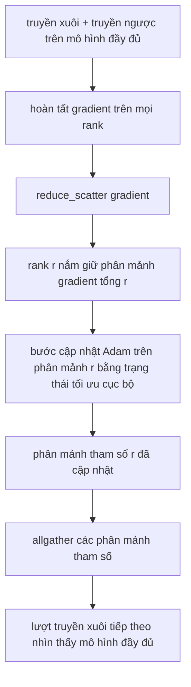

# Phân mảnh Trạng thái Bộ tối ưu hóa với ZeRO

> Adam lưu trữ hai ước lượng mô-men (moment estimates) cho mỗi tham số, cả hai đều ở định dạng float32. Một mô hình 7 tỷ tham số (7B) sẽ chiếm dụng tới 56 GB bộ nhớ chỉ cho trạng thái bộ tối ưu hóa (optimiser state). ZeRO giai đoạn 1 (ZeRO stage 1) thực hiện phân mảnh (shard) lượng trạng thái đó qua N tiến trình (rank); mỗi rank chỉ nắm giữ 1/N trạng thái bộ tối ưu hóa. Sau bước cập nhật cục bộ, các phân mảnh tham số đã cập nhật được phát tán ngược lại qua thao tác allgather, mọi rank tái tạo lại mô hình đầy đủ và bước tiếp theo bắt đầu. Lợi ích đạt được là sự cắt giảm bộ nhớ tuyến tính trên khoản phân bổ bộ nhớ đơn lẻ lớn nhất trong toàn bộ ngăn xếp huấn luyện.

**Loại:** Xây dựng (Build)
**Ngôn ngữ:** Python
**Yêu cầu tiên quyết:** Phase 19 Chuỗi C các bài học 42-49
**Thời lượng:** ~90 phút

## Mục tiêu Học tập

- Phân mảnh trạng thái bộ tối ưu hóa (mô-men bậc một, mô-men bậc hai, bản sao chính fp32) qua N rank để mỗi rank chỉ quản lý 1/N.
- Sử dụng phép toán gom-phân-mảnh (reduce_scatter) để chỉ chuyển tới mỗi rank phần tổng gradient thuộc phân mảnh của nó, sau đó dùng phép gom-tất-cả (allgather) để phát tán các phân mảnh tham số đã cập nhật trở lại.
- Tính toán bảng tiết kiệm bộ nhớ cho ZeRO giai đoạn 1, giai đoạn 2, giai đoạn 3 so với DDP truyền thống.
- Luận chứng việc lựa chọn giữa Stage 1, Stage 2 và Stage 3 dựa trên quy mô mô hình và ngân sách băng thông truyền thông.

## Vấn đề

DDP thuần túy (vanilla DDP) sao chép nguyên vẹn mọi thứ: tham số, gradient và trạng thái bộ tối ưu hóa đều tồn tại đầy đủ trên từng rank. Đối với một mô hình 7 tỷ tham số (7B) ở định dạng fp16, điều đó có nghĩa là mỗi rank phải gánh 14 GB tham số, 14 GB gradient và 56 GB trạng thái bộ tối ưu hóa (hai mô-men float32 của Adam). Huấn luyện độ chính xác hỗn hợp (mixed-precision training) còn cộng thêm một bản sao chính (master copy) float32 nặng 28 GB của các trọng số. Trạng thái bộ tối ưu hóa chính là thành phần chiếm dụng bộ nhớ lớn nhất và cũng là thành phần dễ phân mảnh nhất vì nó chỉ được can thiệp trong bước cập nhật (step), hoàn toàn không tham gia vào lượt truyền xuôi hay truyền ngược.

ZeRO giai đoạn 1 phân mảnh trạng thái bộ tối ưu hóa. Mỗi rank chỉ lưu giữ 1/N các mô-men của Adam. Sau lượt truyền ngược, thay vì allreduce toàn bộ gradient rồi thực hiện cập nhật cục bộ trên mọi rank, ZeRO sử dụng `reduce_scatter` để mỗi rank chỉ nhận về gradient tổng của riêng phân mảnh mà nó quản lý. Rank đó áp dụng bước tối ưu hóa Adam lên phân mảnh tham số chính của mình. Các phân mảnh tham số sau khi cập nhật sẽ được `allgather` lại với nhau để mọi rank đều có được mô hình đầy đủ sẵn sàng cho lượt truyền xuôi kế tiếp. Bộ nhớ dành cho bộ tối ưu hóa giảm đi N lần. Lưu lượng truyền thông trên dây mạng ở mỗi bước hoàn toàn tương đương với DDP: một phép `reduce_scatter` cộng với một phép `allgather` có tổng băng thông đúng bằng một phép `allreduce`. Bộ nhớ được giải phóng ngoạn mục trong khi thông lượng vẫn giữ vững.

## Khái niệm



### Các giai đoạn của ZeRO

| Giai đoạn (Stage) | Thành phần được phân mảnh | Bộ nhớ trên mỗi rank | Truyền thông mỗi bước |
|-------------------|--------------------------|----------------------|-----------------------|
| DDP | Không phân mảnh | params + grads + optim | 1x allreduce |
| ZeRO-1 | Trạng thái bộ tối ưu hóa | params + grads + optim/N | 1x reduce_scatter + 1x allgather |
| ZeRO-2 | optim + grads | params + grads/N + optim/N | 1x reduce_scatter + 1x allgather |
| ZeRO-3 | optim + grads + params | params/N + grads/N + optim/N | 1x allgather mỗi tầng + 1x reduce_scatter mỗi tầng |

Stage 1 là giải pháp tiết kiệm kinh tế nhất vì trạng thái bộ tối ưu hóa chiếm phần lớn ngân sách bộ nhớ. Stage 2 đòi hỏi thêm logic tích lũy phân mảnh gradient nhưng băng thông truyền thông vẫn giữ nguyên. Stage 3 (FSDP) phải trả chi phí truyền thông trên từng tầng cho mỗi lượt truyền xuôi và truyền ngược, đổi lại việc giảm thiểu bộ nhớ lưu trữ phân mảnh tham số. Bài học này tập trung hiện thực hóa toàn diện Stage 1.

### Toán học bộ nhớ qua số liệu thực tế

Đối với một mô hình có P tham số được huấn luyện bằng Adam ở độ chính xác hỗn hợp:

| Thành phần | DDP thuần | ZeRO-1 | Lý do |
|------------|-----------|--------|-------|
| Tham số fp16 | 2P byte | 2P byte | Cần thiết cho lượt truyền xuôi |
| Gradient fp16 | 2P byte | 2P byte | Cần thiết cho lượt truyền ngược |
| Bản sao chính fp32 | 4P byte | 4P/N byte | Chỉ bộ tối ưu hóa sử dụng |
| Mô-men thứ nhất fp32 | 4P byte | 4P/N byte | Chỉ bộ tối ưu hóa sử dụng |
| Mô-men thứ hai fp32 | 4P byte | 4P/N byte | Chỉ bộ tối ưu hóa sử dụng |
| Tổng cộng | 16P byte | 4P + 12P/N byte | |

Với N=8: DDP thuần tốn 16P, ZeRO-1 chỉ tốn 5.5P, giảm tới 65%. Với N=64: DDP thuần tốn 16P, ZeRO-1 tốn 4.19P, giảm tới 74%.

### Tại sao reduce_scatter vượt trội hơn allreduce-rồi-cắt-phân-mảnh

Allreduce cung cấp cho mọi rank toàn bộ gradient đã được tính tổng. Nếu bạn chỉ cần phân mảnh r, thì lượng (N-1)/N gradient được tính tổng còn lại hoàn toàn bị lãng phí trên rank r. Phép `reduce_scatter` chuyển giao chính xác phân mảnh mà mỗi rank sở hữu; số byte dữ liệu trên mỗi rank tương đương với allreduce (vì bản chất allreduce gồm reduce_scatter kết hợp allgather), nhưng nửa chặng sau được thay thế bằng lệnh `allgather` cho phân mảnh tham số ở bước kế tiếp. Băng thông mạng ròng hoàn toàn tương đương DDP, nhưng bộ nhớ lưu trữ được chia nhỏ hiệu quả.

````figure cd-zero-shard
````

## Xây dựng Thực tế

Mã nguồn `code/main.py` cài đặt:

- `flatten_params(module)` và `unflatten_into(module, flat)`: đóng gói các tham số của mô hình vào một tensor liền kề (contiguous tensor) duy nhất và giải nén ngược lại. Bố cục phẳng này giúp việc phân mảnh theo từng rank trở thành một thao tác cắt lát (slice) mảng đơn giản.
- `ZeroOptimizer(model, world_size, rank, lr)`: chịu trách nhiệm quản lý phân mảnh của rank đối với bản sao chính và các mô-men của Adam.
- `step()`: thực thi `reduce_scatter` trên tensor gradient phẳng, áp dụng thuật toán Adam lên phân mảnh của rank, và gọi `allgather` để thu thập lại các tham số đã cập nhật.
- Một kịch bản minh họa huấn luyện mạng MLP 3 tầng trong 20 bước và in bảng ngân sách bộ nhớ theo từng bước đối chiếu với đường cơ sở DDP thuần túy.

Chạy thử nghiệm:

```bash
python3 code/main.py
```

Kết quả đầu ra: hàm mất mát (loss) theo từng bước và bảng phân bổ bộ nhớ chứng minh ZeRO-1 chỉ lưu 1/N trạng thái bộ tối ưu hóa trên mỗi rank so với toàn bộ bản sao trong DDP.

## Các mẫu hình sản xuất trong thực tế

Ba mẫu hình giúp hoàn thiện ZeRO để sẵn sàng triển khai trên thực tế:

**Lưu checkpoint phân mảnh (sharded checkpointing) là yếu tố sống còn.** Trạng thái bộ tối ưu hóa của ZeRO-1 bị phân tán qua nhiều rank; tệp checkpoint bắt buộc phải ghi lại rõ ràng rank nào sở hữu phần nào. Bài học 80 xây dựng tệp kê khai (manifest) checkpoint phân mảnh để khôi phục tiến trình ZeRO trên cùng số lượng rank. Nếu thiếu tệp này, trạng thái đã lưu sẽ không thể giải mã lại khi khởi động lại tiến trình.

**Bản chất cốt lõi nằm ở độ chính xác hỗn hợp (mixed precision).** ZeRO là một kỹ thuật phục vụ mixed-precision; bản sao chính fp32 chính là đối tượng được phân mảnh. Chạy ZeRO mà không dùng độ chính xác hỗn hợp sẽ phải trả chi phí bộ nhớ cho bản sao chính fp32 mà không thu được lợi ích tiết kiệm bộ nhớ từ lượt truyền xuôi fp16. Các hệ thống sản xuất luôn kết hợp ZeRO với `torch.autocast` hoặc trọng số định dạng bfloat16.

**Stage 1 là giải pháp tiết kiệm gần như miễn phí.** Băng thông truyền thông hoàn toàn tương đương với DDP. Lợi ích tiết kiệm bộ nhớ tỉ lệ thuận tuyến tính với N. Chi phí duy nhất là phần quản lý sổ sách (bookkeeping) cho phân mảnh của bộ tối ưu hóa. Các ngăn xếp sản xuất thường mặc định chọn Stage 1 trừ khi bộ nhớ của gradient hoặc tham số cũng chạm ngưỡng giới hạn. Stage 2 phân mảnh thêm gradient mà không tốn thêm băng thông; chỉ có Stage 3 mới phân mảnh chính các tham số và phải đánh đổi chi phí truyền thông trên từng tầng để đổi lấy khoản bộ nhớ đó.

## Sử dụng trong Thực tế

Các mô hình triển khai thực tế:

- **DeepSpeed ZeRO.** Triển khai gốc tham chiếu. Cấu hình `deepspeed_config.json` lựa chọn stage 1/2/3 và kích thước phân vùng (partition size).
- **PyTorch FSDP.** Bản tương đương tích hợp sẵn của PyTorch. `ShardingStrategy.SHARD_GRAD_OP` tương ứng với ZeRO-2; `FULL_SHARD` tương ứng với ZeRO-3.
- **HuggingFace Accelerate.** Đóng gói cả DeepSpeed lẫn FSDP dưới một giao diện cấu hình thống nhất.

## Triển khai Mở rộng

Bài học 79 (song song hóa đường ống - pipeline parallel) là một trục phân mảnh trực giao: thay vì phân mảnh trạng thái bộ tối ưu hóa trên cùng một mô hình, pipeline parallel phân mảnh các tầng (layers) của mô hình qua các rank. Bài học 81 sẽ tổng hợp DDP + ZeRO vào một bản trình diễn hoàn chỉnh từ đầu đến cuối.

## Bài tập Thực hành

1. Mở rộng lên ZeRO-2 bằng cách phân mảnh gradient: mỗi rank chỉ lưu gradient cho phân mảnh của riêng nó, thực hiện bằng cách gán 0 cho phần không thuộc phân mảnh sau lượt truyền ngược.
2. Thêm một bộ đo biên dạng bộ nhớ (memory profiler) in ra mức sử dụng byte fp32 thực tế trên rank 0 so với dự đoán của công thức toán học.
3. Đo thời gian đồng hồ thực tế (wall-clock time) trên từng bước của DDP thuần so với ZeRO-1 và phân rã thành các giai đoạn: truyền xuôi, truyền ngược, truyền thông.
4. Triển khai kỹ thuật cắt tỉa gradient (gradient clipping) trong ZeRO-1: chuẩn L2 norm phải được tính toán trên toàn bộ các phân mảnh thông qua phép allreduce tổng bình phương chuẩn cục bộ.
5. Hiện thực một phiên bản "ZeRO ngây thơ" dùng allreduce thay cho reduce_scatter, đo đạc chênh lệch thời gian trên đường truyền mạng. Luận giải sự lựa chọn reduce_scatter bằng các con số định lượng cụ thể.

## Thuật ngữ Then chốt

| Thuật ngữ | Cách gọi thông thường | Ý nghĩa bản chất |
|-----------|----------------------|------------------|
| ZeRO-1 | "Phân mảnh bộ tối ưu hóa" | Mỗi rank nắm giữ 1/N bản sao chính fp32 + các mô-men của Adam |
| ZeRO-2 | "Phân mảnh cả gradient" | Mỗi rank loại bỏ thêm các gradient không thuộc phân mảnh sau reduce_scatter |
| ZeRO-3 | "Phân mảnh tham số" | Mỗi rank giữ 1/N tham số fp16; allgather trên từng tầng trong lượt truyền xuôi |
| Master copy | "Trọng số fp32" | Bản sao tham số độ chính xác cao mà bộ tối ưu hóa dùng để cập nhật |
| Reduce_scatter | "Chia nhỏ tổng" | Chỉ phân phát tới mỗi rank phần gradient tổng thuộc phân mảnh của rank đó |

## Tài liệu Đọc thêm

- [Rajbhandari et al., ZeRO: Memory Optimizations Toward Training Trillion Parameter Models](https://arxiv.org/abs/1910.02054)
- [Tài liệu hướng dẫn DeepSpeed ZeRO](https://www.deepspeed.ai/tutorials/zero/)
- [Tài liệu chính thức PyTorch FSDP](https://pytorch.org/docs/stable/fsdp.html)
- Phase 19 Bài học 76 - Các phép toán reduce_scatter và allgather làm nền móng cho bài học này
- Phase 19 Bài học 80 - Cơ chế checkpoint phân mảnh bắt buộc dùng cho trạng thái ZeRO
