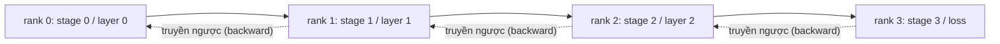

# Song song hóa Đường ống và Phân tích Bong bóng Trễ

> Song song hóa tensor (tensor parallelism) chia nhỏ phép nhân ma trận qua các rank. Song song hóa đường ống (pipeline parallelism) chia mô hình theo chiều sâu qua các rank, mỗi rank đảm nhận một chặng (stage). Các vi-batch (microbatches) luân chuyển tuần tự qua đường ống. Khoảng thời gian chết ở giai đoạn bắt đầu và kết thúc được gọi là bong bóng trễ (bubble); việc cực tiểu hóa bong bóng này chính là nghệ thuật cốt lõi của kỹ thuật đường ống.

**Loại:** Xây dựng (Build)
**Ngôn ngữ:** Python
**Yêu cầu tiên quyết:** Phase 19 Chuỗi C các bài học 42-49
**Thời lượng:** ~90 phút

## Mục tiêu Học tập

- Phân chia một mô hình tuần tự thành N chặng (stages) và mô phỏng một đường ống truyền xuôi qua N tiến trình (ranks).
- Lập lịch điều phối M vi-batch (microbatches) đi qua đường ống theo lịch trình GPipe (lấp đầy toàn bộ lượt truyền xuôi rồi mới thực hiện truyền ngược) và tính toán tỷ lệ bong bóng trễ (bubble fraction).
- So sánh tỷ lệ bong bóng trễ với lịch trình xen kẽ 1F1B (One Forward, One Backward) được sử dụng trong Megatron-LM và PipeDream.
- Luận giải việc phân bổ chặng: cân bằng lượng tính toán (compute) trên mỗi chặng quan trọng hơn nhiều so với việc cân bằng số lượng tham số trên mỗi chặng.

## Vấn đề

Một mô hình 70 tỷ tham số (70B) ở định dạng fp16 chỉ riêng tham số đã ngốn tới 140 GB bộ nhớ. Không có GPU tiêu dùng cá nhân nào có thể chứa nổi. Kỹ thuật ZeRO-3 phân mảnh tham số qua các rank nhưng vẫn đòi hỏi mỗi rank phải gọi allgather toàn bộ tầng cho mỗi bước truyền xuôi, phải trả chi phí $\log(N)$ bước nhảy truyền thông trên từng tầng. Song song hóa đường ống (pipeline parallel) đi theo một hướng hoàn toàn khác: cắt mô hình thành N chặng (stages) và đặt mỗi chặng lên một rank riêng biệt. Lượt truyền xuôi của tầng 1 hoàn tất trên rank 0 và trao tensor kích hoạt (activation) sang cho rank 1; rank 1 chạy tiếp tầng 2 và chuyển sang cho rank 2; và cứ thế tiếp diễn. Lượt truyền ngược (backward) sẽ chảy theo chiều ngược lại. Bộ nhớ giảm đi một cách tuyến tính vì mỗi rank chỉ lưu giữ một chặng; tuy nhiên việc tính toán bị tuần tự hóa, và đó chính là bài toán bong bóng trễ (bubble problem).

Bong bóng trễ là khoảng thời gian nhàn rỗi (idle time) ở giai đoạn khởi đầu của đường ống (khi các chặng sau phải chờ vi-batch đầu tiên đến được chặng cuối cùng) và ở giai đoạn kết thúc (khi các chặng đầu phải chờ vi-batch cuối cùng hoàn tất xả truyền ngược về). Với M vi-batch và N chặng đường ống, tỷ lệ bong bóng trễ trên mỗi chặng được tính theo công thức $(N-1)/(M+N-1)$. Với $M=8, N=4$, tỷ lệ này là 27%. Nhưng với $M=64, N=4$, nó giảm xuống chỉ còn 4.5%. Bong bóng trễ sẽ co nhỏ lại khi bạn có nhiều vi-batch trên mỗi bước huấn luyện, điều này đồng nghĩa với việc kích thước của mỗi vi-batch phải nhỏ — đây chính là ràng buộc then chốt chi phối việc thiết kế kích thước vi-batch.

## Khái niệm



### Lịch trình GPipe

Lấp đầy đường ống theo chiều truyền xuôi với toàn bộ M vi-batch trước khi bắt đầu bất kỳ lượt truyền ngược nào; sau đó xả ngược lại theo chiều lan truyền ngược. Các giá trị kích hoạt từ mọi vi-batch bắt buộc phải được giữ lại trong bộ nhớ cho đến khi lượt truyền ngược của chính nó diễn ra, do đó mức tiêu thụ bộ nhớ tăng tuyến tính theo M. Lượt truyền xuôi tốn $M+N-1$ chu kỳ, lượt truyền ngược tốn thêm $M+N-1$ chu kỳ nữa. Lượng công việc hữu ích trên mỗi chặng là $2M$ chu kỳ; thời gian bong bóng chết trên mỗi chặng là $2(N-1)$ chu kỳ. Tỷ lệ bong bóng trễ là $(N-1)/(M+N-1)$ khi mỗi lượt truyền xuôi và truyền ngược đều tốn đúng 1 đơn vị thời gian. Chọn $M$ lớn hơn $N$ rất nhiều là chìa khóa để ẩn giấu bong bóng trễ.

### Lịch trình 1F1B

Cơ chế xen kẽ: ngay khi lượt truyền xuôi của một vi-batch chạm tới chặng cuối cùng, chặng đó lập tức bắt đầu lượt truyền ngược của vi-batch đó và cho nó truyền ngược dần về trước. Lịch trình này luân phiên một lượt truyền xuôi và một lượt truyền ngược trên mỗi chặng (1 Forward, 1 Backward). Tỷ lệ bong bóng trễ vẫn là $(N-1)$, nhưng bộ nhớ lưu trữ giá trị kích hoạt bị chặn lại bởi độ sâu của đường ống chứ không phụ thuộc vào tổng số lượng vi-batch. Các hệ thống đường ống trong sản xuất thực tế đều dùng 1F1B (Megatron-LM, PipeDream). Bài học này cài đặt GPipe trước tiên vì tính trực quan dễ hiểu, và để dành 1F1B như một bài tập thực hành nâng cao.

### Tại sao cân bằng tính toán trên mỗi chặng lại quan trọng

Nếu chặng 0 mất 50 ms nhưng chặng 1 mất tới 100 ms, thì mọi chu kỳ trong đường ống đều bị tắc nghẽn ở chặng 1. Các chặng khác sẽ phải ngồi rảnh rỗi 50 ms trong mỗi chu kỳ để chờ chặng 1 giải phóng dữ liệu. Chia đều số lượng tham số là một hướng tiếp cận sai lầm: khối lượng tính toán của một transformer chủ yếu bị chi phối bởi cơ chế chú ý (attention) kết hợp với MLP ở từng tầng, trong khi các tầng nhúng từ (embedding layers) chứa rất nhiều tham số nhưng lại đòi hỏi rất ít phép tính. Việc phân bổ chặng phải hướng tới việc cân bằng số phép tính dấu phẩy động (FLOPs) trên mỗi chặng, chứ không phải cân bằng trọng số giữa các chặng.

### Vi-batch (microbatch) so với batch tổng

Một đường ống xử lý M vi-batch, mỗi vi-batch có kích thước là B. Kích thước batch hiệu dụng (effective batch size) sẽ là $M \times B$. Gradient thu được ở cuối bước huấn luyện đường ống chính là gradient trên toàn bộ $M \times B$ mẫu dữ liệu kết hợp lại. Tỷ lệ bong bóng trễ phụ thuộc trực tiếp vào M; bộ tối ưu hóa nhìn thấy kích thước lô $M \times B$. Tinh chỉnh M đồng nghĩa với việc đánh đổi giữa bong bóng trễ (càng thấp khi M càng lớn) và bộ nhớ trên mỗi vi-batch (bộ nhớ kích hoạt càng cao khi M càng lớn trong lịch trình GPipe).

````figure cd-pipeline-bubble
````

## Xây dựng Thực tế

Mã nguồn `code/main.py` cài đặt:

- `PipelineStage`: một `nn.Module` gọn nhẹ lưu trữ tham số của một chặng và cung cấp hàm `forward(activation)`.
- `Pipeline(stages, num_microbatches)`: điều phối lịch trình GPipe trên các chặng mô phỏng bằng cách sử dụng thời gian đồng hồ mô phỏng trên từng chặng.
- `bubble_fraction(num_stages, num_microbatches)`: tính toán công thức giải tích đóng $(N-1)/(M+N-1)$.
- Một kịch bản minh họa 4 chặng in ra dấu vết thực thi (trace) theo từng vi-batch và tỷ lệ bong bóng trễ đo đạc được thực tế.

Chạy thử nghiệm:

```bash
python3 code/main.py
```

Kết quả đầu ra: một biểu đồ Gantt hiển thị tiến trình chặng-theo-vi-batch và phần trăm thời gian bong bóng trễ đo đạc được đối chiếu với dự đoán từ công thức giải tích.

## Các mẫu hình sản xuất trong thực tế

Có ba mẫu hình giúp hoàn thiện song song hóa đường ống để đạt chuẩn sản xuất:

**Kết hợp lưu checkpoint kích hoạt (activation checkpointing).** Khi có M vi-batch đang cùng lưu thông trên đường ống theo lịch trình GPipe, bộ nhớ kích hoạt sẽ gấp M lần bộ nhớ của một vi-batch đơn lẻ. Kỹ thuật activation checkpointing sẽ tính toán lại lượt truyền xuôi tại thời điểm truyền ngược, đánh đổi năng lực tính toán để đổi lấy bộ nhớ; sự kết hợp này chính là cứu cánh giúp xử lý các chuỗi ngữ cảnh siêu dài trong mô hình đường ống.

**Cân bằng chặng dựa trên đo đạc thực tế chứ không suy đoán.** Các đội ngũ kỹ sư sản xuất luôn chạy một vòng đo biên dạng (profiling pass) để đo chính xác thời gian tính toán thực tế của từng tầng (cả FLOPs và thời gian đồng hồ thực) trên phần cứng mục tiêu, sau đó mới tiến hành phân vùng mô hình theo dữ liệu đo đạc đó. Cờ `--num-layers-per-stage` trong Megatron-LM chấp nhận một danh sách số tầng không đồng đều nhằm hỗ trợ trường hợp các chặng có chi phí tính toán trên mỗi tầng khác nhau.

**Lịch trình gửi-nhận (send-recv) phải tuyệt đối tránh bế tắc (deadlock).** Một đường ống mà ở đó mọi chặng đều cố gắng gửi (send) trước khi nhận (recv) sẽ gây bế tắc đường truyền mạng. Giải pháp chuẩn tắc là xen kẽ: các chặng có thứ hạng (rank) chẵn sẽ thực hiện gửi trước rồi mới nhận, trong khi các chặng có thứ hạng lẻ sẽ nhận trước rồi mới gửi. Bài học này lập lịch các rank một cách tường minh để mẫu hình này hiện rõ trực quan.

## Sử dụng trong Thực tế

Các mô hình triển khai thực tế:

- **Megatron-LM.** Chuẩn mực tham chiếu cho song song hóa đường ống ở quy mô lớn. Ứng dụng lịch trình 1F1B và hỗ trợ kết hợp đồng thời cả song song hóa tensor + đường ống + dữ liệu (3D parallelism).
- **DeepSpeed Pipeline.** Tích hợp mượt mà với ZeRO; sự kết hợp giữa ZeRO-1 và pipeline là một lựa chọn vô cùng phổ biến cho các mô hình mã nguồn mở lớn nhất.
- **PyTorch Pipe.** Lớp bao bọc đường ống nguyên bản của PyTorch, xây dựng dựa trên `torch.distributed.pipeline.sync.Pipe`.

## Triển khai Mở rộng

Bài học 80 sẽ lưu trữ các phân mảnh tham số theo từng chặng vào tệp checkpoint phân mảnh. Bài học 81 tổng hợp DDP + ZeRO + song song hóa đường ống vào một bản trình diễn hoàn chỉnh (về mặt bản chất; bản demo giữ phần đường ống dưới dạng mô phỏng để tối ưu thời gian chạy).

## Bài tập Thực hành

1. Cài đặt lịch trình 1F1B và xác minh rằng tỷ lệ bong bóng trễ tương đương với GPipe nhưng dung lượng bộ nhớ kích hoạt bị chặn cố định.
2. Đo biên dạng thời gian thực tế trên từng chặng của một mô hình sâu hơn và tái cân bằng lại các chặng dựa trên thời gian đo đạc thực tế.
3. Bổ sung cơ chế tích lũy gradient qua các vi-batch của đường ống và kiểm tra xem gradient thu được có bằng chính xác gradient của một lượt truyền xuôi trên toàn bộ batch hay không.
4. Kết hợp đường ống với kỹ thuật lưu checkpoint kích hoạt (activation checkpointing) và đo đạc mức sụt giảm bộ nhớ so với chi phí tính toán tăng thêm.
5. Kết hợp đường ống với DDP (mỗi rank đường ống được sao chép qua một nhóm song song hóa dữ liệu) và suy luận logic về lịch trình điều phối không gian 2 chiều (2D schedule).

## Thuật ngữ Then chốt

| Thuật ngữ | Cách gọi thông thường | Ý nghĩa bản chất |
|-----------|----------------------|------------------|
| Pipeline | "Song song mô hình theo chiều sâu" | Mỗi rank một chặng, kích hoạt truyền nối tiếp từ chặng này sang chặng khác |
| Bubble | "Thời gian nhàn rỗi của đường ống" | (N-1) bước ở đầu + cuối khi một số chặng không có công việc để làm |
| Microbatch | "Mảnh cắt nhỏ của batch" | Một đơn vị tính toán truyền xuôi/ngược; bong bóng trễ co lại khi M tăng |
| GPipe | "Lấp đầy rồi mới xả" | Toàn bộ M lượt truyền xuôi hoàn tất trước mọi lượt truyền ngược; tốn nhiều bộ nhớ kích hoạt |
| 1F1B | "Lịch trình xen kẽ" | Một truyền xuôi, một truyền ngược trên mỗi chặng; chặn giới hạn bộ nhớ kích hoạt |

## Tài liệu Đọc thêm

- [Huang et al., GPipe: Efficient Training of Giant Neural Networks](https://arxiv.org/abs/1811.06965)
- [Narayanan et al., PipeDream: Generalized Pipeline Parallelism for DNN Training](https://arxiv.org/abs/1806.03377)
- [Tài liệu song song hóa đường ống của Megatron-LM](https://github.com/NVIDIA/Megatron-LM)
- Phase 19 Bài học 76 - Các nguyên hàm truyền thông send/recv mà lịch trình đường ống sử dụng
- Phase 19 Bài học 78 - ZeRO là trục trực giao với đường ống và thường xuyên được kết hợp cùng nhau
