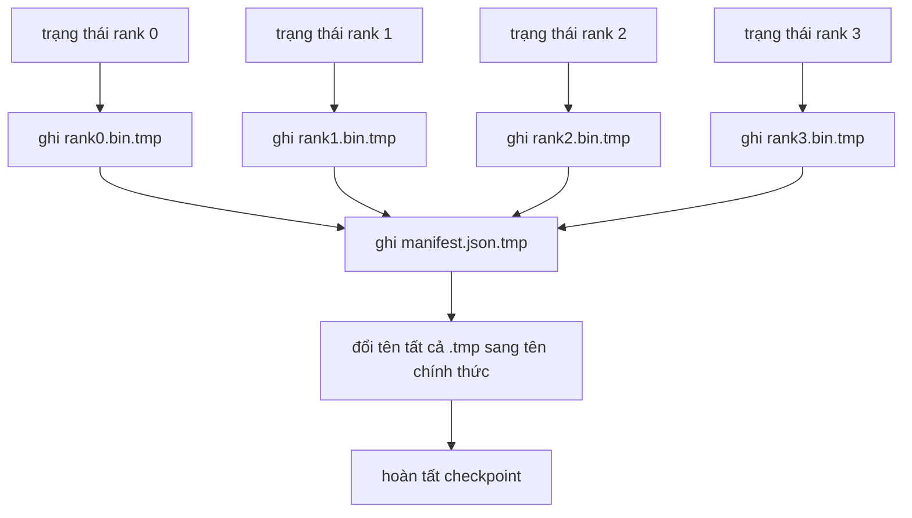

# Checkpoint Phân mảnh và Khôi phục Nguyên tử

> Một tác vụ huấn luyện 70 tỷ tham số (70B) thường bị tạm dừng do sự cố lỗi nút tính toán (node failure) sau mỗi vài giờ. Định dạng điểm kiểm tra (checkpoint format) sẽ quyết định bạn mất 30 phút hay mất trắng 30 giờ huấn luyện. Checkpoint phân mảnh (sharded checkpoint) ghi phân mảnh của từng rank một cách song song và ghi nhận quyền sở hữu dữ liệu trong một tệp kê khai (manifest). Quá trình khôi phục (resume) sẽ tải phân mảnh của mỗi rank từ tệp riêng biệt của chính nó, tái thiết lập trạng thái trên cùng quy mô tiến trình (world size), và bộ tối ưu hóa tiếp tục bước tính toán như thể chưa từng có sự cố xảy ra. Thao tác ghi nguyên tử (atomic write) đảm bảo một checkpoint đang ghi dở sẽ không bao giờ làm hỏng lần khôi phục tiếp theo.

**Loại:** Xây dựng (Build)
**Ngôn ngữ:** Python
**Yêu cầu tiên quyết:** Phase 19 Chuỗi C các bài học 42-49
**Thời lượng:** ~90 phút

## Mục tiêu Học tập

- Lưu trữ một checkpoint đa rank (multi-rank checkpoint) dưới dạng các tệp phân mảnh riêng theo từng rank kết hợp với một tệp kê khai (manifest) ghi lại chi tiết rank nào sở hữu phần dữ liệu nào.
- Áp dụng mẫu hình ghi nguyên tử (ghi ra đường dẫn tạm rồi đổi tên atomic rename) để sự cố sập nguồn giữa chừng không bao giờ tạo ra một tệp checkpoint chắp vá.
- Khôi phục tiến trình từ manifest, xác thực tính đồng nhất tuyệt đối tới từng byte đối với cả tham số fp16 lẫn trạng thái bộ tối ưu hóa ZeRO trên mọi rank.
- Luận chứng cấu trúc lược đồ manifest nhằm chống lại 3 chế độ lỗi kinh điển: thay đổi số lượng rank (world size), không khớp số lượng phân mảnh, và tệp ghi dở dang.

## Vấn đề

Một checkpoint truyền thống thường đọc toàn bộ tham số và trạng thái bộ tối ưu hóa về rank 0, thực hiện gom dữ liệu (gather), rồi mới ghi ra một tệp tin duy nhất. Đối với một mô hình 70B, điều đó đồng nghĩa với việc đẩy 1.1 TB trạng thái qua một cổng mạng duy nhất của rank 0. Thao tác ghi này sẽ làm tắc nghẽn toàn bộ các rank còn lại vì chúng phải ngồi nhàn rỗi chờ đợi lệnh gather hoàn tất. Băng thông I/O bị giới hạn bởi đường truyền mạng của một GPU chậm nhất, chứ không tận dụng được băng thông tổng của cả cụm. Trên một cụm máy chủ thực tế, bước gom-rồi-ghi này có thể tốn nhiều thời gian hơn cả một giờ huấn luyện vừa qua, khiến cho tác vụ huấn luyện chỉ lưu được chưa tới một checkpoint trong suốt cả ngày làm việc.

Checkpoint phân mảnh đảo ngược hoàn toàn mẫu hình này: mọi rank tự ghi phân mảnh của chính mình vào một tệp tin riêng biệt một cách song song. Tệp manifest ghi nhận rank nào sở hữu phân mảnh nào để quá trình khôi phục có thể đưa từng phân mảnh về đúng vị trí xuất phát. Băng thông ghi tổng hợp lúc này sẽ mở rộng tỷ lệ thuận theo quy mô cụm máy chủ. Một checkpoint 1 TB từng mất 4 giờ khi ghi qua một rank thì nay chỉ mất 4 phút khi được ghi đồng thời qua 64 rank. Ngoài ra, manifest còn cung cấp một bản giao kèo chặt chẽ ngăn chặn các lần khôi phục không tương thích: việc thay đổi quy mô world size có thể phát hiện được ngay, các tệp ghi dở được chỉ điểm tức thì, và luồng nạp dữ liệu có thể báo lỗi tường minh thay vì âm thầm sử dụng dữ liệu rác cũ kỹ.

## Khái niệm



### Lược đồ Manifest (Manifest schema)

```json
{
  "world_size": 4,
  "step": 1234,
  "wall_clock_seconds": 4521,
  "shards": [
    {"rank": 0, "path": "rank0.bin", "sha256": "...", "param_shard_offset": 0, "param_shard_numel": 65536},
    {"rank": 1, "path": "rank1.bin", "sha256": "...", "param_shard_offset": 65536, "param_shard_numel": 65536}
  ],
  "schema_version": 1
}
```

Có 3 trường dữ liệu giữ vai trò then chốt: `world_size` đảm bảo việc khôi phục trên một số lượng rank khác sẽ báo lỗi ngay lập tức thay vì gây sai lệch dữ liệu ngầm. `sha256` trên mỗi phân mảnh giúp bắt trọn các lỗi tệp ghi dở dang hoặc bị hỏng dữ liệu. `param_shard_offset` và `param_shard_numel` trên mỗi phân mảnh cho phép trình nạp dữ liệu tái thiết lập tensor tham số phẳng ở chính xác vị trí ban đầu.

### Ghi nguyên tử (Atomic write)

Mẫu hình tiêu chuẩn: ghi mọi phân mảnh ra `<name>.tmp`, ghi manifest ra `manifest.json.tmp`, thực hiện lệnh `fsync` trên từng tệp, đổi tên (rename) các phân mảnh, và cuối cùng mới đổi tên tệp manifest. Một lệnh đổi tên POSIX (POSIX rename) trong cùng một hệ thống tệp là một thao tác nguyên tử (atomic): hoặc là tệp mới xuất hiện hoàn chỉnh, hoặc là tệp cũ vẫn tồn tại nguyên vẹn. Một tập hợp nhiều thao tác đổi tên thì không phải là một giao dịch nguyên tử (transaction), do đó việc đổi tên tệp manifest chính là điểm cam kết (commit point), và bộ nạp dữ liệu sẽ kiểm tra mã băm của từng phân mảnh đối chiếu với manifest. Hãy ghi mỗi checkpoint vào một thư mục bước (step directory) riêng biệt; khi đó nếu có sự cố sập nguồn trước khi tệp manifest được đổi tên, checkpoint trước đó vẫn an toàn là checkpoint hiện hành hợp lệ. Việc tái sử dụng chung một thư mục duy nhất sẽ phá vỡ bảo đảm này, bởi vì việc đổi tên phân mảnh sẽ ghi đè lên phân mảnh cũ trước khi tệp manifest mới kịp xuất hiện. Nếu không ghi nguyên tử, một cú sập nguồn có thể để lại một phân mảnh ghi dở kèm theo tệp manifest trỏ vào nó, khiến quá trình khôi phục làm hỏng trạng thái bộ tối ưu hóa.

### Ba chế độ lỗi mà lược đồ phải phòng vệ

| Sự cố lỗi | Triệu chứng | Cơ chế phòng ngự |
|-----------|-------------|------------------|
| Thay đổi world size | Khôi phục trên N=8 với manifest từ N=4 | Không khớp `world_size` trong manifest, dừng lại và báo lỗi ngay |
| Không khớp số lượng phân mảnh | Quá trình khôi phục thấy ít tệp `rank*.bin` hơn số phân mảnh ghi trong manifest | Liệt kê các phân mảnh, xác thực từng tệp đều tồn tại |
| Ghi dở dang (partial write) | Tệp phân mảnh bị cắt cụt giữa chừng khi xả bộ đệm | Xác thực mã băm `sha256` khi nạp dữ liệu |

Mỗi cơ chế phòng vệ đều chủ động loại bỏ dữ liệu hỏng ngay từ đầu; nếu không làm vậy, lỗi dữ liệu ngầm sẽ chỉ phát tác sau đó 100 bước huấn luyện khi hàm mất mát bất ngờ biến thành NaN.

### Tại sao lại chia tệp theo từng rank thay vì một tệp lớn duy nhất

Ghi đồng thời vào một tệp duy nhất thông qua cờ `O_APPEND` có thể hoạt động trên POSIX cho các thao tác ghi khớp byte, nhưng trong thực tế, các khoảng offset trong một phân mảnh trải rộng trên các vùng dữ liệu kích thước hàng Megabyte và chi phí khóa tài nguyên (locking) sẽ chiếm ưu thế áp đảo. Sử dụng các tệp riêng biệt theo từng rank hoàn toàn không có tranh chấp và tận dụng tối đa cơ chế phân dải dữ liệu (striping) khi hệ thống tệp bên dưới là hệ thống tệp phân tán song song (Lustre, GPFS). Các ngăn xếp sản xuất lớn (DeepSpeed, FSDP, NeMo) đều nhất quán lựa chọn phương án lưu tệp riêng theo từng rank vì lý do này.

````figure ci-sharded-checkpoint
````

## Xây dựng Thực tế

Mã nguồn `code/main.py` cài đặt:

- `ShardManifest`: dataclass biểu diễn lược đồ trên kèm theo các phương thức `to_json` và `from_json`.
- `save_sharded(state_dict_per_rank, dir, step)`: ghi trạng thái nhị phân của mọi rank ra tệp riêng bằng mẫu hình nguyên tử ghi-tạm-rồi-đổi-tên, sau đó ghi tệp manifest.
- `load_sharded(dir, expected_world_size)`: đọc manifest, kiểm tra tính hợp lệ của mã băm sha256 trên từng phân mảnh, và trả về từ điển trạng thái (state dict) của từng rank.
- Một bài kiểm tra toàn trình (round-trip test): khởi tạo trạng thái theo rank, lưu checkpoint, nạp lại, và xác minh sự tương đương tuyệt đối tới từng byte.

Chạy thử nghiệm:

```bash
python3 code/main.py
```

Kết quả đầu ra: 4 tệp phân mảnh cùng 1 tệp manifest được ghi thành công, sau đó được nạp lại và vượt qua khâu xác thực tính tương đương từng byte.

## Các mẫu hình sản xuất trong thực tế

Ba mẫu hình giúp hoàn thiện hệ thống lưu checkpoint đạt chuẩn sản xuất:

**Ghi bất đồng bộ (async write).** Các hệ thống sản xuất chuyển việc ghi checkpoint sang một luồng (thread) hoặc tiến trình riêng biệt để quá trình huấn luyện có thể tiếp tục diễn ra mà không bị đình trệ. Điểm rào chắn (barrier) sẽ nằm ở lần lưu checkpoint kế tiếp: không được phép bắt đầu lần lưu mới cho đến khi lần lưu trước đó đã hoàn tất hoàn toàn. Cờ `async_io` của DeepSpeed vận hành chính xác theo nguyên lý này. Bài học này duy trì việc ghi đồng bộ để các bước thực thi hiện rõ một cách trực quan.

**Ưu tiên ghi ổ đĩa nhanh cục bộ trước, sau đó tải lên đám mây bất đồng bộ.** Ghi trước vào ổ cứng NVMe cục bộ (tốc độ cực nhanh), sau đó tải bất đồng bộ lên S3 hoặc GCS. Mẫu hình lưu trữ hai tầng (two-tier pattern) này giúp checkpoint trong cụm luôn sẵn sàng tức thì để khôi phục nhanh chóng, đồng thời vẫn gửi một bản sao bền bỉ ra ngoài cụm để lưu trữ dài hạn. Manifest cục bộ lưu đường dẫn local; một upload manifest riêng sẽ lưu đường dẫn trên kho lưu trữ từ xa.

**Luân chuyển vòng đời lưu trữ (rotation) là thiết yếu.** Các đợt huấn luyện trong sản xuất thường chỉ giữ lại K checkpoint gần nhất (thường là 3 đến 5 bản) và xoay vòng xóa bản cũ nhất. Nếu không có cơ chế luân chuyển này, ổ đĩa sẽ bị lấp đầy giữa chừng và lần lưu tiếp theo sẽ thất bại. Nhờ có cơ chế rotation, lần lưu mới sẽ chủ động xóa bản ghi cũ nhất trước, giải phóng dung lượng đĩa cần thiết.

## Sử dụng trong Thực tế

Các mô hình triển khai thực tế:

- **Cơ chế checkpoint của DeepSpeed.** Hàm `deepspeed.save_checkpoint(tag=step)` ghi các tệp theo từng rank và một tệp `latest` trỏ tới tag đang hoạt động.
- **PyTorch FSDP checkpointing.** Thư viện `torch.distributed.checkpoint` hỗ trợ lưu trạng thái phân mảnh với một bộ lập kế hoạch (`Planner`) quyết định bố cục dữ liệu trên từng rank.
- **NeMo.** Đóng gói DeepSpeed và FSDP dưới một API `save_to_checkpoint` thống nhất bổ sung thêm nhiều siêu dữ liệu mở rộng.

## Triển khai Mở rộng

Bài học 81 sẽ lưu một checkpoint phân mảnh cho toàn bộ quá trình huấn luyện DDP+ZeRO end-to-end và nạp lại trên cùng số lượng rank để chứng minh giao ước khôi phục được duy trì trọn vẹn.

## Bài tập Thực hành

1. Cài đặt cơ chế ghi bất đồng bộ: kích hoạt tiến trình ghi trong một thread riêng biệt và cho phép vòng lặp huấn luyện tiếp tục. Chặn lần lưu tiếp theo cho đến khi lần lưu trước hoàn tất.
2. Bổ sung cơ chế luân chuyển `last_5_steps`: duy trì tối đa 5 checkpoint gần nhất, tự động xóa bản cũ nhất trước khi ghi checkpoint mới.
3. Bổ sung một luồng kiểm tra nhanh chỉ dựa trên CRC cho vòng lặp nạp dữ liệu nội bộ (khi luân chuyển biến một checkpoint thành bản active mới mà không cần tính lại toàn bộ sha256).
4. Cài đặt tính năng nạp checkpoint xuyên world-size: tái cân bằng phân mảnh từ cấu hình N=4 sang N=8 bằng cách đọc manifest, nối các phân mảnh lại và phân mảnh lại từ đầu.
5. Mô phỏng việc tải lên S3 giả lập (một thư mục thứ hai) và ghi tệp upload manifest. Luận giải chính sách lưu trữ hai tầng (two-tier storage policy).

## Thuật ngữ Then chốt

| Thuật ngữ | Cách gọi thông thường | Ý nghĩa bản chất |
|-----------|----------------------|------------------|
| Sharded checkpoint | "Lưu riêng theo từng rank" | Mỗi rank ghi tệp phân mảnh của chính mình một cách song song |
| Manifest | "Tệp chỉ mục" | Tệp JSON ghi lại đường dẫn phân mảnh, độ lệch offset và mã sha256 |
| Atomic write | "Ghi tạm rồi đổi tên" | Ghi ra `.tmp` rồi đổi tên POSIX để nếu gặp sự cố sập nguồn thì tệp cũ vẫn an toàn |
| Partial write | "Phân mảnh bị cắt cụt" | Sự cố sập nguồn giữa lúc ghi sinh ra tệp hỏng; mã sha256 sẽ phát hiện ra |
| Rotation | "Giữ lại K bản gần nhất" | Xóa checkpoint cũ nhất trước khi ghi bản mới để giới hạn dung lượng đĩa sử dụng |

## Tài liệu Đọc thêm

- [Tài liệu checkpointing của DeepSpeed](https://deepspeed.readthedocs.io/en/latest/model-checkpointing.html)
- [Tài liệu chính thức torch.distributed.checkpoint](https://pytorch.org/docs/stable/distributed.checkpoint.html)
- [Tính nguyên tử của thao tác POSIX rename](https://pubs.opengroup.org/onlinepubs/9699919799/functions/rename.html)
- Phase 19 Bài học 78 - Trạng thái ZeRO mà cấu trúc checkpoint này được thiết kế để lưu trữ
- Phase 19 Bài học 81 - Bản trình diễn đầu-cuối thực hiện chu trình lưu và khôi phục trạng thái hoàn chỉnh
