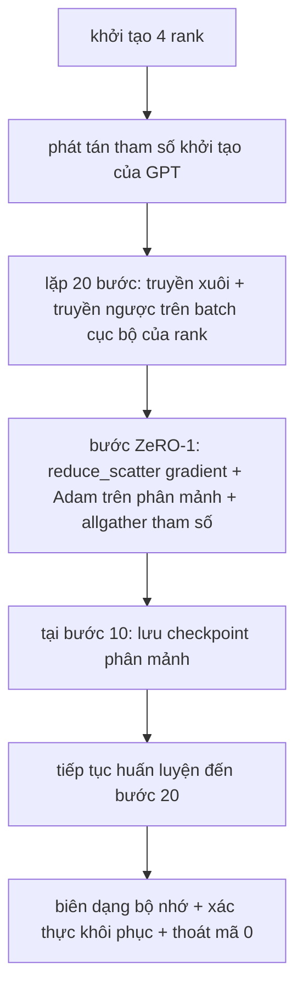

# Huấn luyện Phân tán Toàn trình (End-to-End Distributed Training)

> Các bài học từ 76 đến 80 mỗi bài đã xây dựng một mảnh ghép riêng biệt. Đây chính là bước lắp ráp hoàn chỉnh: một mô hình GPT thu nhỏ được huấn luyện trên 4 tiến trình (rank) mô phỏng với DDP để đồng bộ hóa gradient, ZeRO-1 để phân mảnh trạng thái bộ tối ưu hóa, và lưu một checkpoint phân mảnh ở mốc nửa chặng đường. Bản trình diễn chạy đúng 20 bước, tự động kết thúc an toàn (self-terminating), in ra đường cong hàm mất mát cùng biểu đồ phân bổ bộ nhớ, và ghi lại một checkpoint có khả năng khôi phục chuẩn xác.

**Loại:** Xây dựng (Build)
**Ngôn ngữ:** Python
**Yêu cầu tiên quyết:** Phase 19 Chuỗi C các bài học 42-49
**Thời lượng:** ~90 phút

## Mục tiêu Học tập

- Tích hợp DDP (bài 77) cùng ZeRO-1 (bài 78) và cơ chế checkpoint phân mảnh (bài 80) vào trong một vòng lặp huấn luyện duy nhất.
- Huấn luyện một mô hình ngôn ngữ transformer 2 tầng trên tập ngữ liệu tổng hợp nhỏ trong 20 bước qua 4 rank CPU mô phỏng.
- In ra bảng theo dõi hàm mất mát qua từng bước, biên dạng bộ nhớ trên từng rank, và một manifest checkpoint có khả năng khôi phục chính xác tới từng byte trên cùng một cấu hình số rank.
- Luận giải kiến trúc tích hợp: từng thành phần đều có thể kiểm thử độc lập ở các bài học trước và bài học này chứng minh chúng phối hợp với nhau một cách hoàn hảo.

## Vấn đề

Một dự án tốt nghiệp (capstone) là bằng chứng xác thực rằng các mảnh ghép hoàn toàn ăn khớp với nhau. Bài học 76 đã cài đặt các phép toán truyền thông tập thể (collectives). Bài học 77 đóng gói chúng thành DDP. Bài học 78 phân mảnh trạng thái bộ tối ưu hóa bằng reduce_scatter. Bài học 79 phân tích mô hình đường ống. Bài học 80 lưu checkpoint phân mảnh. Mỗi bài học đều đứng độc lập với bài kiểm thử riêng. Tuy nhiên, một đợt huấn luyện trong thực tế đòi hỏi mọi nguyên hàm phải vận hành đồng thời; nếu khâu tích hợp gặp lỗi, hàm mất mát sẽ phân kỳ, checkpoint sẽ từ chối nạp lại, hoặc bộ nhớ trên từng rank sẽ phình to thay vì thu nhỏ lại.

Bài học này vận hành bản trình diễn toàn trình và kiểm chứng 4 điều kiện bất biến: (a) hàm mất mát suy giảm đơn điệu qua 20 bước trong phạm vi nhiễu số thực float, (b) mọi rank đều duy trì chuẩn độ lớn tham số (parameter norm) giống hệt nhau ở mỗi bước, (c) bộ nhớ bộ tối ưu hóa trên mỗi rank khớp chính xác với công thức $12P/N$ byte của ZeRO-1, và (d) checkpoint lưu ở bước 10 khi nạp lại lúc khởi động lại sẽ khớp hoàn toàn tới từng byte. Bản trình diễn tự động kết thúc: đúng 20 bước, một lệnh duy nhất, thoát mã 0.

## Khái niệm



### Mô hình mini GPT

Mô hình được chủ đích thiết kế tinh gọn: 2 khối transformer block, số chiều nhúng (embed dim) 32, 4 đầu chú ý (attention heads), từ vựng 64 token, độ dài chuỗi ngữ cảnh 16, kích thước batch 4. Tổng cộng chỉ vài nghìn tham số. Quy mô này vừa đủ để kích hoạt mọi quyết định kết nối phân tán (cơ chế đa đầu chú ý chạy luồng che mặt nạ chuẩn masked attention; tầng LayerNorm có trọng số cần đồng bộ; đầu dự đoán ngôn ngữ LM head là một phép chiếu tuyến tính riêng biệt trở lại không gian từ vựng). Đồng thời, nó đủ nhỏ để 20 bước huấn luyện trên 4 rank CPU hoàn tất chỉ trong vài giây.

### Quy tắc tích hợp các thành phần

| Thành phần bài học | Trách nhiệm đảm nhận | Phần việc chuyển giao cho vòng lặp |
|--------------------|---------------------|-----------------------------------|
| DDP broadcast | Đồng bộ hóa tham số ban đầu | Một lệnh gọi duy nhất tại thời điểm khởi tạo |
| Bước ZeRO-1 | Đồng bộ gradient, cập nhật bản sao chính, phát tán tham số | Một lệnh gọi mỗi bước thay thế hoàn toàn cho `optimiser.step` |
| Checkpoint phân mảnh | Lưu trạng thái từng rank, ghi manifest kèm sha256 | Gọi trên rank 0 với dữ liệu thu thập qua allgather |
| Vòng lặp huấn luyện | Truyền xuôi, truyền ngược, ghi log hàm mất mát | Gọi tuần tự 3 thành phần trên theo đúng thứ tự |

Vòng lặp chính hoàn toàn không cần bận tâm về chi tiết lệnh `reduce_scatter` hay các tệp rendezvous. Các mô-đun ZeRO và checkpoint cung cấp giao diện hẹp, rõ ràng để vòng lặp dễ dàng xâu chuỗi.

### Tại sao lại dùng mini GPT mà không chỉ dừng lại ở MLP

Mạng MLP từ bài học 77 chỉ vừa đủ để xác thực việc đồng bộ gradient. Một mô hình GPT thu nhỏ bổ sung thêm 3 khía cạnh trọng yếu: một đầu LM head riêng biệt trên từ vựng (trong bài này tách biệt trọng số để rõ ràng; mô hình GPT đầy đủ thường liên kết trọng số head với embedding), hàm mất mát softmax + cross-entropy (nhiều trường hợp biên số học hơn so với MSE), và luồng truyền xuôi bất đối xứng (nhúng từ rồi tới attention rồi tới MLP ở mỗi tầng). Nếu chỉ dùng MLP cho bài capstone, chúng ta sẽ không thể biết được liệu kiến trúc tích hợp có xử lý đúng chuẩn LayerNorm hay hình dạng gradient của tầng embedding hay không.

### Tự kết thúc đồng nghĩa với mã thoát 0 (exit 0)

Vòng lặp chạy cố định 20 bước rồi tự động kết thúc. Tuyệt đối không có vòng lặp vô tận `while True`, không cần sự can thiệp thủ công của con người, không cần nạp trạng thái từ bên ngoài. Một bài thực hành capstone mà bạn có thể an tâm cho chạy tự động và nhận về log đầy đủ khi hoàn thành là minh chứng hùng hồn nhất cho thấy hệ thống đã được kết nối chuẩn xác. Nếu bất kỳ mắt xích nào gặp deadlock, chương trình sẽ không thể kết thúc và hệ thống kiểm thử sẽ lập tức phát hiện ra lỗi.

````figure ci-distributed-assembly
````

## Xây dựng Thực tế

Mã nguồn `code/main.py` cài đặt:

- `MiniGPT`: mạng transformer 2 tầng với cơ chế masked self-attention và một đầu LM head độc lập.
- `make_corpus(seed, total_tokens)`: sinh dữ liệu dự đoán token tiếp theo có tính tất định.
- `_train_worker`: hàm công nhân chạy trên từng rank; phát tán tham số khởi tạo, vận hành vòng lặp, gọi bước ZeRO, và ghi checkpoint phân mảnh tại bước 10.
- `verify_resume`: sau lượt chạy chính, tiến hành nạp lại checkpoint bước 10 ngay trong tiến trình và đối soát từng byte giữa các phân mảnh đã lưu với ảnh chụp bộ nhớ.
- `main`: điều phối toàn bộ kịch bản demo, in bảng theo dõi hàm mất mát, biên dạng bộ nhớ và kết quả xác thực khôi phục.

Chạy thử nghiệm:

```bash
python3 code/main.py
```

Kết quả đầu ra: bảng hàm mất mát 20 dòng, biên dạng bộ nhớ 4 dòng theo từng rank, một tệp manifest checkpoint, và dòng thông báo "RESUME VERIFIED" báo hiệu thành công trọn vẹn.

## Các mẫu hình sản xuất trong thực tế

Ba mẫu hình giúp hoàn thiện kiến trúc tích hợp cho các đợt chạy thực tế trong sản xuất:

**Lưu checkpoint theo K phút thay vì theo K bước.** Thời gian của một bước biến thiên theo độ dài chuỗi và số lượng vi-batch. Một chu kỳ lưu checkpoint cố định mỗi 10 phút sẽ bao quát cùng một lượng tính toán bất kể mô hình có kích thước ra sao. Bài học này chọn lưu theo bước để đơn giản hóa việc đối soát; trong sản xuất luôn ưu tiên lưu theo thời gian đồng hồ thực tế.

**Phát hiện phân kỳ sớm (detect divergence early).** Các đợt huấn luyện lớn luôn trang bị chốt chặn NaN sau lượt truyền ngược và bộ phát hiện đột biến mất mát (loss-spike detector); nếu hàm mất mát nhảy vọt quá 2 lần trong một bước duy nhất, hệ thống sẽ lập tức quay lui về checkpoint trước đó thay vì để bộ tối ưu hóa tiến sâu vào trạng thái thoái hóa. Trong bài học này, đường cong mất mát suy giảm êm dịu nên chốt chặn không bị kích hoạt nhưng hook vẫn được giữ nguyên sẵn sàng.

**Tổng hợp biên dạng bộ nhớ qua các rank.** Mức tiêu thụ bộ nhớ thực tế có sự chênh lệch giữa các rank (rank gánh chặng đường ống lớn nhất sẽ giữ nhiều giá trị kích hoạt hơn). Môi trường sản xuất sẽ ghi nhận giá trị cực đại (max) giữa các rank kèm theo giá trị trung bình (mean); bài học này in chi tiết từng rank để chứng minh số đo thực tế khớp hoàn toàn với công thức lý thuyết.

## Sử dụng trong Thực tế

Các mô hình triển khai thực tế:

- **DeepSpeed.** Tích hợp đồng thời DDP + ZeRO + song song hóa đường ống + lưu checkpoint kích hoạt dưới một cấu hình tập trung. Bài học này chính là mô hình DeepSpeed thu nhỏ dưới dạng thuần khiết nhất.
- **PyTorch FSDP.** Bản cài đặt tương đương của PyTorch. `FullyShardedDataParallel` kết hợp với chiến lược `ShardingStrategy.SHARD_GRAD_OP` chính là ZeRO-2.
- **NeMo và Megatron-LM.** Bổ sung thêm song song hóa tensor (tensor parallel) cho những mô hình khổng lồ nhất; ngoài thành phần đó ra thì cấu trúc tích hợp tổng thể vẫn giữ nguyên hình mẫu này.

## Triển khai Mở rộng

Toàn bộ lộ trình Chuỗi C khép lại tại đây. 6 bài học liên kết chặt chẽ này chính là hệ thống con huấn luyện phân tán (distributed-training subsystem) hoàn chỉnh mà một đội ngũ kỹ sư thực thụ sẽ xây dựng trước khi chuyển sang sử dụng DeepSpeed; cấu trúc trừu tượng đã được kiểm chứng chuẩn xác trên backend gloo và mọi chế độ lỗi tiềm ẩn đều đã được thực nghiệm. Phase 17 (Cơ sở hạ tầng và Môi trường sản xuất) là nơi bạn có thể mang toàn bộ kiến trúc này lên một cụm máy chủ phần cứng thực thụ.

## Bài tập Thực hành

1. Thêm cơ chế chia tách song song tensor (tensor-parallel) cho đầu chú ý và xác minh hàm mất mát khớp với đường cơ sở đơn rank. Cấu hình 2 rank: mỗi rank xử lý một nửa số đầu chú ý, rồi gọi allreduce cho đầu ra của attention.
2. Cài đặt tích lũy gradient qua 4 vi-batch và chứng minh gradient thu được hoàn toàn bằng với gradient của một batch lớn duy nhất.
3. Bổ sung một luồng khôi phục thực sự từ bước 10 để tiếp tục huấn luyện đến bước 20 và chứng minh nó đạt giá trị hàm mất mát cuối cùng giống hệt với lần chạy gốc ban đầu.
4. Thêm tính năng xuất các chỉ số (hàm mất mát, chuẩn độ lớn gradient, thời gian từng bước) ra tệp định dạng JSONL để trực quan hóa sau khi chạy.
5. Cài đặt chốt chặn NaN tự động quay lui về checkpoint trước đó khi có đột biến hàm mất mát, và thử ép xuất hiện đột biến bằng cách nhân tốc độ học lên 100 lần trong một bước để kiểm tra phản ứng quay lui.

## Thuật ngữ Then chốt

| Thuật ngữ | Cách gọi thông thường | Ý nghĩa bản chất |
|-----------|----------------------|------------------|
| End-to-end | "Nối toàn bộ lại" | Một đợt chạy duy nhất tích hợp mọi mảnh ghép, không chỉ là các bài kiểm thử đơn lẻ |
| Memory profile | "GB trên mỗi rank" | Lượng byte bộ nhớ lưu trữ trên mỗi rank cho tham số, gradient và trạng thái bộ tối ưu hóa |
| Resume contract | "Lưu và nạp" | Trạng thái từng rank đảm bảo bằng nhau tới từng byte sau một chu trình lưu-nạp checkpoint |
| Self-terminating | "Tự ngắt có giới hạn" | Số bước cố định, thoát với mã 0 khi hoàn tất, không cần sự can thiệp thủ công |

## Tài liệu Đọc thêm

- [Hướng dẫn huấn luyện toàn trình DeepSpeed](https://www.deepspeed.ai/getting-started/)
- [Hướng dẫn chuyên sâu PyTorch FSDP](https://pytorch.org/tutorials/intermediate/FSDP_advanced_tutorial.html)
- [Tài liệu tham khảo kịch bản huấn luyện Megatron-LM](https://github.com/NVIDIA/Megatron-LM)
- Phase 19 Các bài học từ 76 đến 80 - từng mảnh ghép nền tảng mà bài học này kết hợp
- Phase 17 - Đưa kiến trúc tích hợp này lên cụm máy chủ thực tế
