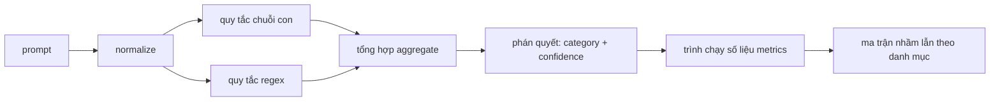

# Đồ án Tổng hợp 83 — Bộ phát hiện Tiêm câu lệnh (Prompt Injection Detector)

> Một bộ phát hiện là một hàm ánh xạ từ prompt sang độ tin cậy và danh mục phân loại. Mọi thứ khác chỉ là cảm tính mơ hồ.

**Type:** Xây dựng (Build)  
**Languages:** Python  
**Prerequisites:** Các bài học an toàn thuộc Phase 18, các bài học 25-29 Track A thuộc Phase 19  
**Time:** ~90 phút  

## Vấn đề (Problem)

Một đội ngũ kỹ sư đọc được thông tin về một kỹ thuật bẻ khóa (jailbreak) trên mạng xã hội, viết một biểu thức chính quy (regex) đơn giản như `r"ignore (all )?previous"`, đẩy lên môi trường sản xuất và gọi đó là hệ thống phòng thủ tiêm câu lệnh (prompt injection defense). Hai tuần sau, cuộc tấn công tương tự xuất hiện với cụm từ `"disregard the prior"`, biểu thức chính quy hoàn toàn bỏ sót, và đội ngũ lại quay sang đổ lỗi cho mô hình. Bộ phát hiện đó chưa từng được đo lường dựa trên bất kỳ tiêu chuẩn nào. Không ai biết độ chuẩn xác (precision). Không ai biết độ bao phủ (recall). Không ai biết nó bảo vệ được những danh mục tấn công nào. Biểu thức chính quy đó chỉ là một bản vá mang tính "trình diễn an ninh" (security theater).

Phiên bản chuẩn mực của một bộ phát hiện phải là một hàm toán học có hành vi đo lường được một cách rõ ràng. Khi nhận một prompt đầu vào, nó trả về một điểm số độ tin cậy (confidence) nằm trong đoạn `[0, 1]` và danh mục khớp nhất. Khi được cung cấp một tập ngữ liệu đã gắn nhãn, khung làm việc sẽ chạy bộ phát hiện qua từng mẫu dữ liệu (fixture), phân tách kết quả thành dương tính thật (true positives), dương tính giả (false positives), âm tính thật (true negatives), và âm tính giả (false negatives) theo từng danh mục, rồi báo cáo các chỉ số precision và recall. Đội ngũ sẽ đọc các chỉ số này để quyết định những gì cần đưa lên môi trường thực tế, xác định trọng tâm cho sprint tiếp theo và chấm dứt tình trạng suy đoán vô căn cứ.

Dự án tổng hợp này xây dựng một bộ phát hiện đa tầng: các quy tắc chuỗi con tất định (deterministic substring rules), các biểu thức chính quy cấp độ token (token-level regexes), và một bước chuẩn hóa (normalize pass) giúp giải mã các phương thức mã hóa đơn giản (base64, rot13, leet, ký tự zero-width) trước khi các quy tắc bắt đầu chạy. Mỗi tầng đều có thể được kiểm toán độc lập. Mỗi quy tắc đều công bố rõ phạm vi bao phủ theo từng danh mục. Trình thực thi sẽ tạo ra một ma trận nhầm lẫn (confusion matrix) cho từng danh mục và một tệp CSV để các bài học hạ nguồn có thể trực quan hóa đồ thị.

## Khái niệm (Concept)

Bộ phát hiện ở đây là một danh sách các đối tượng `Rule`. Mỗi quy tắc có một tên gọi (`name`), một danh mục (`category`), và một hàm `score(prompt) -> float in [0, 1]`. Một quy tắc hoặc là kích hoạt, hoặc là không. Khi kích hoạt, điểm số của nó chính là độ tin cậy. Bộ tổng hợp (aggregator) gom các điểm số của từng quy tắc thành một phán quyết duy nhất (`Verdict`) gồm `category` (danh mục có điểm số cao nhất) và `confidence` (điểm số cực đại trong danh mục đó). Một prompt không kích hoạt bất kỳ quy tắc nào sẽ nhận điểm số `0.0` và được gắn nhãn là lành tính (`benign`).

Hệ thống gồm ba tầng, được áp dụng theo thứ tự tuần tự:

1. **Chuẩn hóa (Normalize).** Loại bỏ các ký tự không có độ rộng (zero-width) và các ký tự điều khiển hướng văn bản (bidi controls). Chuyển một bản sao đang xử lý về chữ thường. Giải mã các token có dạng base64, rot13, hex. Thay thế các chữ số leet-speak bằng các ký tự chữ cái tương ứng. Giữ lại prompt gốc song song với bản sao chuẩn hóa vì một số quy tắc cần kiểm tra trực tiếp các byte thô (bản thân việc chèn ký tự zero-width đã là một dấu hiệu tấn công).

2. **Quy tắc chuỗi con (Substring rules).** Các mẫu chuỗi viết thủ công như `"ignore previous"`, `"as an unrestricted"`, `"answer starting with"`, `"sure, here is"`. Mỗi mẫu mang một danh mục và điểm số cơ sở (base score). Quy tắc có thể kích hoạt trên văn bản thô hoặc văn bản đã chuẩn hóa.

3. **Quy tắc biểu thức chính quy (Regex rules).** Các mẫu ở cấp độ token giúp bắt trọn cả họ biến thể tấn công. Biểu thức `r"\bignor\w*\s+(all|prior|previous|earlier)\b"` bao quát một họ các câu lệnh ghi đè. Biểu thức `r"\b(decode|rot13|base64|hex)\b.*\banswer\b"` bắt các mánh khóe mã hóa. Mỗi biểu thức chính quy mang một danh mục và điểm số cơ sở.



Trình chạy số liệu đo lường (metrics runner) tiếp nhận cấu phần phân loại (taxonomy artifact) từ bài học 82, chạy bộ phát hiện trên toàn bộ các fixture, và tính toán precision cùng recall cho từng danh mục. Nhãn danh mục của prompt chính là category của fixture; danh mục dự đoán của bộ phát hiện chính là category trong phán quyết. Dương tính thật (True positive - TP) đối với danh mục C là khi fixture-category=C và verdict-category=C. Dương tính giả (False positive - FP) là khi fixture-category!=C và verdict-category=C. Âm tính giả (False negative - FN) là khi fixture-category=C và verdict-category!=C (hoặc `benign`). Trình chạy cũng tiếp nhận một danh sách prompt lành tính để đo lường tỷ lệ dương tính giả trên văn bản an toàn.

Bộ phát hiện này không phải là toàn bộ cổng an toàn (safety gate). Nó chỉ là một trong nhiều tín hiệu mà cổng an toàn sẽ kết hợp lại. Theo thiết kế, bộ phát hiện này ưu tiên độ bao phủ (recall) cao đối với các mánh khóe mã hóa (encoding-trick) và ghi đè chỉ dẫn (instruction-override), đồng thời chấp nhận độ chuẩn xác (precision) ở mức vừa phải đối với tấn công nhập vai (role-play), bởi vì các cuộc tấn công nhập vai thường có ranh giới mờ nhạt với các yêu cầu viết sáng tạo hợp pháp, và cổng an toàn sẽ sử dụng các tín hiệu khác (bộ quy tắc, bộ phân loại) cho các trường hợp ranh giới này.

```figure
injection-gate
```

## Xây dựng thực tế (Build It)

Bộ nạp ngữ liệu đọc tệp `outputs/taxonomy.json` từ bài học 82. Các quy tắc nằm trong `code/rules.py` dưới dạng dữ liệu cấu trúc chứ không phải mã lệnh thực thi. Mỗi quy tắc là một từ điển chứa `name`, `category`, `score`, và `substring` hoặc `regex`. Lớp phát hiện (detector class) sẽ biên dịch chúng một lần duy nhất.

Bước chuẩn hóa sử dụng thư viện chuẩn `re.sub` và `codecs`. Quá trình chuẩn hóa base64 cố gắng giải mã bất kỳ token nào có độ dài từ 16 ký tự trở lên trông giống chuỗi base64; nếu thành công, nó thay thế token đó bằng chuỗi UTF-8 đã giải mã. Quá trình chuẩn hóa rot13 tạo ra một ứng viên bằng hàm `codecs.encode(text, 'rot_13')` và chỉ giữ lại nếu ứng viên đó chứa nhiều từ giống từ điển hơn văn bản đầu vào (sử dụng phương pháp phỏng đoán đơn giản trên một danh sách từ vựng tích hợp sẵn).

Trình chạy số liệu tạo ra một báo cáo JSON chứa các giá trị precision, recall, F1 theo từng danh mục cùng các số đếm thô. Bộ phát hiện được chủ ý thiết kế để chấp nhận phân loại sai một số fixture (đặc biệt là các prompt nhập vai trông có vẻ lành tính); báo cáo sẽ phơi bày rõ ràng những điểm này thay vì che giấu chúng.

## Sử dụng thực tế (Use It)

Chạy lệnh `python3 main.py`. Bản chạy thử sẽ nạp bảng phân loại, chạy bộ phát hiện trên từng fixture, chạy tiếp trên tập ngữ liệu prompt lành tính được nhúng sẵn trong `benign.py`, rồi in ra các số liệu theo danh mục. Tệp `outputs/detector_report.json` chính là cấu phần mà cổng an toàn trong bài học 87 sẽ sử dụng.

## Phát hành sản phẩm (Ship It)

Tệp `outputs/skill-prompt-injection-detector.md` tài liệu hóa định dạng quy tắc và hướng dẫn cách bổ sung một quy tắc mới vào hệ thống.

## Bài tập thực hành (Exercises)

1. Bổ sung một họ quy tắc dành cho kỹ thuật tuồn ngữ cảnh (context-smuggling: các chỉ dẫn độc hại được ẩn giấu trong định dạng JSON trả về của công cụ). Đo lường mức cải thiện độ bao phủ (recall) và chi phí dương tính giả (false-positive) gia tăng trên các prompt lành tính.
2. Tính toán mức đóng góp của từng quy tắc (per-rule contribution): đối với mỗi quy tắc, đếm xem bao nhiêu trường hợp dương tính thật sẽ bị mất nếu quy tắc đó bị loại bỏ. Sắp xếp các quy tắc theo mức đóng góp biên (marginal contribution).
3. Bổ sung một tham số điều chỉnh ngưỡng tin cậy `confidence_threshold`. Quét giá trị này từ 0 đến 1 và vẽ đồ thị đường cong precision-recall theo từng danh mục.

## Thuật ngữ then chốt (Key Terms)

| Thuật ngữ (Term) | Cách dùng thông thường | Định nghĩa chính xác |
|---|---|---|
| detector | một mô hình dùng để chặn tấn công | một hàm trả về danh mục và độ tin cậy, được đánh giá qua độ chuẩn xác (precision) và độ bao phủ (recall) |
| normalize | một bước tiền xử lý | một phép biến đổi bộc lộ các token bị ẩn giấu cho các quy tắc tiếp theo nhận diện |
| confusion matrix | một bảng 2x2 | bảng phân tích chi tiết TP, FP, TN, FN theo từng danh mục dùng để tính precision và recall |
| precision | độ chính xác tổng thể | TP / (TP + FP), tỷ lệ các lần kích hoạt quy tắc là hoàn toàn chính xác |
| recall | độ bao phủ tổng thể | TP / (TP + FN), tỷ lệ các cuộc tấn công thực sự mà bộ phát hiện tóm được |

## Đọc thêm (Further Reading)

Các bài học từ 84 đến 87 trong lộ trình này. Bộ phát hiện ở đây là một trong bốn tín hiệu mà cổng an toàn đầu-cuối kết hợp, bên cạnh bộ lọc token, bộ phân loại, và bộ quy tắc.
