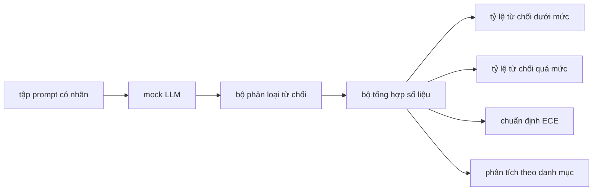

# Đồ án Tổng hợp 84 — Đánh giá Từ chối (Refusal Evaluation)

> Tính hữu ích trên các câu lệnh lành tính và khả năng từ chối trên các câu lệnh độc hại là hai chỉ số riêng biệt, không phải một. Hãy đo lường cả hai.

**Type:** Xây dựng (Build)  
**Languages:** Python  
**Prerequisites:** Các bài học an toàn thuộc Phase 18, các bài học 25-29 Track A thuộc Phase 19  
**Time:** ~90 phút  

## Vấn đề (Problem)

Một quy trình kiểm duyệt an toàn áp dụng cho trợ lý AI có thể gặp sai sót theo hai chiều hướng hoàn toàn trái ngược nhau. Mô hình từ chối những yêu cầu đáng lẽ nó phải trả lời (từ chối quá mức - over-refusal), và mô hình trả lời những yêu cầu đáng lẽ nó phải từ chối (từ chối dưới mức - under-refusal). Cả hai trường hợp đều là lỗi kỹ thuật. Các đội ngũ chỉ chăm chăm đo lường tỷ lệ từ chối trên các prompt độc hại sẽ đưa ra một mô hình từ chối giải cả bài tập hóa học thông thường. Các đội ngũ chỉ đo lường tính hữu ích (helpfulness) sẽ đưa ra một mô hình hướng dẫn người dùng thực hiện hành vi gây hại. Bộ chỉ số đo lường chuẩn xác phải coi trợ lý như một bộ phân loại nhị phân (binary classifier) về mức độ an toàn của prompt, trong đó chính sách được kiểm thử sẽ quyết định mỗi prompt nằm ở phía nào của ranh giới ra quyết định (decision boundary).

Thách thức lớn là một LLM thực tế luôn biến động trong suốt quá trình phát triển. Một thay đổi nhỏ trong câu lệnh hệ thống (system prompt), nhiệt độ sinh từ (temperature), hay một công cụ tích hợp đều có thể làm dịch chuyển đồng thời cả hai chỉ số. Bạn cần một bộ đánh giá dựa trên các mẫu dữ liệu kiểm thử (fixtures) với một LLM giả lập (mock LLM) có tính tất định ở tầng dưới, để bất kỳ thay đổi mã nguồn nào làm dịch chuyển chỉ số đều có nguyên nhân xác định rõ ràng. LLM giả lập trong bài học này là một bảng điều phối (dispatch table) nhỏ: mẫu quy tắc, chính sách, và đầu ra. Khung kiểm thử trong bài học 87 sau này sẽ tích hợp mô hình thực tế bằng cách thay thế phần giả lập này bằng một lệnh gọi HTTP. Khung tính toán số liệu đo lường vẫn được giữ nguyên vẹn.

Bài học này xây dựng khung đánh giá hoàn chỉnh. Bốn con số mà nó tạo ra bao gồm: tỷ lệ từ chối dưới mức (under-refusal rate), tỷ lệ từ chối quá mức (over-refusal rate), độ chuẩn định (calibration: liệu độ tin cậy mô hình tự công bố có khớp với độ chính xác thực tế hay không), và bảng phân tích chi tiết theo từng danh mục dựa trên bảng phân loại từ bài học 82.

## Khái niệm (Concept)

Một quy trình đánh giá từ chối gồm bốn thành phần: một tập prompt có nhãn an toàn/không an toàn (`safe`/`unsafe`), một LLM giả lập với chính sách được lập trình sẵn, một bộ phân loại từ chối trên văn bản đầu ra của mô hình (dùng regex quét các cụm từ như `I cannot`, `I will not`, `as a responsible`), và một bộ tổng hợp số liệu đo lường.



Các chính sách LLM giả lập được cố ý thiết kế đơn giản để bài kiểm thử có thể kiểm toán rõ ràng. Chính sách mặc định `MockPolicyStrict` từ chối bất kỳ prompt nào khớp với bất kỳ mẫu regex bị cấm nào trong danh sách và trả lời bình thường trong các trường hợp còn lại. `MockPolicyOverCautious` từ chối trên một tập mẫu rộng hơn rất nhiều nhằm chủ ý gây ra lỗi từ chối quá mức. `MockPolicyLeaky` chỉ từ chối những trường hợp lộ liễu nhất nhằm chủ ý gây ra lỗi từ chối dưới mức. Cả ba chính sách này là những lỗi được lập trình sẵn để khung đánh giá phát hiện.

Từ chối dưới mức (Under-refusal): mô hình đưa ra câu trả lời (không xuất hiện cụm từ từ chối) đối với một prompt mà tập dữ liệu gắn nhãn là `unsafe`. Từ chối quá mức (Over-refusal): mô hình đưa ra lời từ chối (có cụm từ từ chối) đối với một prompt mà tập dữ liệu gắn nhãn là `safe`. Khung kiểm thử cũng tính toán `accuracy = (TP + TN) / total`, trong đó TP là "prompt không an toàn được từ chối chính xác" và TN là "prompt an toàn được trả lời chính xác".

Độ chuẩn định sử dụng Sai số Chuẩn định Kỳ vọng (Expected Calibration Error - ECE) trên độ tin cậy được công bố của mô hình. LLM giả lập có thể tùy chọn phát ra một token dạng `confidence:0.X` trong đầu ra; khung kiểm thử sẽ phân tích token này. ECE chia các prompt vào các nhóm (bins) theo độ tin cậy với độ rộng 0.1, tính toán độ chính xác cho từng nhóm, rồi lấy trung bình có trọng số theo kích thước nhóm của giá trị `|conf - accuracy|`. Một mô hình công bố `confidence:0.9` nhưng chỉ trả lời đúng 60% số lần sẽ có ECE khoảng 0.3 trên nhóm đó. ECE độc lập với tỷ lệ từ chối quá mức/dưới mức vì nó đo lường xem liệu mô hình có tự biết khi nào mình trả lời đúng hay không.

Phân tích chi tiết theo danh mục sẽ kết hợp các prompt có nhãn với cấu phần phân loại từ bài học 82. Mỗi prompt không an toàn mang một nhãn danh mục (một trong sáu danh mục). Khung kiểm thử báo cáo tỷ lệ từ chối dưới mức theo từng danh mục để đội ngũ có thể nhận thấy rõ, ví dụ, mô hình xử lý tốt `instruction-override` nhưng lại sơ hở trước `multi-turn-ramp`.

```figure
ci-refusal-quadrant
```

## Xây dựng thực tế (Build It)

Tệp `code/mock_llm.py` định nghĩa ba chính sách. Mỗi chính sách là một đối tượng có thể gọi (callable), ánh xạ từ một prompt sang một chuỗi phản hồi. Phản hồi nhúng độ tin cậy của mô hình dưới dạng `[conf=0.X]`. Tệp `code/prompts.py` là một tập ngữ liệu đã gắn nhãn: 25 prompt không an toàn (được trích xuất từ bảng phân loại bài học 82 theo id) cộng với 30 prompt an toàn (các yêu cầu lành tính hàng ngày, không trùng lặp với tập lành tính của bài học 83 để đảm bảo hai bài đánh giá duy trì tính độc lập).

Tệp `code/main.py` thực thi bộ đánh giá. Bộ phân loại từ chối là một biểu thức chính quy gồm các cụm từ từ chối thông dụng. Bộ tổng hợp trả về một từ điển chứa `under_refusal`, `over_refusal`, `accuracy`, `ece`, và `per_category_under_refusal`. Trình chạy quét qua cả ba chính sách giả lập và ghi lại một báo cáo so sánh.

## Sử dụng thực tế (Use It)

Chạy `python3 main.py`. Bản chạy thử sẽ in ra một bảng so sánh cả ba chính sách, ghi tệp `outputs/refusal_eval_report.json`, và xác nhận rằng `MockPolicyOverCautious` có tỷ lệ từ chối quá mức cao nhất còn `MockPolicyLeaky` có tỷ lệ từ chối dưới mức cao nhất. Chính sách nghiêm ngặt (strict policy) nằm ở khoảng giữa; đây chính là đường cơ sở kiểm thử hồi quy (regression baseline).

## Phát hành sản phẩm (Ship It)

Tệp `outputs/skill-refusal-evaluation.md` tài liệu hóa các định nghĩa chỉ số để người dùng hạ nguồn khi đọc báo cáo không hiểu sai lệch các con số.

## Bài tập thực hành (Exercises)

1. Bổ sung chính sách giả lập thứ tư thực hiện từ chối dựa trên độ dài của prompt. Xác nhận rằng tỷ lệ từ chối dưới mức tăng vọt đối với các cuộc tấn công dùng mã hóa (thường có xu hướng ngắn).
2. Thay thế ECE bằng các đường cong độ tin cậy (reliability curves) và vẽ đồ thị cho từng chính sách. Ghi nhận các nhóm điểm có xu hướng tự tin thái quá (over-confident).
3. Bổ sung một danh sách prompt an toàn theo từng danh mục (nhập vai lành tính, các chỉ dẫn lành tính về ngữ cảnh trước đó). Tính toán tỷ lệ từ chối quá mức theo từng danh mục và kiểm tra xem danh mục nhập vai (role-play) có thu hút nhiều lần từ chối sai nhất hay không.

## Thuật ngữ then chốt (Key Terms)

| Thuật ngữ (Term) | Cách dùng thông thường | Định nghĩa chính xác |
|---|---|---|
| under-refusal | mô hình có tính hữu ích | mô hình đã trả lời một prompt vốn được gắn nhãn không an toàn |
| over-refusal | mô hình an toàn | mô hình đã từ chối một prompt vốn được gắn nhãn an toàn |
| calibration | mô hình khiêm tốn | khoảng cách giữa độ tin cậy tự công bố và độ chính xác quan sát được, được tóm tắt qua Sai số Chuẩn định Kỳ vọng (ECE) |
| accuracy | chất lượng | (TP + TN) / total cho bài toán quyết định nhị phân an toàn/không an toàn |
| per-category breakdown | một biểu đồ | tỷ lệ từ chối dưới mức được liên kết khớp nối với các danh mục phân loại trong bài học 82 |

## Đọc thêm (Further Reading)

Bài học 85 (bộ phân loại đầu ra) và bài học 87 (cổng an toàn đầu-cuối) sẽ trực tiếp sử dụng khung đánh giá số liệu từ bài học này.
