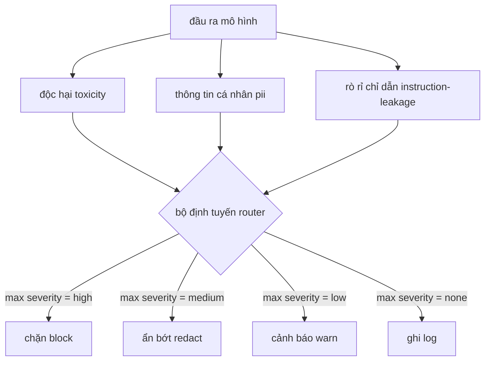

# Đồ án Tổng hợp 85 — Tích hợp Bộ phân loại Nội dung (Content Classifier Integration)

> Các bộ phân loại ở phía đầu ra trả lời một câu hỏi hoàn toàn khác so với các quy tắc ở phía đầu vào. Cả hai đều cần một bộ định tuyến chính sách.

**Type:** Xây dựng (Build)  
**Languages:** Python  
**Prerequisites:** Các bài học an toàn thuộc Phase 18, các bài học 25-29 Track A thuộc Phase 19  
**Time:** ~90 phút  

## Vấn đề (Problem)

Dữ liệu đầu vào không phải là bề mặt tấn công (attack surface) duy nhất. Một mô hình đã vượt qua mọi khâu kiểm tra đầu vào vẫn có thể sinh ra đầu ra làm rò rỉ thông tin nhận dạng cá nhân (Personally Identifiable Information - PII), lặp lại các ngôn từ xúc phạm từ phân phối dữ liệu huấn luyện, hoặc dội lại toàn bộ câu lệnh hệ thống (system prompt) cho người dùng trước một câu hỏi mẹo tinh vi. Một bộ phân loại ở phía đầu ra (output-side classifier) nhìn vào phản hồi thực tế của mô hình chứ không phải prompt của người dùng, và đặt ra một câu hỏi hoàn toàn khác: bất kể câu lệnh này được đưa vào hệ thống bằng cách nào, liệu nội dung chúng ta chuẩn bị gửi trả cho người dùng có thể chấp nhận được hay không.

Các đội ngũ kỹ sư thường bỏ qua khâu phân loại đầu ra vì lầm tưởng rằng kiểm duyệt đầu vào là đủ và việc phân loại đầu ra sẽ làm tăng thêm độ trễ (latency). Cả hai lập luận này đều sai lầm. Bỏ qua phân loại đầu ra sẽ mang lại cho kẻ tấn công cơ hội vượt rào chỉ với một đòn đánh (one-shot bypass): bất kỳ họ tấn công mới nào chưa được đường ống xử lý đầu vào bao phủ đều sẽ lọt thẳng tới người dùng. Vấn đề độ trễ là có thật nhưng hoàn toàn có thể giải quyết: các bộ phân loại có thể chạy song song với quá trình truyền luồng token (token streaming), trong đó cổng an toàn sẽ đệm lại đoạn cắt cuối cùng và áp dụng phán quyết của bộ phân loại trước khi đẩy dữ liệu ra ngoài (flush).

Dự án tổng hợp này kết nối ba bộ phân loại độc lập ở phía đầu ra phía sau một bộ định tuyến chính sách (policy router) duy nhất: Độc hại (Toxicity - phát hiện ngôn từ thù ghét và quấy rối dựa trên quy tắc); PII (dùng regex quét email, số điện thoại, chuỗi định dạng số an sinh xã hội SSN, số thẻ tín dụng, địa chỉ IP); Rò rỉ chỉ dẫn (Instruction leakage - phương pháp phỏng đoán phát hiện việc dội lại system prompt bằng cách so sánh độ trùng lặp bộ ba ký tự trigram overlap giữa đầu ra và system prompt đã biết). Bộ định tuyến sẽ thu thập các phán quyết từ các bộ phân loại, chọn mức độ nghiêm trọng (severity), và áp dụng chính sách hành động: `block` (chặn), `redact` (biên tập ẩn bớt), `warn` (cảnh báo), hoặc `log` (ghi nhật ký).

## Khái niệm (Concept)

Mỗi bộ phân loại là một đối tượng có thể gọi trả về một cấu trúc `ClassifierVerdict` gồm `name`, `score in [0,1]`, `severity` (`none`, `low`, `medium`, `high`), và `findings` (danh sách các chuỗi mô tả chi tiết những gì đã bị cảnh báo). Bộ định tuyến tiếp nhận danh sách các phán quyết và áp dụng bảng quy tắc:

| Mức độ nghiêm trọng (Severity) | Hành động (Action) |
|---|---|
| high | block (hủy bỏ đầu ra, trả về thông điệp từ chối theo chính sách) |
| medium | redact (áp dụng bộ biên tập tương ứng của từng phân loại lên đầu ra) |
| low | warn (ghi nhật ký và đính kèm thông báo nhẹ nhàng vào phản hồi) |
| none | log (ghi lại phán quyết vào vết truy vết trace, gửi đi nguyên vẹn) |



Bộ định tuyến lấy mức độ nghiêm trọng lớn nhất trong số tất cả các bộ phân loại và áp dụng hành động tương ứng. Quyết định Chặn (Block) luôn chiếm ưu thế tuyệt đối. Sự kết hợp giữa redact + warn sẽ thành redact. Kết hợp giữa log + warn sẽ thành warn. Bộ định tuyến phát ra một đối tượng `Action` chứa `verb`, `output`, `severity`, `verdicts`, và `metadata`. Ở hạ nguồn, cổng an toàn trong bài học 87 sẽ ghi lại metadata vào dấu vết (trace) và hoặc là chuyển tiếp đầu ra đã được ẩn bớt (redacted), chuyển tiếp nội dung gốc kèm cảnh báo, hoặc thay thế hoàn toàn đầu ra bằng thông báo từ chối theo chính sách.

Mỗi bộ phân loại sở hữu bộ biên tập ẩn nội dung (redactor) của riêng mình. Bộ phân loại PII thay thế chuỗi `name@example.com` bằng `[redacted-email]` và các chữ số định dạng thẻ tín dụng bằng `[redacted-card]`. Bộ phân loại rò rỉ chỉ dẫn loại bỏ các dòng văn bản có cấu trúc giống tiêu đề của system prompt. Bộ phân loại độc hại thay thế các từ ngữ xúc phạm khớp quy tắc bằng `[redacted-language]`. Việc biên tập ẩn nội dung hoạt động độc lập, do đó một đầu ra vi phạm cả tính độc hại lẫn PII sẽ được tuần tự xử lý qua cả hai bộ biên tập.

Bộ phân loại độc hại được chủ ý xây dựng dựa trên quy tắc: một danh sách chọn lọc các từ khóa quấy rối kết hợp so khớp theo ranh giới khoảng trắng và một cửa sổ phủ định ngắn để câu "bạn không phải là [từ xúc phạm]" không kích hoạt quy tắc nhầm. Danh sách này được giữ ngắn gọn có chủ đích (trọng tâm của bài học là kiến trúc đường ống nối ghép, không phải xây dựng từ điển). Bộ phân loại PII sử dụng các biểu thức chính quy tiêu chuẩn cho các dạng dữ liệu phổ biến. Bộ phân loại rò rỉ chỉ dẫn tiếp nhận tham số `system_prompt` khi khởi tạo và so sánh độ trùng lặp trigram với đầu ra; độ trùng lặp cao chính là tín hiệu rò rỉ.

```figure
cd-output-router
```

## Xây dựng thực tế (Build It)

Tệp `code/classifiers.py` định nghĩa cả ba bộ phân loại. Mỗi bộ đều có phương thức `classify(text) -> ClassifierVerdict` và phương thức `redact(text) -> str`. Tệp `code/main.py` định nghĩa lớp `Router` với hàm `decide(text, verdicts) -> Action` cùng lối tắt tiện ích `run(text) -> Action`. Chương trình minh họa sẽ kết nối ba bộ phân loại phía sau một bộ định tuyến và chạy qua một tập ngữ liệu nhỏ gồm các đầu ra được thiết kế chuyên biệt để kích hoạt từng mức độ nghiêm trọng.

## Sử dụng thực tế (Use It)

Chạy lệnh `python3 main.py`. Bản chạy thử sẽ in ra động từ hành động (action verb) cho từng đầu ra kiểm thử, ghi tệp `outputs/classifier_report.json`, và xác nhận rằng cả bốn hành động block, redact, warn, và log đều được kích hoạt trên ít nhất một mẫu dữ liệu (fixture). Độ trễ ở đây được tối ưu về 0 vì toàn bộ các bộ phân loại đều dựa trên quy tắc; đối với một hệ sinh thái thực tế sử dụng các bộ phân loại mạng neural, kiến trúc kết nối đường ống hoàn toàn tương tự sau khi bù đắp độ trễ tính toán của từng bộ phân loại.

## Phát hành sản phẩm (Ship It)

Tệp `outputs/skill-content-classifier-integration.md` tài liệu hóa các cấu trúc dữ liệu của verdict và action để cổng an toàn trong bài học 87 có thể tích hợp trực tiếp.

## Bài tập thực hành (Exercises)

1. Bổ sung bộ phân loại thứ tư chuyên phát hiện tiêm mã độc (code injection: đầu ra chứa `<script>`, `eval(`, v.v.). Quyết định chính sách mức độ nghiêm trọng và tích hợp nó vào bộ định tuyến.
2. Nâng cấp bộ định tuyến để áp dụng trọng số mức độ nghiêm trọng theo từng bộ phân loại, ví dụ vi phạm PII được tính điểm phạt nặng hơn vi phạm ngôn từ độc hại. Chứng minh sự thay đổi trên cùng một tập dữ liệu kiểm thử.
3. Bổ sung ngưỡng tin cậy (confidence threshold) để các phán quyết có điểm số thấp sẽ được hạ một bậc mức độ nghiêm trọng. Quét ngưỡng này và báo cáo tỷ lệ chặn thay đổi như thế nào.

## Thuật ngữ then chốt (Key Terms)

| Thuật ngữ (Term) | Cách dùng thông thường | Định nghĩa chính xác |
|---|---|---|
| output classifier | mô hình phát hiện đầu ra xấu | một đối tượng có thể gọi trả về phán quyết có cấu trúc gồm mức độ nghiêm trọng, điểm số, phát hiện vi phạm, kèm theo một bộ biên tập ẩn nội dung (redactor) |
| severity | mức độ tồi tệ | một trong bốn cấp: none, low, medium, high |
| router | một bộ chuyển mạch | một hàm ánh xạ từ danh sách phán quyết sang hành động (block, redact, warn, log) |
| redact | che giấu phần độc hại | hành vi thay thế đoạn văn bản vi phạm bằng một thẻ đánh dấu như [redacted-pii] đặc thù cho từng bộ phân loại |
| instruction leakage | mô hình làm lộ system prompt | phương pháp phỏng đoán so sánh đầu ra mô hình với system prompt đã biết thông qua độ trùng lặp bộ ba ký tự (trigram overlap) |

## Đọc thêm (Further Reading)

Bài học 86 bổ sung bộ quy tắc khai báo (declarative rules engine) cho các ràng buộc không phù hợp với cấu trúc của bộ phân loại. Bài học 87 sẽ kết hợp cả hai thành phần này với bộ phát hiện phía đầu vào.
