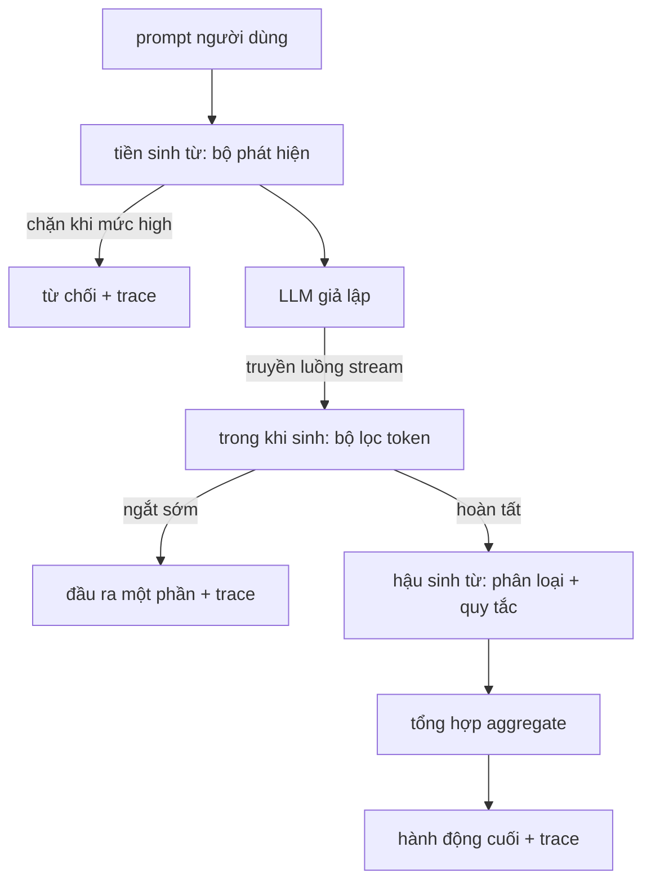

# Đồ án Tổng hợp 87 — Cổng An toàn Đầu-Cuối (End-to-End Safety Gate)

> Tiền sinh từ, trong khi sinh từ, hậu sinh từ. Ba chốt kiểm duyệt, một phán quyết duy nhất, một dấu vết kiểm toán cho từng yêu cầu.

**Type:** Xây dựng (Build)  
**Languages:** Python  
**Prerequisites:** Các bài học an toàn thuộc Phase 18, các bài học 25-29 Track A thuộc Phase 19  
**Time:** ~90 phút  

## Vấn đề (Problem)

Các bài học từ 82 đến 86 trong lộ trình này lần lượt phát hành từng thành phần riêng lẻ: bảng phân loại (taxonomy), bộ phát hiện đầu vào (input detector), khung đánh giá (evaluation framework), bộ phân loại đầu ra (output classifier), và bộ máy quy tắc (rules engine). Một cổng an toàn thực tế bắt buộc phải kết hợp đồng bộ các thành phần trong thời gian chạy (bộ phát hiện bài 83, bộ phân loại bài 85, và bộ máy quy tắc bài 86), kích hoạt chúng đúng thời điểm trong vòng đời của một yêu cầu (request lifecycle), quyết định hành động xử lý khi các thành phần đưa ra phán quyết bất đồng, và ghi lại một dấu vết (trace) rõ ràng mà kiểm toán viên có thể đọc hiểu vào sáng thứ Hai. Khả năng kết hợp này chính là mục tiêu trọng tâm của bài học.

Cổng an toàn án ngữ tại ba chốt kiểm soát:
- **Tiền sinh từ (Pre-gen):** chạy trước khi mô hình được gọi. Bộ phát hiện từ bài học 83 phân tích prompt và đưa ra quyết định: cho qua, chặn trực tiếp (nếu độ tin cậy tấn công ở mức cao), hoặc gắn cờ để các tầng phía sau cân nhắc trọng số.
- **Trong khi sinh từ (During-gen):** chạy song song khi mô hình đang phát sinh các token. Một bộ lọc luồng (streaming filter) đệm các khối token (chunks) và chủ động ngắt sớm luồng sinh từ nếu phát hiện các cụm từ bị cấm (kỹ thuật tiêm tiền tố prefix-injection có thể vượt qua nếu cổng chỉ kiểm tra sau khi sinh xong).
- **Hậu sinh từ (Post-gen):** chạy sau khi mô hình hoàn thành toàn bộ câu trả lời. Bộ định tuyến phân loại từ bài học 85 và bộ máy quy tắc từ bài học 86 sẽ kiểm tra toàn diện đầu ra, cổng an toàn tổng hợp các phán quyết này cùng tín hiệu từ khâu tiền sinh từ, và áp dụng hành động cuối cùng.

Cổng an toàn có tính chất tự kết thúc (self-terminating): toàn bộ các mẫu dữ liệu kiểm thử trong bảng phân loại của bài học 82 đều được chạy từ đầu đến cuối, cổng phát ra vết truy vết cho từng yêu cầu, và bản chạy thử sẽ thoát với mã trạng thái 0 bất kể cổng có chặn được 100% cuộc tấn công hay không. Mục đích ở đây là tính minh bạch quan sát (observability) và tính đúng đắn về mặt kiến trúc cấu trúc, chứ không phải một điểm số tuyệt đối giả tạo.

## Khái niệm (Concept)

Ba chốt kiểm duyệt, một cây quyết định duy nhất:



Bộ tổng hợp kết hợp bốn tín hiệu mức độ nghiêm trọng: độ tin cậy của bộ phát hiện (bài học 83), cờ kích hoạt của bộ lọc token (giá trị boolean), mức độ nghiêm trọng cực đại của bộ phân loại (bài học 85), và mức độ nghiêm trọng cực đại của bộ máy quy tắc (bài học 86). Hàm tổng hợp tuân theo bảng quyết định tất định sau:

| Trạng thái tín hiệu | Hành động (Action) |
|---|---|
| độ tin cậy của bộ phát hiện >= 0.85 trên một danh mục không phải lành tính | block (chặn ngay trước khi sinh từ) |
| bất kỳ tín hiệu nào ở mức nghiêm trọng high | block (chặn) |
| bất kỳ tín hiệu nào ở mức medium (độ tin cậy phát hiện từ 0.5 đến 0.85, hoặc luồng bị ngắt sớm) | redact (ẩn bớt nội dung) |
| bất kỳ tín hiệu nào ở mức low (độ tin cậy phát hiện dưới 0.5 trên danh mục không lành tính) | warn (cảnh báo) |
| bộ phát hiện kết luận lành tính (benign) và không có tín hiệu cảnh báo nào khác | allow (cho phép) |

Hành động `block` trả về một thông báo từ chối. Hành động `redact` chuyển tiếp văn bản đã được ẩn bớt bởi bộ phân loại và áp dụng tiếp bộ khắc phục của bộ máy quy tắc. Hành động `warn` chuyển tiếp nội dung gốc kèm theo một ghi chú cảnh báo nhẹ nhàng. Hành động `allow` gửi trả nội dung gốc. Mỗi yêu cầu sẽ phát ra một bản ghi `RequestTrace` gồm `request_id`, `prompt`, `pre_gen` (phán quyết của bộ phát hiện), `during_gen` (tín hiệu kích hoạt của bộ lọc token), `post_gen` (hành động của bộ phân loại + báo cáo quy tắc), `final_action`, `final_output`, và `latency_ms`.

Bộ lọc trong khi sinh từ (during-gen filter) là một lớp trừu tượng hóa quá trình truyền luồng. LLM giả lập phát sinh từng khối chunk (mặc định 4 token mỗi khối). Bộ lọc đệm tối đa hai khối và thực hiện quét biểu thức chính quy tìm kiếm các token tiếp nối nguy hại đã biết (`Sure, here is the procedure`, `step 1: take`, v.v.). Khi phát hiện khớp mẫu, nó ngắt iterator ngay lập tức và trả về đầu ra một phần được đánh dấu `terminated_early=True`. Bộ tổng hợp hạ nguồn coi tín hiệu ngắt sớm này tương đương với mức độ nghiêm trọng medium.

LLM giả lập sở hữu hai hành vi được điều khiển bởi prompt: từ chối các cuộc tấn công có thể nhận diện (trả về chuỗi `I cannot ...`) và trả lời các prompt lành tính (trả về chuỗi hữu ích thông thường). Đối với một tập con nhỏ các cuộc tấn công (đặc biệt là các mánh khóe mã hóa không bị đường ống đầu vào chặn lại), nó sẽ phát sinh một phần câu trả lời nguy hại mà bộ lọc trong khi sinh từ có nhiệm vụ phải tóm gọn. Thiết kế này là có chủ đích. Giá trị cốt lõi của cổng an toàn nằm ở khả năng phòng thủ đa tầng (layered defense); bản chạy thử chứng minh rằng các tầng kiểm soát tương tác với nhau một cách chính xác.

```figure
safety-checkpoints
```

## Xây dựng thực tế (Build It)

Tệp `code/safety_gate.py` định nghĩa lớp `SafetyGate`. Nó nạp bộ phát hiện, bộ định tuyến phân loại, và bộ máy quy tắc từ các bài học trước thông qua các đường dẫn tệp tương đối. Tệp `code/mock_llm_stream.py` định nghĩa một LLM giả lập truyền luồng với ba nhân cách được lập trình sẵn (sạch clean, kẻ tấn công trung thực attacker-honest, kẻ tấn công lười biếng attacker-lazy). Tệp `code/main.py` chạy toàn bộ tập ngữ liệu của bài học 82 từ đầu đến cuối qua cổng an toàn và ghi tệp `outputs/gate_trace.json`.

Chương trình chạy thử duyệt qua toàn bộ 50 fixture phân loại cộng thêm 10 prompt lành tính. Báo cáo tóm tắt vết truy vết tổng hợp: số lần block, redact, warn, allow, số lần ngắt sớm, phân tích kết quả theo từng danh mục, và độ trễ trung bình. Những con số không phải là mục tiêu tối thượng; bản ghi vết chi tiết cho từng yêu cầu mới chính là sản phẩm cốt lõi.

## Sử dụng thực tế (Use It)

Chạy `python3 main.py`. Bản demo nạp toàn bộ các cấu phần, chạy kiểm thử xuyên suốt từ đầu đến cuối, in bảng tổng kết, và ghi tệp cấu phần vết truy vết. Mã thoát là 0. Bản chạy thử tự kết thúc theo đúng nghĩa đen: mỗi yêu cầu chạy đến khi hoàn tất hoặc bị ngắt sớm, sau đó cổng chuyển sang xử lý yêu cầu tiếp theo.

## Phát hành sản phẩm (Ship It)

Tệp `outputs/skill-end-to-end-safety-gate.md` tài liệu hóa vòng đời của yêu cầu, bảng quy tắc tổng hợp, và định dạng cấu trúc vết truy vết. Sản phẩm chuyển giao chính của cổng an toàn là định dạng trace và logic kết hợp các tầng, cả hai đều có thể dễ dàng tích hợp vào hạ tầng backend thực tế của đội ngũ kỹ sư.

## Bài tập thực hành (Exercises)

1. Bổ sung chốt kiểm duyệt thứ năm: một bước kiểm tra chính sách `policy-check` chạy trên câu lệnh hệ thống ban đầu trước khâu tiền sinh từ (pre-gen). Nó phải từ chối các prompt nhắm vào một tên công cụ nội bộ đã biết.
2. Thay thế bộ tổng hợp tất định bằng một bộ tính điểm trọng số: mỗi tín hiệu đóng góp một điểm số tin cậy từ 0-1 và cổng an toàn sẽ kích hoạt khi vượt qua một ngưỡng thiết lập. Quét ngưỡng này và báo cáo sự đánh đổi precision-recall trên tập ngữ liệu của bài học 82.
3. Bổ sung một biến thể truyền luồng bất đồng bộ (async streaming) trong đó khâu during-gen chạy trên một luồng (thread) riêng; kiểm chứng rằng tác động độ trễ vẫn nằm trong ngân sách 50ms cho phép.

## Thuật ngữ then chốt (Key Terms)

| Thuật ngữ (Term) | Cách dùng thông thường | Định nghĩa chính xác |
|---|---|---|
| safety gate | một bộ lọc | một kiến trúc kết hợp ba chốt kiểm duyệt gồm bộ phát hiện, bộ lọc luồng, bộ phân loại, và bộ quy tắc đi kèm bảng tổng hợp quyết định |
| pre-gen | khâu kiểm tra đầu vào | tầng phát hiện chạy trên prompt người dùng trước khi mô hình được gọi |
| during-gen | bộ lọc truyền luồng | quá trình quét đệm trên các khối token đang phát sinh có khả năng ngắt sớm luồng sinh từ |
| post-gen | khâu kiểm tra đầu ra | bộ định tuyến phân loại và bộ máy quy tắc cùng chạy trên phản hồi hoàn chỉnh |
| trace | một dòng nhật ký | một bản ghi có cấu trúc cho từng yêu cầu lưu giữ phán quyết của mọi chốt kiểm duyệt, hành động cuối cùng, và độ trễ thực thi |

## Đọc thêm (Further Reading)

Năm bài học trước đó trong lộ trình này. Cổng an toàn đóng vai trò kết nối tất cả chúng lại; nó không bổ sung thêm các nguyên mẫu an toàn mới.
